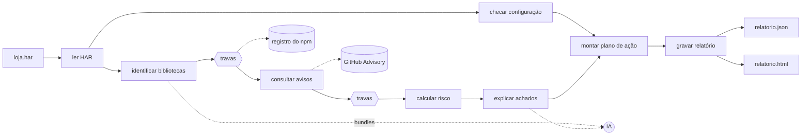

# Design: Rastro MVP

**Como.** Este arquivo diz como o Rastro atende o `requirements.md`: arquitetura, sequência, modelos, regras, erros e estratégia de testes. As regras de construção (SRP, nomes, Windows e Linux) estão no `.kiro/steering/` e não se repetem aqui.

Itens marcados com **[spike]** dependem do spike e podem mudar antes de virar código.

## 1. Visão geral

```
python -m rastro analisar loja.har [--ia kiro|claude|codex] [--sem-ia] [--saida <pasta>]
```

O código segue as etapas da apresentação, na mesma ordem e com os mesmos nomes:



Os losangos são as **travas** (R21): a IA sugere, a regra confirma. Nada da IA vira dado do relatório sem passar por elas.

- **Bordas** (entrada e saída): `cli.py`, `har/leitor.py`, `fontes/github_advisory.py`, `fontes/registro_npm.py`, `ia/`, `relatorio/`.
- **Núcleo puro** (regras, sem rede nem arquivo): `identificacao/assinaturas.py`, `travas/`, `risco/`, `configuracao/`, `acao/`.
- **Três interfaces**, só onde há troca real: `ConectorDeAvisos` (fonte), `RegistroDePacotes` (npm) e `ProvedorDeIA` (Kiro, Claude, Codex). Nos testes, as três viram dublês sem rede.

## 2. Estrutura

| Arquivo | Responsabilidade | Requisitos |
|---|---|---|
| `rastro/__main__.py` | permite `python -m rastro` | R01.1 |
| `rastro/cli.py` | lê argumentos, escolhe o provedor, chama o fluxo, grava, imprime o resumo | R13.8, R14 |
| `rastro/fluxo.py` | orquestra as etapas, sem regra própria | todos |
| `rastro/har/leitor.py` | lê e valida o HAR, decodifica base64 | R01 |
| `rastro/har/modelos.py` | `Requisicao`, `Cookie` | R01 |
| `rastro/har/site.py` | descobre o site analisado | R01.7 |
| `rastro/identificacao/assinaturas.py` | reconhece por nome de arquivo e comentário | R02 |
| `rastro/identificacao/bundles.py` | escolhe bundles e extrai trechos | R03.1 |
| `rastro/identificacao/ia.py` | pede à IA e valida a resposta | R03 |
| `rastro/identificacao/modelos.py` | `Biblioteca`, `Evidencia` | R02.5 |
| `rastro/fontes/conector.py` | interface `ConectorDeAvisos` | R04 |
| `rastro/fontes/github_advisory.py` | consulta e converte a resposta | R04 |
| `rastro/fontes/osv.py`, `nvd.py`, `juncao.py` | extensão opcional: OSV, CVSS do NVD e junção dos avisos | R04A |
| `rastro/fontes/registro_npm.py` | confere se `pacote@versão` existe e lê o pacote publicado em memória | R21.4, R21.5, R21.9 |
| `rastro/travas/formato.py` | aceita só o JSON fechado da IA | R21.1 |
| `rastro/travas/ancoragem.py` | trecho real e versão dentro do trecho | R21.2, R21.3 |
| `rastro/travas/codigo_publicado.py` | procura o trecho nos arquivos do pacote | R21.5 |
| `rastro/travas/faixa_de_versao.py` | confere se a versão está na faixa afetada | R21.7 |
| `rastro/travas/explicacao.py` | barra explicação com fato que não estava na entrada | R21.6 |
| `rastro/travas/conferencia.py` | aplica as travas e decide "confirmada" ou "a confirmar" | R03.3, R03.4, R21.10 |
| `rastro/risco/nota.py` | fórmula da nota | R05.1, R05.3, R05.4 |
| `rastro/risco/prioridade.py` | faixas e ordenação | R05.2, R05.5, R05.6 |
| `rastro/configuracao/checagens.py` | uma função por checagem | R06 |
| `rastro/explicacao/ia.py` | pede explicação e teste de verificação | R07 |
| `rastro/acao/plano.py` | monta e ordena as ações | R08 |
| `rastro/acao/task.py` | gera o texto da task | R09 |
| `rastro/ia/cliente.py` | ponto único de chamada, mede tempo e tokens, registra a chamada | R11, R14 |
| `rastro/ia/sanitizacao.py` | tira dados sensíveis do que vai para a IA | R16.3 |
| `rastro/ia/provedores/{kiro,claude,codex}.py` | chama cada CLI sem interação | R14 |
| `rastro/ia/prompts/*.md` | prompts versionados, com exemplo de entrada e saída | R03, R07 |
| `rastro/relatorio/json.py` | monta o dicionário do relatório | R13.7 |
| `rastro/relatorio/html.py` | embute o JSON no HTML do build | R13.5 |
| `rastro/relatorio/gravacao.py` | monta a pasta da análise (aplicação, data e hora) e grava os dois arquivos sem sobrescrever | R13.1–R13.4, R17 |
| `frontend/` | React: só exibe o JSON | R09.2, R10.2, R12, R13.5, R13.6 |

**Diferenças em relação ao `structure.md`:** entram `acao/` (plano e task não cabem em `risco/`), `travas/`, `fontes/registro_npm.py`, `har/site.py`, `identificacao/bundles.py`, `ia/sanitizacao.py` e `relatorio/gravacao.py`. Se aprovadas, o steering é atualizado no mesmo commit.

## 3. Sequência do fluxo

`fluxo.py` lê como a apresentação:

```python
def analisar(caminho_har: Path, fonte: ConectorDeAvisos, registro: RegistroDePacotes,
             ia: ClienteDeIA | None) -> Analise:
    requisicoes = ler_har(caminho_har)
    site = descobrir_site_analisado(requisicoes)
    bibliotecas = identificar_bibliotecas(requisicoes, ia)
    bibliotecas = conferir_bibliotecas(bibliotecas, registro)
    achados = consultar_avisos(bibliotecas.confirmadas, fonte)
    achados = descartar_fora_da_faixa(achados)
    achados = calcular_risco(achados)
    explicacoes = explicar_achados(achados, ia)
    checagens = checar_configuracao(requisicoes, site)
    plano = montar_plano_de_acao(achados, explicacoes, checagens)
    return Analise(site, bibliotecas, achados, checagens, plano, chamadas_de_ia(ia), travas_acionadas())
```

Com `--sem-ia`, `ia` é `None`: `identificar_bibliotecas` usa só assinatura e `explicar_achados` devolve as explicações vazias.

### Análise sem IA fica explícita (R14.5–R14.7)

A análise sem IA é útil (máquina sem CLI de IA, primeira execução, testes), mas é **incompleta**, e quem usa precisa saber disso sem ler a documentação.

| Onde | O que aparece |
|---|---|
| `--help` | `--sem-ia  analisa sem IA: não procura bibliotecas em bundles e não explica os achados` |
| Terminal, no início e no resumo final | `Atenção: análise sem IA. Bibliotecas em bundles não foram procuradas; podem existir falhas que não aparecem aqui.` |
| JSON | `analise.ia: null` e `analise.limitacoes: ["bundles_nao_procurados", "achados_sem_explicacao"]` |
| Relatório, no topo | faixa fixa `AvisoSemIA`: o que não foi feito, o que continua igual (nota, prioridade, checagens, plano) e o comando para rodar com IA |
| Indicador "encontradas só pela IA" | "não procurado", e não zero |
| Painel "Onde a IA entrou" | "IA desligada nesta análise", sem a comparação com e sem IA |

O texto das limitações sai do Python, no campo `limitacoes`. O React só exibe.

## 4. Modelos

`dataclass(frozen=True)` em todos os modelos.

| Modelo | Campos |
|---|---|
| `Requisicao` | `indice`, `url`, `metodo`, `status`, `tipo_conteudo`, `cabecalhos_resposta: dict[str, str]`, `cookies_resposta: list[Cookie]`, `conteudo: str \| None` |
| `Cookie` | `nome`, `http_only`, `secure`, `same_site: str \| None` (sem o valor) |
| `Evidencia` | `indice_requisicao`, `url`, `trecho: str \| None` |
| `Biblioteca` | `pacote`, `versao`, `metodo: "assinatura" \| "ia"`, `situacao: "confirmada" \| "a_confirmar"`, `conferida_no_npm: bool \| None`, `travas_que_falharam: list[str]`, `evidencias: list[Evidencia]` |
| `TravaAcionada` | `trava`, `alvo` (biblioteca, aviso ou explicação), `motivo` |
| `Aviso` | `fontes: list[str]`, `apelidos: list[str]`, `ghsa`, `cve`, `resumo`, `cvss: float \| None`, `percentil_epss: float \| None`, `versoes_afetadas`, `versao_corrigida: str \| None`, `link` |
| `Nota` | `valor: float \| None`, `prioridade: "alta" \| "media" \| "baixa" \| "a avaliar"`, `conta: str`, `sem_epss: bool` |
| `Achado` | `biblioteca`, `aviso`, `nota` |
| `Checagem` | `id`, `titulo`, `situacao: "falhou" \| "passou" \| "nao_verificada"`, `severidade`, `quem_resolve`, `evidencia`, `detalhe` |
| `Explicacao` | `o_que_e`, `impacto`, `como_corrigir`, `teste_verificacao`, `gerada_por_ia: bool` |
| `Acao` | `id`, `prioridade`, `nota`, `o_que_fazer`, `porque`, `impacto`, `quem_resolve`, `texto_task`, `refs` (achados ou checagem) |
| `ChamadaIA` | `etapa`, `provedor`, `entrada`, `resposta`, `duracao_s`, `tokens: int \| None`, `sucesso: bool` |

A `situacao` sai só das travas; a IA não tem campo de confiança que decida algo. O campo `Nota.conta` guarda a conta escrita, ex.: `10 × (0,5 × 6,1/10 + 0,5 × 0,97) = 7,9`, que o painel de origem mostra (R10.1).

## 5. Ler o HAR (R01)

- `json.loads` do arquivo aberto com `encoding="utf-8"`. Valida `log.entries` como lista.
- O conteúdo dos scripts vem em `response.content.text`, em texto puro (spike T03, `docs/spike/har-e-bundles.md`). Entrada sem `text` (ex.: WebSocket) fica sem conteúdo. Chaves com `_` (`_resourceType`, `_initiator`…) são ignoradas.
- `response.content.encoding == "base64"` → `base64.b64decode` e depois decodifica em UTF-8 com `errors="replace"`. No spike, só imagens e fontes vieram assim.
- Cookies: usa `response.cookies` do HAR. Se vier vazio, interpreta os `Set-Cookie` dos cabeçalhos, guardando só o nome e os atributos. Cookie criado por JavaScript não tem `Set-Cookie` e fica de fora das checagens.
- Cabeçalhos: nome em minúsculas; nome repetido junta os valores com `, `. O `Set-Cookie` não entra em `cabecalhos_resposta`: o cookie fica só em `cookies_resposta`, sem o valor.
- `tipo_conteudo`: `content.mimeType` (ou o `Content-Type`) sem parâmetros e em minúsculas, ex.: `text/html`.
- Erros: `HarNaoEncontrado` (caminho que não é arquivo) e `HarInvalido` (não é UTF-8, não é JSON, sem `log.entries` em lista ou entrada sem `request.url`, `request.method` e `response.status`), filhas de `ErroAoLerHar`. O `cli.py` transforma em código 1 (T23). Base64 corrompido deixa a entrada sem conteúdo.
- **Site analisado:** host da primeira resposta com `tipo_conteudo` `text/html` que não seja redirecionamento (3xx), em minúsculas e com a porta (`localhost:3000`). Sem resposta HTML, `None` (R13.3 usa o nome do HAR).

## 6. Identificar bibliotecas

### Por assinatura (R02)

Uma tabela de dados em `assinaturas.py`, uma linha por biblioteca:

| Pacote npm | Nome no arquivo | Comentário de versão (regex) |
|---|---|---|
| `jquery` | `jquery` | `jQuery (?:JavaScript Library )?v(\d+\.\d+\.\d+)` |
| `jquery-ui` | `jquery-ui` | `jQuery UI - v(\d+\.\d+\.\d+)` |
| `bootstrap` | `bootstrap` | `Bootstrap v(\d+\.\d+\.\d+)` |
| `lodash` | `lodash` | `lodash (?:lodash\.com/license \| )?v?(\d+\.\d+\.\d+)` |
| `moment` | `moment` | `//! version : (\d+\.\d+\.\d+)` |
| `angular` | `angular` | `AngularJS v(\d+\.\d+\.\d+)` |
| `underscore` | `underscore` | `Underscore\.js (\d+\.\d+\.\d+)` |
| `requirejs` | `requirejs` | `@license RequireJS (\d+\.\d+\.\d+)` |
| `ckeditor` | `ckeditor` | — |

**Padrão do nome do arquivo**, o mesmo para todas as linhas: `(?<![\w-])` + nome no arquivo + separador `[-.@/]?` ou `(?:\.min)?\.js\?v(?:er)?=` + `(\d+\.\d+\.\d+)`, sem diferenciar maiúsculas, procurado no caminho e nos parâmetros da URL (o host fica de fora) e só em scripts (tipo de conteúdo JavaScript ou caminho terminado em `.js`). Reconhece `jquery-3.4.1.min.js`, `/lodash@4.17.15/`, `/jquery/3.4.1/jquery.min.js`, `ckeditor.js?v=4.10.1` e `jquery.min.js?ver=3.4.1`. O início impede que `react-bootstrap@1.0.0` vire Bootstrap, e `jquery-ui-1.10.4.js` não vira jQuery porque, depois de `jquery`, o separador exige a versão.

As linhas de Underscore, RequireJS e CKEditor vêm da avaliação (T04, `avaliacao/README.md`): as três têm aviso nos alvos. As de Lodash, Moment.js e AngularJS não apareceram nos alvos e ficam como estão.

- **O comentário é procurado no conteúdo inteiro**, e cada comentário encontrado registra uma biblioteca. Um bundle agregado (Drupal) junta várias bibliotecas e cada uma mantém o seu `/*!`: jQuery no início, Underscore no byte 86 mil e jQuery UI no 136 mil. No WebGoat, o `//     Underscore.js` vem depois do *wrapper* UMD.
- **O padrão do comentário começa no início de um comentário** (`/*`, `/*!`, `//`, `//!` ou ` * ` no começo da linha). Assim, `Requires jQuery v1.7.2`, dentro do comentário do jQuery Form, não vira jQuery 1.7.2.
- **O nome do arquivo inclui o `?v=` e o `?ver=` da URL**, onde o Drupal e o WordPress põem a versão (`ckeditor.js?v=4.10.1`).
- **Nome e comentário divergentes: vale o comentário**, que é o código que rodou. O nome entra na evidência. No WebGoat, `jquery-ui-1.10.4.js` traz a jQuery UI 1.10.3.

Bibliotecas iguais são agrupadas por `(pacote, versao)`.

### Em bundles, com IA (R03)

1. **Escolher bundles** (`bundles.py`): scripts sem assinatura com mais de 30 KB. No Juice Shop, os bundles com versão tinham mais de 140 KB.
2. **Extrair trechos:** comentários de licença `/*!` com conteúdo (`/*!*/` vazio é ignorado) e janelas de 300 caracteres em volta de versões entre aspas (`["'`]v?\d+\.\d+\.\d+(-[\w.]+)?["'`]`). No máximo 5 trechos por bundle. O número solto e a palavra `version` ficaram de fora: no spike T03, só trouxeram coordenadas de SVG e propriedades sem relação.
3. **Sanitizar** (`ia/sanitizacao.py`) e enviar com o prompt `identificar_bibliotecas.md`.
4. **Resposta fechada:** JSON `{"bibliotecas": [{"pacote", "versao", "trecho"}]}`, nada além disso. Nome de pacote npm inválido ou versão fora do formato `x.y.z` derrubam a resposta inteira.
5. **Travas:** cada biblioteca passa pelas travas da seção 8 antes de ser usada.

## 7. Consultar o GitHub Advisory (R04)

```
GET https://api.github.com/advisories?ecosystem=npm&affects=<pacote>@<versao>&per_page=100
Accept: application/vnd.github+json
Authorization: Bearer $GITHUB_TOKEN      (só se a variável existir)
```

Formato conferido no spike T01 (`docs/spike/github-advisory.md`).

| Campo do aviso | Vem de |
|---|---|
| `ghsa`, `cve`, `resumo`, `link` | `ghsa_id`, `cve_id` (pode ser `null`), `summary`, `html_url` |
| `cvss` | `cvss_severities.cvss_v3.score`; senão, `cvss_v4.score`; senão, nenhum. Cada um só vale com `vector_string` preenchido: CVSS ausente vem como `score: 0.0` e vetor `null`. O campo legado `cvss` não é usado. |
| `percentil_epss` | `epss.percentile` (0 a 1). Sem EPSS, a chave `epss` não vem na resposta. |
| `versoes_afetadas`, `versao_corrigida` | itens de `vulnerabilities` com `package.ecosystem == "npm"` e `package.name == pacote`; vale o item cuja `vulnerable_version_range` contém a versão (trava 6). `first_patched_version` pode ser `null`. |

- Aviso com `withdrawn_at` preenchido (retirado) é descartado (R04.6).
- `urllib.request` com tempo limite de 15 s. Sem token, o limite é de 60 requisições por hora por IP, uma por biblioteca: uma análise cabe nele; várias na mesma hora dividem as 60. Com `GITHUB_TOKEN`, 5.000 por hora.
- Sem paginação: com `per_page=100`, nenhuma resposta do spike passou de 26 avisos.
- Lista vazia não prova que o pacote existe; isso é da trava 4.
- Erro de rede, HTTP 403/429 ou 5xx → biblioteca "não consultada" com o motivo (R04.3). A análise continua.
- `ConectorDeAvisos.consultar(pacote, versao) -> list[Aviso]`. Nos testes, `ConectorFalso` devolve avisos fixos.

### OSV e NVD, extensão opcional (R04A)

Entram só se as fases 1 e 2 fecharem no prazo (tasks T49 a T51, prazo limite 02/12).

| Fonte | Consulta | O que acrescenta |
|---|---|---|
| OSV | `POST https://api.osv.dev/v1/query` com `{"package": {"name": "<pacote>", "ecosystem": "npm"}, "version": "<versão>"}` | avisos que o GitHub não tem; `aliases` liga ao GHSA e ao CVE |
| NVD | `GET https://services.nvd.nist.gov/rest/json/cves/2.0?cveId=<CVE>` | CVSS quando o GitHub não traz; só para avisos com CVE |

- **Arquivos:** `fontes/osv.py` implementa `ConectorDeAvisos`. `fontes/nvd.py` não busca avisos, só completa o CVSS de um CVE, então não usa a interface. `fontes/juncao.py` (puro) junta avisos iguais por ID e apelidos e aplica a ordem fixa de fontes de R04A.4.
- **Faixa de versão do OSV:** vem como eventos `introduced` e `fixed` do tipo `SEMVER`. `faixa_de_versao.py` ganha a leitura desse formato; a trava 6 vale igual.
- **Limites:** o OSV não exige chave. O NVD sem chave aceita poucas requisições por minuto, então só é chamado para CVE sem CVSS, uma vez por CVE. **[spike]**
- Falha de OSV ou NVD não para a análise: o relatório lista as fontes consultadas e as que não responderam.

## 8. Travas contra invenção (R21)

**A IA sugere, a regra confirma.** Cada trava é uma função pura, com nome que diz o que confere, e o que ela barra fica registrado no painel da IA (R21.10). É isso que dá para mostrar na banca: onde a IA pode errar e qual regra pega o erro.

| # | Trava | Pergunta que responde | Onde | Se falhar |
|---|---|---|---|---|
| 1 | Formato fechado | A resposta é exatamente o JSON pedido? | `travas/formato.py` | descarta a resposta inteira |
| 2 | Trecho real | O trecho que a IA citou foi mesmo enviado a ela? | `travas/ancoragem.py` | "a confirmar" |
| 3 | Ancoragem | A versão aparece escrita no trecho? | `travas/ancoragem.py` | "a confirmar" |
| 4 | Pacote existe | `pacote@versão` foi publicado no npm? | `fontes/registro_npm.py` | "a confirmar" |
| 5 | Código confere | O trecho aparece no código publicado daquela versão? | `travas/codigo_publicado.py` | "a confirmar" |
| 6 | Faixa conferida | A versão está na faixa afetada do aviso? | `travas/faixa_de_versao.py` | descarta o aviso |
| 7 | Explicação sem fato novo | A explicação só cita CVE, GHSA, versões e números da entrada? | `travas/explicacao.py` | usa o resumo do aviso |

| Origem da biblioteca | Travas aplicadas |
|---|---|
| Assinatura | 4 e 6 (a assinatura já é regra determinística) |
| IA | 1 a 6, todas |

**Biblioteca "a confirmar"** aparece numa lista própria, com a trava que falhou e como confirmar à mão (ex.: "procure `3.4.1` no arquivo `main.js` do HAR"). Não entra na nota, no resumo nem no plano de ação, mas também não some (R03.4).

### Registro do npm, só leitura

```
GET https://registry.npmjs.org/<pacote>/<versao>      → 200 publicado · 404 não publicado
GET <dist.tarball>                                     → pacote .tgz, só para a trava 5
```

- Pacotes com escopo (`@angular/core`) levam a barra codificada como `%2F`.
- O `.tgz` é lido **em memória**: `tarfile.open(fileobj=io.BytesIO(dados), mode="r:gz")` e `extractfile` só nos `.js`, `.mjs` e `.cjs` (o Angular só publica `.mjs`). Nunca `extract` nem `extractall`, nada gravado em disco, nada executado.
- A integridade do pacote é conferida com `hashlib.sha512` contra `dist.integrity` antes da leitura.
- Limite de 10 MB por pacote e tempo limite de 15 s. Acima disso, a trava 5 não roda e a biblioteca fica "a confirmar".
- Cada `pacote@versão` é consultado uma vez por análise.
- Sem resposta do registro (R21.9): biblioteca por assinatura segue com o selo "não conferida no npm"; da IA vai para "a confirmar".

### Como a trava 5 compara

Conferido no spike T03 (`docs/spike/har-e-bundles.md`). O minificador renomeia variáveis e troca as aspas (`"FA \"5.15.4\""` vira `` `FA "5.15.4"` ``), mas mantém o valor das strings. Por isso a trava compara **o valor das strings**:

1. Tira do trecho todas as strings (entre `"`, `'` ou `` ` ``) e resolve os escapes.
2. Exige que uma delas contenha a versão e que alguma tenha 3 ou mais caracteres além da versão. Só a versão não prova o pacote.
3. Exige que cada string do trecho apareça, com o mesmo valor, como string em algum arquivo do pacote.

No spike, esse critério passou o acerto da IA (`@angular/core@22.2.2`) e barrou versão vizinha, pacote irmão na mesma versão, trecho inventado e "só a versão". Comparar o trecho com espaços normalizados nunca passou, porque o minificador muda o código. Já aceitar só a versão ou a licença deixou passar invenção.

**Limite:** um pacote que traz por dentro o código de outro na mesma versão (ex.: `@fortawesome/fontawesome-free` contém o `fontawesome-svg-core`) passa pela trava, porque o código é mesmo dele. Por isso a biblioteca da IA aparece sempre com o método "ia" e o trecho como evidência (R03.2).

### Faixa de versão

`vulnerable_version_range` do GitHub vem como `>= 1.2.0, < 3.5.0` ou `<= 2.1.0`. `faixa_de_versao.py` separa por vírgula, compara `x.y.z` como tupla de inteiros e trata pré-lançamento (`-beta`) como menor que a versão final. É só isso, sem biblioteca de semver.

### Explicação sem fato novo

`explicacao.py` extrai do texto da IA todo padrão `CVE-\d+-\d+`, `GHSA-…`, `\d+\.\d+(\.\d+)?` e número com `%`, e exige que cada um esteja na entrada enviada. Qualquer sobra descarta a explicação.

## 9. Calcular o risco (R05)

```python
def calcular_nota_de_risco(cvss: float, percentil_epss: float) -> float:
    return round(10 * (0.5 * cvss / 10 + 0.5 * percentil_epss), 1)
```

| Situação | Nota | Prioridade |
|---|---|---|
| CVSS e EPSS | fórmula | pela faixa |
| Só CVSS | igual ao CVSS, selo "sem EPSS" | pela faixa |
| Sem CVSS | sem nota | "a avaliar" |

No spike T01, 8,8% dos avisos vieram sem EPSS (todos sem CVE, porque o EPSS só existe para CVE) e 5,9% sem CVSS.

Faixas: alta ≥ 7,5; média ≥ 6,5; baixa no resto. Nota da biblioteca = maior nota dos seus achados. Ordem: nota decrescente e, no empate, CVSS decrescente. O porquê dos pesos 0,5 / 0,5 vai para `docs/decisoes/`.

## 10. Checar a configuração (R06)

Só as respostas do site analisado. Cada checagem é uma função pura `(requisicoes, site) -> Checagem`.

| ID | Checagem | Falha quando | Severidade | Quem resolve |
|---|---|---|---|---|
| C01 | CSP ausente | HTML sem `Content-Security-Policy` | média | infra |
| C02 | HSTS ausente | site em HTTPS sem `Strict-Transport-Security` | média | infra |
| C03 | nosniff ausente | HTML sem `X-Content-Type-Options: nosniff` | baixa | infra |
| C04 | proteção contra frame ausente | sem `X-Frame-Options` e sem `frame-ancestors` | baixa | infra |
| C05 | servidor expõe versão | `Server` ou `X-Powered-By` com dígitos de versão | baixa | infra |
| C06 | cookie sem HttpOnly | cookie do site sem `HttpOnly` | média | dev back-end |
| C07 | cookie sem Secure | site em HTTPS, cookie sem `Secure` | média | dev back-end |
| C08 | cookie sem SameSite | cookie sem `SameSite` | baixa | dev back-end |

- Checagem de cabeçalho: falha se **alguma** resposta HTML do site falha; a evidência é a primeira delas.
- C06 a C08 viram "não verificada" quando não há nenhum cookie do site (R06.7).
- A severidade da checagem vira a prioridade da ação. Checagens não têm nota.

## 11. IA

### Cliente único (R11, R14)

```python
class ProvedorDeIA(Protocol):
    nome: str
    def executar(self, prompt: str) -> RespostaDoProvedor: ...   # texto, tokens | None

class ClienteDeIA:
    def perguntar(self, etapa: str, prompt: str) -> str | None: ...
```

`perguntar` sanitiza, mede o tempo com `time.perf_counter`, chama o provedor, registra a `ChamadaIA` e devolve `None` em caso de falha. Só ele conversa com os provedores.

### Provedores

Conferido no Linux no spike T02 (`docs/spike/clis-de-ia.md`). O Windows é conferido na T42.

| Provedor | Comando (prompt pela entrada padrão) | Texto da resposta | Tokens | Linux | Windows |
|---|---|---|---|---|---|
| Claude | `claude -p --output-format json --tools ""` | campo `result` do JSON | `usage`: entrada (`input_tokens` + `cache_creation_input_tokens` + `cache_read_input_tokens`) e `output_tokens` | funciona | a conferir (T42) |
| Codex | `codex exec --skip-git-repo-check --sandbox read-only --ephemeral --json -` | `text` do evento `item.completed` do tipo `agent_message` | `usage` do evento `turn.completed` | funciona | a conferir (T42) |
| Kiro | `kiro-cli chat --no-interactive --trust-tools=` | a saída padrão inteira | não informa: "não informado" (R11.3) | funciona | a conferir (T42) |

Regras comuns: executável por `shutil.which`, `subprocess.run(..., input=prompt, capture_output=True, encoding="utf-8", timeout=120)`. Falha: código de saída diferente de zero, tempo limite estourado, `is_error: true` no Claude ou nenhum `agent_message` no Codex.

- As opções desligam ferramentas e gravação: a IA só responde, sem ler, rodar ou gravar nada na máquina.
- Sem `--bare` no Claude: ele exige `ANTHROPIC_API_KEY`, e o Rastro não usa chave.
- O Rastro não escolhe o modelo: vale o padrão de cada CLI. Cada CLI soma o próprio prompt de sistema (de 12 mil a 27 mil tokens de entrada por chamada no spike), e o custo entra na medição da T46.

### Prompts

Em `rastro/ia/prompts/`, um arquivo por tarefa, iguais para os três provedores:

- `identificar_bibliotecas.md`: recebe trechos e devolve o JSON da seção 6.
- `explicar_achado.md`: recebe pacote, versão, avisos e URL; devolve `{"o_que_e", "impacto", "como_corrigir", "teste_verificacao"}`.

Cada prompt pede **só JSON**, em português simples, e traz um exemplo de entrada e saída. A resposta é lida pelo primeiro objeto JSON do texto e validada campo a campo.

### Sanitização (R16.3)

Antes de qualquer envio: tira query strings das URLs e troca por `[removido]` o que casar com JWT (`eyJ…\.…\.…`), `Bearer …` e sequências hexadecimais ou base64 com mais de 32 caracteres. Cabeçalhos, cookies e corpos de requisição nunca entram no prompt.

## 12. Plano de ação e task (R08, R09)

- Uma ação por biblioteca com achados: "Atualizar `jquery` de 3.4.1 para 3.5.0". A versão-alvo é a maior entre as `versao_corrigida` dos avisos dela, que é a menor versão que corrige todos.
- Uma ação por checagem com falha.
- Ordem: prioridade (alta, média, baixa, a avaliar) e, dentro dela, nota decrescente.
- O texto da task é montado por modelo fixo em `acao/task.py`, sem IA. A IA só entra nos campos de explicação e teste de verificação.

```markdown
## [Rastro] Atualizar jquery de 3.4.1 para 3.5.0

**Por quê:** 2 falhas conhecidas (GHSA-…, GHSA-…). Nota 7,9 (alta).
**Impacto:** <explicação da IA ou resumo do aviso>
**O que fazer:** atualizar o pacote e publicar.
**Critério de aceite:** novo HAR analisado pelo Rastro sem este achado.

### Evidências
- [ ] Versão antes e depois
- [ ] Teste de verificação: <teste da IA>
- [ ] Novo HAR sem o achado
```

## 13. Relatório (R13)

### JSON

```json
{
  "versao_formato": 1,
  "analise": { "har": "loja.har", "site": "loja.exemplo.com", "data": "2026-11-20T14:03:00", "ia": "kiro", "limitacoes": [], "duracao_s": 41.2 },
  "resumo": { "nota_maxima": 7.9, "acoes_por_prioridade": { "alta": 1, "media": 3, "baixa": 4 },
              "bibliotecas": 9, "bibliotecas_vulneraveis": 4, "encontradas_so_pela_ia": 2 },
  "bibliotecas": [], "a_confirmar": [], "achados": [], "checagens": [], "plano_de_acao": [],
  "ia": { "chamadas": [], "travas_acionadas": [], "com_e_sem_ia": { "bibliotecas": [7, 9], "achados": [5, 8] }, "tokens_total": null }
}
```

Toda contagem que a tela mostra já vem no `resumo`. O React não calcula nada (R13.7).

### HTML

1. `npm run build` em `frontend/` gera `frontend/dist/index.html` com JS, CSS e fontes embutidos (`vite-plugin-singlefile`).
2. Esse arquivo vai para o pacote Python como `rastro/relatorio/modelo.html` e é **versionado**, para quem usa precisar só de Python (R20.2). Mudou o frontend, o build é refeito e o `modelo.html` entra no mesmo commit.
3. `html.py` troca o conteúdo de `<script id="dados" type="application/json"></script>` pelo JSON, escapando `</` como `<\/`.
4. **Favicon e logo** vêm de `frontend/src/assets/` (cópia do logo da identidade visual).
5. Sem requisição externa (R13.5): as fontes IBM Plex vão embutidas em woff2 ou caem para as fontes do sistema. **[decidir]** O tamanho decide.

### Gravação

```
~/Rastro/relatorios/                        (Windows: C:\Users\<nome>\Rastro\relatorios\)
  loja.exemplo.com/
    2026-11-20_14-03-00/
      relatorio.html
      relatorio.json
    2026-11-27_09-41-12/
      ...
  intranet.senai.br_8443/
    ...
```

- **Pasta padrão:** `Path.home() / "Rastro" / "relatorios"`. Fica visível e é igual nos dois sistemas, sem depender do nome localizado de "Documentos". `--saida` troca só a raiz.
- **Nome da aplicação:** o host do site analisado; sem site, o nome do HAR. `nome_de_pasta_seguro()` troca por `_` o que o Windows não aceita (`<>:"/\|?*`).
- **Data e hora:** hora local, `AAAA-MM-DD_HH-MM-SS`, sem `:` (o Windows não aceita). Ordena certo por nome.
- **Gravação:** cria as pastas do site e da raiz se faltarem (`mkdir(parents=True, exist_ok=True)`), mas a pasta da análise com `exist_ok=False`. Os dois arquivos são abertos com `open(caminho, "x", encoding="utf-8")`. Se a pasta da análise já existir, nada é gravado (R13.4).
- A regra de montar o caminho é pura (`caminho_do_relatorio(raiz, site, momento)`) e testada; só a gravação toca o disco.

### Frontend

Componentes do MVP (padrões em `.kiro/steering/frontend-react.md`):

| Zona | Componentes |
|---|---|
| Estrutura | `BarraSuperior`, `CabecalhoAnalise` |
| Indicadores | `Indicador` (risco do site, bibliotecas vulneráveis, encontradas só pela IA, primeira ação) |
| Rastreado | `GraficoDispersao` (CVSS × EPSS), `PainelIA` |
| Agir | `PlanoDeAcao` → `Acao`, `ModalTask` |
| Detalhes | `ListaBibliotecas` → `LinhaBiblioteca` → `ExplicacaoIA`, `ListaFalhas` → `ItemFalha`; `ListaChecagens` → `ItemChecagem` |
| Sob demanda | `PainelOrigemDoDado` |
| Avisos | `AvisoSemIA` (só quando `limitacoes` não está vazio) |
| Apoio | `Termo` + `Dica`, `Selo`, `Icone` |
| Modo foco | `BarraDeFoco`, e o botão "Focar" no cabeçalho de cada zona |

**Modo foco (R15).** O layout de hoje continua sendo o padrão. O foco é só um estado do `App.tsx`: `zonaEmFoco: "rastreado" | "agir" | "detalhes" | null`, com `useState`.

- Com `null`, nada muda: é o layout atual.
- Com uma zona escolhida, o `App` renderiza só aquela zona, em largura cheia (mantendo o limite de largura de linha do texto para a leitura), mais a `BarraDeFoco` no topo: nome da zona, troca entre zonas e "Sair do foco".
- Esc sai do foco. Ao sair, a página rola até a zona que estava em foco.
- Painéis e modais (`PainelOrigemDoDado`, `ModalTask`, `Dica`) ficam fora das zonas, então funcionam igual. O `AvisoSemIA` aparece em versão compacta, numa linha.
- Nenhum componente de zona sabe que está em foco. Só o `App` decide o que mostrar, o que mantém a regra de que eventos sobem por props.

Ficam fora do MVP: `Tour`, `GuiaComoUsar`, `ModalPedidoFalsoPositivo`, `PainelBaseFalsosPositivos` e o vínculo de task.

## 14. Erros

| Situação | Comportamento | Saída |
|---|---|---|
| HAR não existe | mensagem com o caminho | código 1 |
| HAR inválido | "o arquivo não é um HAR válido" | código 1 |
| `--ia` inválida | lista as opções | código 1 |
| CLI da IA ausente | diz qual faltou e sugere `--sem-ia`, com o que se perde | código 1, antes de ler o HAR |
| Relatório já existe | diz qual arquivo; não grava nenhum | código 1 |
| Sem rede ou limite no GitHub | biblioteca "não consultada", com motivo | segue; código 0 |
| Registro do npm não responde | assinatura: selo "não conferida no npm"; IA: "a confirmar" | segue; código 0 |
| IA falha ou responde fora do formato | registra no painel da IA; segue sem aquele dado | segue; código 0 |
| HAR sem JavaScript | aviso no relatório; só checagens | segue; código 0 |

Código 0 significa que a análise terminou, mesmo com achados. As mensagens vão para a saída de erro, em texto simples.

## 15. Estratégia de testes

- **Rastreio:** cada critério `Rxx.y` tem pelo menos um teste com o ID no nome: `test_r05_3_sem_epss_usa_cvss`. Os critérios *(verificação manual)* entram num roteiro no README.
- **Pirâmide:**
  - Unitários puros: `assinaturas`, `bundles`, todas as `travas`, `nota`, `prioridade`, `checagens`, `plano`, `task`, `sanitizacao`, `relatorio/json`. São a maior parte e não usam dublê.
  - Bordas com dublê: `leitor` (HARs pequenos em `tests/dados/`), `github_advisory` e `registro_npm` (troca `urlopen` por uma função que devolve resposta gravada; o `.tgz` de teste é montado no próprio teste), `cliente` (com `ProvedorFalso`), provedores (troca `subprocess.run`), `gravacao` (em `tmp_path`).
  - Ponta a ponta: `fluxo.analisar` com um HAR de exemplo, `ConectorFalso` e `ProvedorFalso`, comparando o JSON com um esperado.
  - Travas com casos de invenção: para cada trava, ao menos um teste em que a IA (dublê) inventa algo — versão que não está no trecho, trecho que não foi enviado, pacote que não existe, CVE que não estava na entrada — e a trava barra.
- **Dados de teste:** `tests/dados/` com HARs mínimos (jQuery por nome, por comentário, bundle, sem JS, sanitized, base64) e respostas gravadas do GitHub Advisory.
- **Sem rede:** nenhum teste chama a API ou uma CLI de IA de verdade (R19.2).
- **Cobertura:** `pytest --cov=rastro --cov-report=term`. As regras de negócio (`har`, `identificacao`, `travas`, `fontes`, `risco`, `configuracao`, `acao`, `ia/sanitizacao`) ficam acima de 80%. Os provedores e o `cli.py` contam, mas não são a meta.
- **Sem CI, verificação local:** `ruff check`, `mypy rastro` e `pytest --cov`, rodados no Windows e no Linux antes de cada entrega. Os comandos ficam na seção "Verificação" do README, e o resultado de cada sistema vai para `docs/cobertura/linux.md` e `docs/cobertura/windows.md` (data, commit, versões e saída dos três comandos). O relatório HTML é da T44, numa subpasta própria: o `pytest-cov` cria na pasta do HTML um `.gitignore` com `*`, que, em `docs/cobertura/`, esconderia do Git também o resultado de cada sistema.

## 16. Decisões a registrar em `docs/decisoes/`

1. Fórmula da nota e pesos 0,5 / 0,5.
2. Uma fonte só: GitHub Advisory.
3. Papel da IA: identifica e explica, não decide.
4. IA por CLI, sem SDK nem chave.
5. React num único HTML, com o JSON embutido.
6. Travas contra invenção: a IA sugere, a regra confirma; conferência só com leitura no registro do npm.
7. EPSS ausente: nota igual ao CVSS.
8. Análise sem IA permitida, mas sempre marcada como incompleta.
9. HAR sanitized como recomendado: o completo só acrescenta as três checagens de cookie e traz segredos para a máquina de quem audita. Na avaliação e no repo, só HAR sanitized.

## 17. A validar no spike

| Pergunta | Afeta | Situação |
|---|---|---|
| Limite do GitHub Advisory sem token; formato de `epss` e `cvss_severities` | seção 7, R04.4 | respondida na T01 (`docs/spike/github-advisory.md`) |
| Com que frequência o EPSS vem vazio | seção 9, R05.3 | respondida na T01 (`docs/spike/github-advisory.md`) |
| O HAR do Chrome traz o conteúdo dos scripts? O sanitized remove só cookies e cabeçalhos de autenticação, ou mais? | R01, R06.7, R16.5 | conteúdo respondido na T03 com HAR do Playwright (`docs/spike/har-e-bundles.md`); sanitized × completo do Chrome pendente, por exportação manual (`avaliacao/README.md`) |
| Lista de assinaturas de R02.4 | seção 6, R02.4 | respondida na T04 (`avaliacao/README.md`) |
| Tamanho mínimo de bundle e seleção de trechos no Juice Shop | seção 6, R03.1 | respondida na T03 (`docs/spike/har-e-bundles.md`) |
| Comando sem interação e tokens de Kiro, Claude e Codex, no Windows e no Linux | seção 11 | Linux respondido na T02 (`docs/spike/clis-de-ia.md`); Windows na T42 |
| Critério da trava 5 (trecho × código publicado) no Juice Shop, e tamanho dos pacotes | seção 8, R21.5 | respondida na T03 (`docs/spike/har-e-bundles.md`) |
