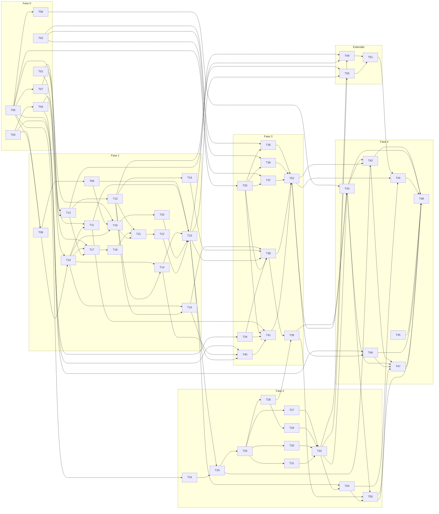

# Dependências entre tasks: Rastro

**Quando cada task pode começar.** O que cada task faz está no `tasks.md`; em que pé ela está, no `kanban.md`. Aqui fica o que precisa estar pronto antes.

## Regras

- **Uma task está liberada quando todas as tasks de "Depende de" foram commitadas** (cartão em "Em revisão" ou "Feito"). A revisão é depois do commit e ajuste vira `fix(...) (Tnn)`, então não é preciso esperar a aprovação.
- **"Libera"** lista as tasks que dependem desta. Elas só começam quando *todas* as dependências delas estiverem prontas, não só esta.
- **A dependência vem do que a task usa:** um módulo, um modelo ou um formato criado por outra task (ver "Arquivos" no `tasks.md`), ou um resultado de spike.
- **Onda** é a primeira rodada em que a task pode começar se as anteriores andarem sem atraso. Tasks da mesma onda podem ser feitas em qualquer ordem.
- Regra do `tasks.md` que também entra aqui: a extensão (T49–T51) só começa com as fases 1 e 2 fechadas (T23 e T32).
- Task nova no `tasks.md` ganha a sua linha aqui no mesmo commit.

## Tabela

| Task | Onda | Depende de | Libera | Por quê |
|---|---|---|---|---|
| T01 Validar o GitHub Advisory e o EPSS | 1 | — | T12, T17 | formato de `epss` e `cvss_severities` |
| T02 Validar as CLIs de IA sem interação | 1 | — | T35, T36, T37 | comando e formato de resposta de cada CLI |
| T03 Validar o HAR real e o bundle do Juice Shop | 1 | — | T04, T08, T40 | formato do HAR e critério da trava 5 |
| T05 Criar o esqueleto Python | 1 | — | T06, T07, T08, T12, T24, T33, T34 | pacote, `cli.py`, `pyproject.toml`, `conftest.py` |
| T45 Registrar as decisões | 1 | — | T48 | só depende do design; melhor perto do fim |
| T04 Montar a avaliação | 2 | T03 | T11, T46 | o Juice Shop não tem falha (T03), então precisa de outros alvos |
| T06 Documentar a verificação local | 2 | T05 | T43 | comandos de verificação |
| T07 Escrever a skill `rastro-nova-regra` | 2 | T05 | T10, T19 | a skill é usada nessas duas |
| T08 Ler e validar o HAR | 2 | T03, T05 | T09, T10 | `har/modelos.py` (`Requisicao`) |
| T12 Consultar o GitHub Advisory | 2 | T01, T05 | T13, T14, T17, T50 | `fontes/conector.py` (`Aviso`) |
| T24 Criar o projeto do frontend | 2 | T05 | T25 | `frontend/`, `tipos.ts` |
| T33 Criar o cliente de IA e a escolha do provedor | 2 | T05 | T35, T36, T37, T38, T41 | `ProvedorDeIA`, `ClienteDeIA` |
| T34 Tirar dados sensíveis do que vai para a IA | 2 | T05 | T38, T41 | `ia/sanitizacao.py` |
| T09 Descobrir o site analisado | 3 | T08 | T19, T23 | `har/site.py` |
| T10 Identificar bibliotecas pelo nome do arquivo | 3 | T07, T08 | T11, T14, T15, T17, T19 | `identificacao/modelos.py` (`Biblioteca`) |
| T13 Conferir a faixa de versão afetada | 3 | T12 | T14, T15, T16, T21, T49 | `travas/modelos.py` |
| T35 Chamar o Claude pela CLI | 3 | T02, T33 | T52 | provedor |
| T36 Chamar o Codex pela CLI | 3 | T02, T33 | T52 | provedor |
| T37 Chamar o Kiro pela CLI | 3 | T02, T33 | T52 | provedor (padrão) |
| T11 Identificar bibliotecas pelo comentário de versão | 4 | T04, T10 | T23, T41 | usa os casos do `gabarito.json` |
| T14 Conferir no npm se o pacote existe | 4 | T10, T12, T13 | T23, T40 | `registro_npm.py`, `travas/conferencia.py` |
| T15 Travar a resposta da IA: formato e ancoragem | 4 | T10, T13 | T38, T40 | `travas/formato.py`, `travas/ancoragem.py` |
| T16 Barrar explicação com fato novo | 4 | T13 | T38 | `travas/explicacao.py` |
| T17 Calcular a nota de risco | 4 | T01, T10, T12 | T18 | `risco/modelos.py` usa `Biblioteca` e `Aviso` |
| T19 Checar os cabeçalhos de segurança | 4 | T07, T09, T10 | T20, T21 | só olha o site analisado (T09) |
| T18 Classificar a prioridade e ordenar | 5 | T17 | T21 | nota pronta |
| T20 Checar os cookies | 5 | T19 | T23 | mesmo arquivo `checagens.py` |
| T40 Conferir o trecho no código publicado | 5 | T03, T14, T15 | T41 | trava 5 sobre o `registro_npm.py` e a ancoragem |
| T21 Montar o plano de ação | 6 | T13, T18, T19 | T22 | achados ordenados, checagens, versão-alvo |
| T41 Identificar bibliotecas em bundles com IA | 6 | T11, T33, T34, T40 | T52 | travas 1 a 6 prontas antes da IA |
| T22 Gerar o texto da task | 7 | T21 | T23 | `Acao` |
| T23 Gravar o relatório JSON e ligar o fluxo sem IA | 8 | T09, T11, T14, T20, T22 | T25, T38, T49, T50, T54 | fecha a fase 1 |
| T25 Embutir o JSON no HTML | 9 | T23, T24 | T26, T42 | JSON gravado e `modelo.html` |
| T38 Explicar cada achado com IA | 9 | T15, T16, T23, T33, T34 | T39, T52 | entra no fluxo e na task |
| T26 Mostrar os indicadores e o plano de ação | 10 | T25 | T27, T28, T30, T31 | `App.tsx` e componentes base |
| T52 Ligar a IA na linha de comando | 10 | T35, T36, T37, T38, T41 | T42, T43, T44, T46 | fecha a fase 3 |
| T27 Mostrar o aviso de análise sem IA | 11 | T26 | T32 | |
| T28 Mostrar bibliotecas, falhas e checagens | 11 | T26 | T29, T39 | |
| T30 Mostrar o glossário | 11 | T26 | T32 | |
| T31 Abrir e copiar a task | 11 | T26 | T32 | |
| T46 Medir com e sem IA | 11 | T04, T52 | T47, T48 | gabarito e análise com IA |
| T29 Mostrar a origem de cada dado | 12 | T28 | T32 | clique em biblioteca e falha |
| T39 Mostrar onde a IA entrou | 12 | T28, T38 | T43 | chamadas registradas e travas acionadas |
| T32 Ler uma zona por vez (modo foco) | 13 | T27, T29, T30, T31 | T43, T49, T50, T54 | painel, glossário e task precisam funcionar em foco; fecha a fase 2 |
| T43 Escrever o README de uso | 14 | T06, T32, T39, T52 | T42, T47, T48 | uso completo e prints |
| T49 Consultar o OSV | 14 | T13, T23, T32 | T51 | extensão: só com fases 1 e 2 fechadas |
| T50 Completar o CVSS pelo NVD | 14 | T12, T23, T32 | T51 | extensão: só com fases 1 e 2 fechadas |
| T54 Rever a visita num radar | 14 | T23, T32 | T44 | `visita` no JSON; radar também em foco |
| T55 Ensinar a usar o relatório: tour guiado e Como usar | 15 | T39, T43, T54 | T47, T48 | o tour passa pelo painel da IA e pelo radar; o guia usa os comandos do README |
| T42 Instalar do zero no Windows e no Linux | 15 | T25, T43, T52 | T47, T48 | segue o README, com e sem IA |
| T51 Juntar avisos de fontes diferentes | 15 | T49, T50 | T44 | |
| T44 Publicar o relatório de cobertura | 16 | T51, T52, T54 | T48 | depois do último código |
| T47 Gravar a apresentação e o demo | 16 | T42, T43, T46, T55 | T48 | números reais, instalação conferida e o relatório final na tela |
| T48 Preparar a versão final | 17 | T42, T43, T44, T45, T46, T47, T55 | — | última |

## Grafo

As setas vão da task que libera para a liberada.

## Caminho crítico

A sequência mais longa, que decide a data final:

T03 (ou T05) → T08 → T10 → T17 → T18 → T21 → T22 → T23 → T25 → T26 → T28 → T29 → T32 → T43 → T42 → T47 → T48

Atraso em qualquer uma delas atrasa a entrega. A fase 3 (T33–T37) e o frontend base (T24) começam cedo e correm em paralelo ao núcleo.

## Situação em 10/11

Tudo até a T55 está commitado. Faltam só tasks da fase 4:

| Task | Estado | Pode começar? |
|---|---|---|
| T46 Medir com e sem IA | em andamento | — (falta o tempo de triagem manual) |
| T42 Instalar do zero no Windows e no Linux | a fazer | **sim**: T25, T43 e T52 commitadas |
| T47 Gravar a apresentação e o demo | a fazer | não: espera T42 e T46 |
| T48 Preparar a versão final | a fazer | não: espera T42, T46 e T47 |
