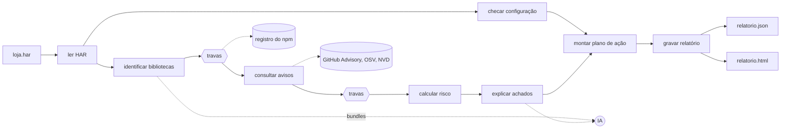

# Design: Rastro

**Como.** Este arquivo diz como o Rastro atende o [`requirements.md`](requirements.md): arquitetura, sequência, modelos, regras, erros e testes. O porquê de cada escolha está em [`docs/decisoes/`](../../../docs/decisoes/); as regras de construção (estrutura, nomes, Windows e Linux), no [`.kiro/steering/`](../../steering/).

## 1. Visão geral

```
python -m rastro analisar loja.har [--ia kiro|claude|codex] [--sem-ia] [--saida <pasta>] [--nao-abrir] [--pentest <pentest.json>]
python -m rastro gravar <url> [--robo] [--ia NOME | --sem-ia] [--saida <pasta>] [--nao-abrir]
python -m rastro pentest loja.har --autorizo [--saida <pasta>]
python -m rastro como-usar
```

O código segue as etapas da apresentação, na mesma ordem e com os mesmos nomes:



Os losangos são as **travas** (R21): a IA sugere, a regra confirma. Nada da IA vira dado do relatório sem passar por elas.

- **Bordas** (entrada e saída): `cli.py`, `comandos/`, `har/leitor_do_har.py`, `fontes/` (GitHub Advisory, OSV, NVD, registro do npm), `ia/`, `relatorio/`, `captura/`, `pentest/`.
- **Núcleo puro** (regras, sem rede nem arquivo): `identificacao/assinaturas.py`, `travas/`, `risco/`, `configuracao/`, `acao/`.
- **Cinco interfaces**, só onde há troca real: `ConectorDeAvisos` (GitHub Advisory e OSV), `BuscaDeCvss` (NVD), `RegistroDePacotes` (npm), `ProvedorDeIA` (Kiro, Claude, Codex) e `SessaoDeGravacao` (Playwright). Nos testes, as cinco viram dublês sem rede.

## 2. Estrutura

O que cada arquivo faz está em [`structure.md`](../../steering/structure.md) (Python) e [`frontend-react.md`](../../steering/frontend-react.md) (frontend). Por pasta:

| Pasta | Responsabilidade | Requisitos |
|---|---|---|
| `rastro/__main__.py`, `cli.py` | entrada do `python -m rastro` e do comando `rastro`; despacha para o comando | R01.1 |
| `rastro/comandos/` | um arquivo por comando: lê os argumentos, escolhe a IA, chama o fluxo, grava, mostra o resumo e abre o navegador | R13.8, R13.9, R14, R23.8, R24, R25 |
| `rastro/instalacao/`, `install.sh` | criar e remover o comando `rastro` na pasta do usuário ([decisão 11](../../../docs/decisoes/11-comando-rastro-de-qualquer-pasta.md)) | R17.3, R17.4, R18.1 |
| `rastro/` (raiz) | `fluxo_da_analise.py` orquestra as etapas, sem regra própria; `modelos_da_analise.py` (`Analise`), `andamento.py` e os módulos neutros (semver, gravação segura) | todos, R13.10 |
| `rastro/terminal/` | linha que se redesenha, cores e andamento da análise | R13.10, R24.18, R24.19 |
| `rastro/har/` | lê e valida o HAR, descobre o site, monta a visita | R01, R22.1–R22.3 |
| `rastro/identificacao/` | bibliotecas por assinatura e, com a IA, em bundles | R02, R03 |
| `rastro/travas/` | uma trava por arquivo e a conferência das bibliotecas | R03.3, R03.4, R21 |
| `rastro/fontes/` | GitHub Advisory, OSV, NVD, junção dos avisos e registro do npm | R04, R04A, R21.4, R21.5, R21.9 |
| `rastro/risco/` | nota, prioridade e achados | R05 |
| `rastro/configuracao/` | checagens de cabeçalhos e cookies | R06 |
| `rastro/explicacao/` | explicação dos achados pela IA | R07 |
| `rastro/acao/` | plano de ação e texto da task | R08, R09 |
| `rastro/ia/` | cliente único, escolha da IA, provedores, prompts e sanitização | R11, R14, R16.3 |
| `rastro/relatorio/` | JSON, HTML (com o `modelo.html` do build) e gravação | R13 |
| `rastro/captura/` | gravar a visita pelo Playwright e o robô | R24 |
| `rastro/pentest/` | validações ativas, isoladas da análise | R25 |
| `frontend/` | React: só exibe o JSON | R09.2, R10, R12, R13.5, R13.6, R15, R22.4–R22.7, R23 |

## 3. Sequência do fluxo

`fluxo_da_analise.py` lê como a apresentação (sem as linhas do andamento):

```python
def analisar(caminho_har, fonte, registro, cliente_de_ia=None, conector_osv=None,
             busca_de_cvss=None, gravado_pelo_rastro=False, andamento=ANDAMENTO_SILENCIOSO) -> Analise:
    requisicoes = ler_har(caminho_har)
    site = descobrir_site_analisado(requisicoes)
    bibliotecas_por_assinatura = identificar_por_assinatura(requisicoes)
    resultado_dos_bundles = identificar_em_bundles(requisicoes, bibliotecas_por_assinatura, cliente_de_ia, andamento)
    bibliotecas = conferir_bibliotecas(bibliotecas_por_assinatura + resultado_dos_bundles.bibliotecas, registro, andamento)
    consulta_de_avisos = consultar_avisos(bibliotecas.confirmadas, fonte, conector_osv, busca_de_cvss, andamento)
    avisos_na_faixa, travas_da_faixa = conferir_faixas(consulta_de_avisos.avisos)
    achados = calcular_risco(avisos_na_faixa)
    resultado_das_explicacoes = explicar_achados(achados, cliente_de_ia, andamento)
    checagens = checar_configuracao(requisicoes, site, gravado_pelo_rastro)
    plano_de_acao = montar_plano_de_acao(achados, resultado_das_explicacoes.explicacoes, checagens)
    return Analise(..., visita=montar_visita(requisicoes))
```

- Sem IA (`cliente_de_ia=None`), `identificar_em_bundles` não acha nada e `explicar_achados` devolve o dicionário vazio. A ordem é a mesma com e sem IA.
- `consultar_avisos` (`fontes/consulta_dos_avisos.py`): `ConsultaNaoRealizada` vira `nao_consultadas[pacote@versão] = motivo` e a análise segue (R04.3). Biblioteca respondida pelo GitHub passa por OSV, `juntar_avisos` e `completar_cvss` antes da trava 6 (seção 7).
- `conferir_faixas` aplica a trava 6 biblioteca por biblioteca; `calcular_risco` (`risco/achados.py`) monta um `Achado` por aviso mantido e devolve a lista ordenada.
- `checar_configuracao` (`configuracao/checagens.py`) roda a tupla `CHECAGENS` na ordem dos IDs (C01 a C08).
- `Analise` (`modelos_da_analise.py`): `har` (nome do arquivo), `site`, `inicio` (hora local), `duracao_s`, `provedor_de_ia: str | None`, `tem_javascript` (R01.6), `bibliotecas` (confirmadas), `a_confirmar`, `nao_consultadas: dict[str, str]`, `fontes_sem_resposta: list[FonteSemResposta]`, `achados`, `explicacoes`, `checagens`, `plano_de_acao`, `travas_acionadas` (as dos bundles, do npm, da faixa e da explicação), `chamadas_de_ia` (as `ChamadaDaIA` do cliente; vazia sem IA) e `visita: list[PassoDaVisita]`.
- `comandos/comando_analisar.py` escolhe a IA e procura a CLI antes de ler o HAR (código 1 se a IA for inválida ou a CLI faltar), monta o `ClienteDeIA`, chama o fluxo, monta o relatório (`relatorio/montagem_do_relatorio.py`) e grava (`relatorio/gravacao_do_relatorio.py`) na pasta do site e de `analise.inicio`.

### Análise sem IA fica explícita (R14.5–R14.7)

A análise sem IA é útil (máquina sem CLI de IA, testes), mas é **incompleta**, e quem usa precisa saber disso sem ler a documentação ([decisão 08](../../../docs/decisoes/08-analise-sem-ia.md)).

| Onde | O que aparece |
|---|---|
| `--help` | `--sem-ia  analisa sem IA: não procura bibliotecas em bundles e não explica os achados` |
| Terminal, no início e no resumo final | `Atenção: análise sem IA. Bibliotecas em bundles não foram procuradas; podem existir falhas que não aparecem aqui.` |
| JSON | `analise.ia: null`, `analise.limitacoes` com `bundles_nao_procurados` e `achados_sem_explicacao` (cada uma `{"id", "texto"}`), `analise.continua_igual` com o texto do que não muda e `resumo.encontradas_so_pela_ia: null` |
| Relatório, no topo | `AvisoDeLimitacoes`: o que não foi feito, o que continua igual (nota, prioridade, checagens, plano) e o comando para rodar com IA |
| Indicador "encontradas só pela IA" | "não procurado", e não zero |
| Painel "Onde a IA entrou" | "IA desligada nesta análise", sem a comparação com e sem IA |

O texto das limitações sai do Python (`relatorio/limitacoes_da_analise.py`), no campo `limitacoes` (`id` para o React escolher o ícone, `texto` para exibir). A mesma lista leva `sem_javascript` quando nenhuma resposta do HAR trouxe conteúdo JavaScript (R01.6), com ou sem IA.

Com IA, chamada que falha também é limitação: `ia_falhou_identificacao` (bundles que ficaram sem análise) e `ia_falhou_explicacao` (achados só com o resumo do aviso), uma por etapa com ao menos uma falha, com o provedor e quantas chamadas falharam. O terminal repete esses textos no fim, com `Atenção:`, e o aviso do topo aparece como "Análise incompleta.".

## 4. Modelos

`dataclass(frozen=True)` em todos os modelos.

| Modelo | Campos |
|---|---|
| `Requisicao` | `indice`, `url`, `metodo`, `status`, `tipo_conteudo`, `cabecalhos_resposta: dict[str, str]`, `cookies_resposta: list[Cookie]`, `conteudo: str \| None`, `inicio: datetime \| None`, `duracao_ms: float \| None` |
| `Cookie` | `nome`, `http_only`, `secure`, `same_site: str \| None` (sem o valor) |
| `Evidencia` | `indice_requisicao`, `url`, `trecho: str \| None` |
| `Biblioteca` | `pacote`, `versao`, `metodo: "assinatura" \| "ia"`, `situacao: "confirmada" \| "a_confirmar"`, `conferida_no_npm: bool \| None`, `travas_que_falharam: list[str]`, `evidencias: list[Evidencia]` |
| `TravaAcionada` | `trava`, `alvo` (biblioteca, aviso ou explicação), `motivo` |
| `FonteSemResposta` | `fonte` (`OSV` ou `NVD`), `alvo` (`pacote@versão` ou CVE), `motivo` |
| `Aviso` | `fontes: list[str]`, `apelidos: list[str]`, `ghsa`, `cve`, `resumo`, `cvss: float \| None`, `percentil_epss: float \| None`, `versoes_afetadas`, `versao_corrigida: str \| None`, `link`, `origem_dos_campos: dict[str, str]` (campo → fonte que o trouxe; só os campos preenchidos) |
| `Nota` | `valor: float \| None`, `prioridade: "alta" \| "media" \| "baixa" \| "a avaliar"`, `conta: str`, `sem_epss: bool` |
| `Achado` | `biblioteca`, `aviso`, `nota` |
| `Checagem` | `id`, `titulo`, `situacao: "falhou" \| "passou" \| "nao_verificada"`, `severidade: "alta" \| "media" \| "baixa"`, `quem_resolve`, `evidencia: Evidencia \| None`, `detalhe` |
| `Explicacao` | `o_que_e`, `impacto`, `como_corrigir`, `teste_verificacao`, `gerada_por_ia: bool` |
| `Acao` | `id`, `prioridade`, `nota`, `o_que_fazer`, `porque`, `impacto`, `quem_resolve`, `refs: list[str]` (GHSA dos achados ou ID da checagem), `teste_verificacao: str \| None` (só o sugerido pela IA), `texto_task` |
| `PassoDaVisita` | `indice_requisicao`, `url`, `camada: "pagina" \| "script" \| "estilo" \| "dados" \| "midia"`, `inicio_ms` (desde a primeira requisição), `duracao_ms` (0 quando o HAR não traz `time`) |
| `ChamadaDaIA` | `etapa`, `provedor`, `entrada`, `resposta`, `duracao_s`, `tokens: int \| None`, `sucesso: bool` |

A `situacao` sai só das travas; a IA não tem campo de confiança que decida algo. `Nota.conta` guarda a conta escrita, ex.: `10 × (0,5 × 6,1/10 + 0,5 × 0,97) = 7,9`, que o painel de origem mostra (R10.1).

## 5. Ler o HAR (R01)

- `json.loads` do arquivo aberto com `encoding="utf-8"`. Valida `log.entries` como lista.
- O conteúdo dos scripts vem em `response.content.text`, em texto puro (spike T03, `docs/historico/spike/har-e-bundles.md`). Entrada sem `text` (ex.: WebSocket) fica sem conteúdo. Chaves com `_` (`_resourceType`, `_initiator`…) são ignoradas.
- `response.content.encoding == "base64"` → `base64.b64decode` e depois UTF-8 com `errors="replace"`. No spike, só imagens e fontes vieram assim. Base64 corrompido deixa a entrada sem conteúdo.
- Cookies: usa `response.cookies` do HAR. Se vier vazio, interpreta os `Set-Cookie` dos cabeçalhos, guardando só o nome e os atributos. Cookie criado por JavaScript não tem `Set-Cookie` e fica de fora das checagens.
- Cabeçalhos: nome em minúsculas; nome repetido junta os valores com `, `. O `Set-Cookie` não entra em `cabecalhos_resposta`: o cookie fica só em `cookies_resposta`, sem o valor.
- `tipo_conteudo`: `content.mimeType` (ou o `Content-Type`) sem parâmetros e em minúsculas, ex.: `text/html`.
- Erros: `HarNaoEncontrado` (caminho que não é arquivo) e `HarInvalido` (não é UTF-8, não é JSON, sem `log.entries` em lista ou entrada sem `request.url`, `request.method` e `response.status`), filhas de `ErroAoLerHar`. Os comandos transformam em código 1.
- **Horário (R22.1):** `startedDateTime` vira `inicio` (o `Z` vira `+00:00`, que o `fromisoformat` do Python 3.10 não aceita) e `time` vira `duracao_ms` quando é número não negativo. Ausente ou inválido fica `None`, sem barrar o HAR.
- **Visita (R22.2, R22.3):** `har/visita.py` (puro) conta o tempo de cada requisição desde a primeira, ordena por tempo e índice e tira a camada do `tipo_conteudo`. Sem horário, a requisição fica fora da visita.
- **Site analisado:** host da primeira resposta com `tipo_conteudo` `text/html` que não seja redirecionamento (3xx), em minúsculas e com a porta (`localhost:3000`). Sem resposta HTML, `None` (R13.3 usa o nome do HAR).

## 6. Identificar bibliotecas

### Por assinatura (R02)

Uma tabela de dados em `identificacao/assinaturas.py`, uma linha por biblioteca:

| Pacote npm | Nome no arquivo | Comentário de versão (regex) |
|---|---|---|
| `jquery` | `jquery` | `jQuery (?:JavaScript Library )?v(\d+\.\d+\.\d+)` |
| `jquery-ui` | `jquery-ui` | `jQuery UI - v(\d+\.\d+\.\d+)` |
| `bootstrap` | `bootstrap` | `Bootstrap v(\d+\.\d+\.\d+)` |
| `lodash` | `lodash` | `lodash (\d+\.\d+\.\d+)` |
| `moment` | `moment` | `moment\.js\s*//! version : (\d+\.\d+\.\d+)` |
| `angular` | `angular` | `(?:@license )?AngularJS v(\d+\.\d+\.\d+)` |
| `underscore` | `underscore` | `Underscore\.js (\d+\.\d+\.\d+)` |
| `requirejs` | `requirejs` | `@license RequireJS (\d+\.\d+\.\d+)` |
| `ckeditor` | `ckeditor` | — |

**Padrão do nome do arquivo**, o mesmo para todas as linhas: `(?<![\w-])` + nome no arquivo + separador `[-.@/]?` ou `(?:\.min)?\.js\?v(?:er)?=` + `(\d+\.\d+\.\d+)`, sem diferenciar maiúsculas, procurado no caminho e nos parâmetros da URL (o host fica de fora) e só em scripts (tipo de conteúdo JavaScript ou caminho terminado em `.js`). Reconhece `jquery-3.4.1.min.js`, `/lodash@4.17.15/`, `/jquery/3.4.1/jquery.min.js`, `ckeditor.js?v=4.10.1` e `jquery.min.js?ver=3.4.1`. O início impede que `react-bootstrap@1.0.0` vire Bootstrap, e `jquery-ui-1.10.4.js` não vira jQuery porque, depois de `jquery`, o separador exige a versão.

As linhas de Underscore, RequireJS e CKEditor vêm da avaliação ([`avaliacao/README.md`](../../../avaliacao/README.md)). Lodash, Moment.js e AngularJS não aparecem nos alvos; os padrões foram conferidos em arquivos publicados no npm (jsDelivr e cdnjs): ` * lodash 3.10.1` (Lodash 3 e 4.0.0; na 4.17.15 e na 4.18.1 o comentário não traz versão e só cita `Underscore.js 1.8.3`, que não pode virar Underscore), `//! moment.js` seguido de `//! version : 2.18.1` (o `moment.min.js` 2.29.1 não tem cabeçalho) e `/*\n AngularJS v1.8.2` no `.min.js` ou ` * @license AngularJS v1.8.2` no completo. Sem versão no comentário, vale o nome do arquivo ou a IA.

- **O comentário é procurado no conteúdo inteiro**, e cada comentário encontrado registra uma biblioteca. Um bundle agregado (Drupal) junta várias bibliotecas e cada uma mantém o seu `/*!`: jQuery no início, Underscore no byte 86 mil e jQuery UI no 136 mil. No WebGoat, o `//     Underscore.js` vem depois do *wrapper* UMD.
- **O padrão do comentário começa no início de um comentário**: a coluna da tabela é o texto logo depois da abertura, e a abertura, comum a todas as linhas, é `/*`, `/**` ou `/*!` (seguidos de espaços ou quebra de linha), `//` ou `//!` (seguidos de espaços) ou ` * ` no começo da linha (`(?:/\*[*!]?\s*|//!?[ \t]*|^[ \t]*\*[ \t]*)`, com `re.MULTILINE`). Assim, `Requires jQuery v1.7.2`, dentro do comentário do jQuery Form, não vira jQuery 1.7.2, e o `Underscore.js 1.8.3` do cabeçalho do Lodash não vira Underscore. A evidência guarda o trecho encontrado (ex.: `/*! jQuery v3.4.1`).
- **O nome do arquivo inclui o `?v=` e o `?ver=` da URL**, onde o Drupal e o WordPress põem a versão (`ckeditor.js?v=4.10.1`).
- **Nome e comentário divergentes: vale o comentário**, que é o código que rodou. O nome entra na evidência. No WebGoat, `jquery-ui-1.10.4.js` traz a jQuery UI 1.10.3.

Bibliotecas iguais são agrupadas por `(pacote, versao)`, juntando as evidências na ordem das requisições, uma por requisição (os 22 comentários da jQuery UI num bundle do Drupal viram uma evidência). A entrada é `identificar_por_assinatura(requisicoes)`, pura.

### Em bundles, com IA (R03)

1. **Escolher bundles** (`identificacao/trechos_dos_bundles.py`): scripts sem assinatura com mais de 30 KB. No Juice Shop, os bundles com versão tinham mais de 140 KB.
2. **Extrair trechos:** comentários de licença `/*!` com conteúdo (`/*!*/` vazio é ignorado) e janelas de 300 caracteres em volta de versões entre aspas (`["'`]v?\d+\.\d+\.\d+(-[\w.]+)?["'`]`). No máximo 5 trechos por bundle. O número solto e a palavra `version` ficaram de fora: no spike T03, só trouxeram coordenadas de SVG e propriedades sem relação.
3. **Sanitizar** (`ia/sanitizacao.py`) e enviar com o prompt `identificar_bibliotecas.md`.
4. **Resposta fechada:** JSON `{"bibliotecas": [{"pacote", "versao", "trecho"}]}`, nada além disso. Nome de pacote npm inválido ou versão fora do formato `x.y.z` derrubam a resposta inteira.
5. **Travas** (seção 8): em `identificacao/bibliotecas_pela_ia.py`, a resposta passa pela trava 1 e cada biblioteca pelas travas 2 e 3, contra os trechos já sanitizados que foram enviados. Em `travas/conferencia_das_bibliotecas.py`, a biblioteca já barrada segue "a confirmar" sem consultar o npm; as outras passam pela trava 4 e, se vieram da IA, pela 5. A 6 vale para os avisos.
6. **Uma chamada por bundle**, com no máximo 5 trechos. Bundles com o mesmo conteúdo vão uma vez só; bundle sem trecho não chama a IA. Falha da chamada ou resposta fora do formato num bundle não impede os outros (R03.5).
7. **Sem repetição:** biblioteca já reconhecida por assinatura ou em outro bundle (mesmo `pacote@versão`) não entra de novo; vale a primeira evidência, mas uma sugestão confirmada substitui outra igual que ficou "a confirmar" num bundle anterior.

O que a IA achou de verdade nos três alvos está em [`avaliacao/resultados.md`](../../../avaliacao/resultados.md).

## 7. Consultar o GitHub Advisory (R04)

```
GET https://api.github.com/advisories?ecosystem=npm&affects=<pacote>@<versao>&per_page=100
Accept: application/vnd.github+json
Authorization: Bearer $GITHUB_TOKEN      (só se a variável existir)
```

Formato conferido no spike T01 (`docs/historico/spike/github-advisory.md`).

| Campo do aviso | Vem de |
|---|---|
| `ghsa`, `cve`, `resumo`, `link` | `ghsa_id`, `cve_id` (pode ser `null`), `summary`, `html_url` |
| `cvss` | `cvss_severities.cvss_v3.score`; senão, `cvss_v4.score`; senão, nenhum. Cada um só vale com `vector_string` preenchido: CVSS ausente vem como `score: 0.0` e vetor `null`. O campo legado `cvss` não é usado. |
| `percentil_epss` | `epss.percentile` (0 a 1). Sem EPSS, a chave `epss` não vem na resposta. |
| `versoes_afetadas`, `versao_corrigida` | itens de `vulnerabilities` com `package.ecosystem == "npm"` e `package.name == pacote`, um `Aviso` por item (`vulnerable_version_range` e `first_patched_version`, que pode ser `null`); a trava 6 fica com o item cuja faixa contém a versão. |
| `apelidos` | valores de `identifiers` diferentes do GHSA (o CVE, quando há) |

- Aviso com `withdrawn_at` preenchido (retirado) é descartado (R04.6).
- `urllib.request` com tempo limite de 15 s. Sem token, o limite é de 60 requisições por hora por IP, uma por biblioteca: uma análise cabe nele; várias na mesma hora dividem as 60. Com `GITHUB_TOKEN`, 5.000 por hora.
- Sem paginação: com `per_page=100`, nenhuma resposta do spike passou de 26 avisos.
- Lista vazia não prova que o pacote existe; isso é da trava 4.
- `ConectorDeAvisos.consultar(pacote, versao) -> list[Aviso]` e a exceção `ConsultaNaoRealizada(motivo)` ficam em `fontes/conector.py`; o `Aviso`, em `fontes/modelos.py`. Erro de rede, tempo esgotado, HTTP 403/429/5xx, resposta que não é JSON ou fora do formato viram essa exceção com o motivo pronto, e a biblioteca fica "não consultada" (R04.3). A análise continua.

### OSV e NVD (R04A)

| Fonte | Consulta | O que acrescenta |
|---|---|---|
| OSV | `POST https://api.osv.dev/v1/query` com `{"package": {"name": "<pacote>", "ecosystem": "npm"}, "version": "<versão>"}` | avisos que o GitHub não tem; `aliases` liga ao GHSA e ao CVE |
| NVD | `GET https://services.nvd.nist.gov/rest/json/cves/2.0?cveId=<CVE>` | CVSS quando o GitHub não traz; só para avisos com CVE |

- **Arquivos:** `fontes/osv.py` implementa `ConectorDeAvisos`. O NVD não busca avisos, só completa o CVSS de um CVE: `fontes/nvd.py` (cliente) e `fontes/completar_cvss.py` (`BuscaDeCvss`, [decisão 10](../../../docs/decisoes/10-interface-do-nvd.md)). `fontes/juncao_dos_avisos.py` (puro) junta avisos iguais.
- **Faixa do OSV:** vem como eventos `introduced` e `fixed` do tipo `SEMVER`. `fontes/faixas_do_osv.py` (`faixas_dos_eventos_semver`) percorre os eventos na ordem e escreve cada par no formato do GitHub: `introduced` vira `>= x` (`0` não vira condição), `fixed` vira `< y` e é a versão corrigida, `last_affected` vira `<= y` sem versão corrigida, e `introduced` sem fim vira faixa aberta (`>= x`, ou `>= 0`). Um `Aviso` por par. Eventos `limit` e faixas `ECOSYSTEM` ou `GIT` são ignorados. Assim a trava 6 não muda.
- **Campos do OSV:** só os itens de `affected` com `package.ecosystem == "npm"` e `package.name == pacote`; item sem faixa `SEMVER` sai com faixa vazia, e a trava 6 o descarta com o motivo. O identificador do `Aviso` é o GHSA, venha ele no `id` ou nos `aliases`; sem GHSA, o `id` do OSV (ex.: `MAL-…`). Os outros identificadores viram `apelidos`; o CVE é o primeiro `CVE-` entre eles. `resumo` é `summary`, senão `details`. `cvss` e `percentil_epss` ficam vazios: o OSV traz só o vetor CVSS, sem a nota. `link` é `https://osv.dev/vulnerability/<id>`. Aviso com `withdrawn` é descartado, como no GitHub. Falhas viram `ConsultaNaoRealizada` com os mesmos motivos do GitHub.
- **Campos do NVD:** `Nvd.buscar_cvss(cve) -> float | None` e `completar_cvss(avisos, busca) -> CvssCompletado(avisos, nao_responderam)`. Só aviso com CVE e sem CVSS é consultado, uma vez por CVE em cada biblioteca. O CVSS é o `baseScore` de `metrics`, na ordem `cvssMetricV31`, `cvssMetricV30`, `cvssMetricV40`; dentro da lista, a medição `type: "Primary"` (a análise do próprio NVD), senão a primeira. O CVSS v2 é ignorado. Aviso completado ganha `"NVD"` no fim de `fontes`. CVE que o NVD não conhece ou sem métrica v3/v4 deixa o aviso como estava ("sem nota", R05.4). Com `NVD_API_KEY`, vai no cabeçalho `apiKey`; vazia conta como ausente. Falha do NVD (404 é CVE com formato inválido) não para nada: o aviso segue sem CVSS e o CVE vai para `nao_responderam` com o motivo (R04A.6).
- **Junção:** `juntar_avisos(avisos)`. Dois avisos são iguais quando o ID (`ghsa`) ou algum apelido de um aparece no outro (GHSA, CVE, ID do OSV). Cada grupo vira um aviso por faixa da fonte mais alta em `ORDEM_DAS_FONTES` (GitHub Advisory, OSV, NVD): faixa, versão corrigida e link andam juntos, do mesmo item dessa fonte, porque a versão corrigida só vale para a sua faixa e a trava 6 escolhe a faixa depois. `cve`, `resumo`, `cvss` e `percentil_epss` vêm da primeira fonte, na ordem, que traz o campo; assim o CVSS fica com GitHub e depois NVD, e o EPSS só com o GitHub (R04A.4). `fontes` junta as do grupo, sem repetir; `apelidos` junta todos os identificadores menos o `ghsa`. Aviso de uma fonte só sai como veio. Exemplo: para o GHSA-gxr4-xjj5-5px2 do `jquery@3.4.1`, o GitHub diz `>= 1.2, < 3.5.0` e o OSV `>= 1.12.0, < 3.5.0`; vale a do GitHub.
- **Origem de cada campo (R04A.5):** cada conector chama `marcar_origem(aviso, NOME_DA_FONTE)` (`fontes/modelos.py`), que preenche `origem_dos_campos` para os campos de `CAMPOS_COM_ORIGEM` que vieram preenchidos; a junção leva a origem de quem forneceu cada campo e o NVD grava `"cvss": "NVD"` ao completar. O painel da origem do dado mostra a linha "Fontes" e, ao lado de cada campo, a fonte dele.
- **Ordem no fluxo:** GitHub; se respondeu, OSV; `juntar_avisos`; `completar_cvss` (só o aviso junto que ficou sem CVSS); trava 6. Sem resposta do GitHub, a biblioteca é "não consultada" (R04.3) e o OSV nem é consultado. Falha do OSV (por biblioteca) ou do NVD (por CVE) vira `FonteSemResposta` em `Analise.fontes_sem_resposta`, e o relatório ganha uma limitação por fonte (`fonte_sem_resposta_osv`, `fonte_sem_resposta_nvd`), com cada alvo, o motivo e a consequência ("Esses avisos vêm só do GitHub Advisory." ou "Esses avisos seguem sem o CVSS do NVD."), no `AvisoDeLimitacoes` (R04A.6).
- **Limites:** o OSV não exige chave. O NVD sem chave aceita poucas requisições por minuto, por isso só é chamado para CVE sem CVSS.

## 8. Travas contra invenção (R21)

**A IA sugere, a regra confirma** ([decisão 06](../../../docs/decisoes/06-travas-contra-invencao.md)). Cada trava é uma função com nome que diz o que confere, e o que ela barra fica registrado no painel da IA (R21.10).

| # | Trava | Pergunta que responde | Onde | Se falhar |
|---|---|---|---|---|
| 1 | Formato fechado | A resposta é exatamente o JSON pedido? | `travas/formato_das_bibliotecas.py` e `travas/formato_da_explicacao.py`, que leem com `travas/json_estrito.py` | descarta a resposta inteira |
| 2 | Trecho real | O trecho que a IA citou foi mesmo enviado a ela? | `travas/ancoragem.py` | "a confirmar" |
| 3 | Ancoragem | A versão aparece escrita no trecho? | `travas/ancoragem.py`, com `travas/versao_no_trecho.py` | "a confirmar" |
| 4 | Pacote existe | `pacote@versão` foi publicado no npm? | `travas/pacote_existe.py`; a leitura, em `fontes/registro_npm.py` | "a confirmar" |
| 5 | Código confere | As strings do trecho estão no código publicado daquela versão? | `travas/codigo_publicado.py`, com `travas/strings_de_javascript.py`; a leitura, em `fontes/registro_npm.py` e `fontes/pacote_npm.py` | "a confirmar" |
| 6 | Faixa conferida | A versão está na faixa afetada do aviso? | `travas/faixa_de_versao.py`, com `versao_semver.py` | descarta o aviso |
| 7 | Explicação sem fato novo | A explicação só cita CVE, GHSA, versões e números da entrada? | `travas/explicacao_sem_fato_novo.py` | usa o resumo do aviso |

| O que a trava confere | Travas aplicadas |
|---|---|
| Biblioteca por assinatura | 4 e 6 (a assinatura já é regra determinística) |
| Biblioteca vinda da IA | 1 a 6: 1 na resposta, 2 e 3 contra os trechos enviados, 4 e 5 no npm, 6 nos avisos |
| Explicação da IA | 1 (formato da explicação) e 7 |

`travas/conferencia_das_bibliotecas.py` passa cada biblioteca pelas travas do npm (4 e 5) e devolve `BibliotecasConferidas` (`confirmadas`, `a_confirmar`, `travas_acionadas`). **Biblioteca "a confirmar"** aparece numa lista própria, com a trava que falhou e como confirmar à mão (ex.: "procure `3.4.1` no arquivo `main.js` do HAR"). Não entra na nota, no resumo nem no plano de ação, mas também não some (R03.4).

### Registro do npm, só leitura

```
GET https://registry.npmjs.org/<pacote>/<versao>      → 200 publicado · 404 não publicado
GET <dist.tarball>                                     → pacote .tgz, só para a trava 5
```

- Pacotes com escopo (`@angular/core`) levam a barra codificada como `%2F`.
- `RegistroDePacotes` (interface) e `RegistroNpm` ficam em `fontes/registro_npm.py`: `existe(pacote, versao) -> bool`. 200 é `True`, 404 é `False`; sem rede, tempo esgotado, limite, 5xx ou outro código viram `ConsultaNaoRealizada(motivo)`, como nas fontes.
- Barrada pela trava 4, a biblioteca ganha `travas_que_falharam=["pacote existe"]` e uma `TravaAcionada`; `conferida_no_npm` fica `True` (publicado), `False` (não publicado) ou `None` (sem resposta: o selo "não conferida no npm").
- `ler_codigo(pacote, versao) -> list[str]`, também em `RegistroDePacotes`, devolve o texto dos arquivos de código do pacote: lê `dist.tarball` e `dist.integrity` da resposta da versão e baixa o `.tgz`, só se ele estiver no próprio `registry.npmjs.org`.
- O `.tgz` é lido **em memória** (`fontes/pacote_npm.py`): `tarfile.open(fileobj=io.BytesIO(dados), mode="r:gz")` e `extractfile` só nos arquivos comuns `.js`, `.mjs` e `.cjs` (o Angular só publica `.mjs`); pasta e atalho ficam de fora. Nunca `extract` nem `extractall`, nada gravado em disco, nada executado.
- A integridade é conferida com `hashlib.sha512` contra `dist.integrity` antes da leitura. Sem hash `sha512-` (pacote antigo só com `shasum`), o pacote não é lido.
- Limite de 10 MB por pacote baixado (lê no máximo 10 MB + 1 byte), 50 MB de código desempacotado, 20 mil arquivos no pacote e tempo limite de 15 s. Acima disso, falha de rede, integridade diferente ou pacote ilegível viram `ConsultaNaoRealizada(motivo)`: a trava 5 não roda e a biblioteca fica "a confirmar" com o motivo.
- Cada `pacote@versão` é consultado uma vez por análise.
- Sem resposta do registro (R21.9): biblioteca por assinatura segue com o selo "não conferida no npm"; da IA vai para "a confirmar".

### Como a trava 5 compara

Conferido no spike T03 (`docs/historico/spike/har-e-bundles.md`). O minificador renomeia variáveis e troca as aspas (`"FA \"5.15.4\""` vira `` `FA "5.15.4"` ``), mas mantém o valor das strings. Por isso a trava compara **o valor das strings**:

1. Tira do trecho todas as strings (entre `"`, `'` ou `` ` ``) e resolve os escapes.
2. Exige que uma delas contenha a versão e que alguma tenha 3 ou mais caracteres além da versão. Só a versão não prova o pacote.
3. Exige que cada string do trecho apareça, com o mesmo valor, como string em algum arquivo do pacote. A trava escreve o valor de volta nas três formas de aspas (`"…"`, `'…'`, `` `…` ``, com `\`, a aspa e quebras de linha escapadas) e procura cada forma no código: busca de texto, rápida e sem interpretar o JavaScript.

`conferir_codigo_publicado(biblioteca, registro)` devolve `(biblioteca, travas_acionadas)`: barrada, a biblioteca vai para "a confirmar" com a trava `código confere` e uma `TravaAcionada` por motivo (trecho sem prova do pacote, string que não aparece no código, pacote que não pôde ser lido, IA sem trecho).

No spike, esse critério passou o acerto da IA (`@angular/core@22.2.2`) e barrou versão vizinha, pacote irmão na mesma versão, trecho inventado e "só a versão".

**Limite:** um pacote que traz por dentro o código de outro na mesma versão (ex.: `@fortawesome/fontawesome-free` contém o `fontawesome-svg-core`) passa pela trava, porque o código é mesmo dele. Por isso a biblioteca da IA aparece sempre com o método "ia" e o trecho como evidência (R03.2).

### Faixa de versão

`vulnerable_version_range` do GitHub vem como `>= 1.2.0, < 3.5.0` ou `<= 2.1.0`. `versao_semver.py` separa por vírgula, compara `x.y.z` como tupla de inteiros e trata pré-lançamento (`-beta`) como menor que a versão final, sem biblioteca de semver.

- Operadores: `<`, `<=`, `>`, `>=`, `=` (sem operador vale `=`). Versão com dois números completa com zero: o GitHub manda `>= 1.2, < 3.5.0` para o jQuery.
- Entre pré-lançamentos vale a ordem do semver (`alpha` < `alpha.1` < `beta.2` < `beta.11` < `rc.1` < final); `+build` não conta.
- `descartar_fora_da_faixa(pacote, versao, avisos)` devolve os avisos mantidos e uma `TravaAcionada` por aviso descartado (alvo `GHSA… em pacote@versão`). Aviso com várias faixas só é registrado quando nenhuma delas contém a versão, uma vez, com o motivo de cada faixa.
- Faixa ou versão que não se consegue ler também descarta o aviso, com o motivo registrado: a trava não confirma o que não conseguiu conferir.

### Formato fechado

- `conferir_formato(resposta)` devolve as `BibliotecaSugerida` (`pacote`, `versao`, `trecho`) e, se a resposta cair, nenhuma biblioteca e uma `TravaAcionada` (alvo `resposta da IA`) com o motivo. A explicação usa `conferir_formato_da_explicacao`, com as mesmas regras.
- Só espaços em volta são aceitos, e uma única tolerância: a resposta inteira dentro de **um** bloco de código (` ```json ... ``` `), que é como o Kiro responde (`tirar_cerca_de_codigo`). Texto antes ou depois do JSON ou do bloco e dois JSONs seguidos são "texto fora do JSON". Campo a mais, faltando ou repetido, valor que não é texto, nome de pacote npm inválido, versão fora de `x.y.z` (pré-lançamento como `-rc.1` vale; `v` na frente e faixa como `^1.2.3` não) e trecho vazio derrubam a resposta inteira.
- Lista vazia é resposta válida: a IA não achou nada.

### Trecho real e ancoragem

- `conferir_ancoragem(biblioteca, trechos_enviados)` olha o trecho de cada evidência e, se alguma trava falhar, manda a biblioteca para "a confirmar" e devolve uma `TravaAcionada` por falha.
- **Trecho real:** o trecho da IA precisa estar, letra por letra, dentro de um dos trechos enviados, já sanitizados (é um pedaço da janela de 300 caracteres, como o `` [`ng-version`,`22.2.2`] `` do spike T03). Trecho vazio ou ausente não passa.
- **Ancoragem:** a versão precisa aparecer inteira no trecho, sem número colado antes nem continuação depois: `2.2.2` não ancora em `22.2.2`, nem `3.4.1` em `3.4.10` ou `1.0.0` em `1.0.0-rc.1`. O `v` na frente (`v3.4.1`) vale.
- O motivo da ancoragem já diz como confirmar à mão (ex.: "procure `22.2.1` em `main.js`").

### Explicação sem fato novo

`conferir_explicacao(pacote, versao, explicacao, entrada_enviada)` extrai do texto da IA todo padrão `CVE-\d+-\d+`, `GHSA-…`, `\d+\.\d+(\.\d+)?` e número com `%`, e exige que cada um esteja na entrada enviada. Qualquer sobra descarta a explicação, com uma `TravaAcionada` (alvo `explicação de pacote@versão`) que lista cada fato novo e o campo onde apareceu.

- Os fatos da entrada saem pelo mesmo extrator, então a comparação é fato a fato, não pedaço de texto: `3.4` e `3.4.10` não valem por `3.4.1`, nem `3.5.0-rc.1` por `3.5.0`. CVE e GHSA não diferenciam maiúsculas; `v3.4.1`, `3.5.0.` no fim da frase e a versão dentro da URL do script valem.
- Decimal com vírgula (`6,9`) também conta, porque é como a IA escreve CVSS e nota em português (R21.8). Porcentagem (`95%`, `95 %`, `0,95%`) é um fato só.
- A comparação é com a entrada de dados já sanitizada, não com o prompt inteiro: CVE, GHSA ou versão copiados do exemplo do prompt contam como fato novo.

## 9. Calcular o risco (R05)

```python
def calcular_nota_de_risco(cvss: float, percentil_epss: float) -> float:
    parte_do_cvss = PESO_DO_CVSS * Decimal(str(cvss)) / 10
    parte_do_epss = PESO_DO_EPSS * Decimal(str(percentil_epss))
    nota = 10 * (parte_do_cvss + parte_do_epss)
    return float(nota.quantize(UMA_CASA_DECIMAL, rounding=ROUND_HALF_UP))
```

- A conta usa `Decimal` e arredonda meio para cima, como na conta feita à mão ([decisão 01](../../../docs/decisoes/01-formula-da-nota.md)).
- `calcular_nota(cvss, percentil_epss)` devolve a `Nota` com a conta escrita (R10.1): `10 × (0,5 × 6,1/10 + 0,5 × 0,97) = 7,9`, `sem EPSS: nota = CVSS = 6,1` ou `sem CVSS: sem nota`. CVSS e nota com uma casa; o percentil como veio da fonte (`0,21662`). A `prioridade` sai de `classificar_prioridade(valor)` (`risco/prioridade.py`).
- `nota_da_biblioteca(achados_da_biblioteca)` devolve a maior nota; achado sem nota não conta, e biblioteca só com achados sem nota fica sem nota (`None`).
- `ordenar_achados(achados)` devolve uma lista nova: nota decrescente, empate pelo CVSS decrescente e achados sem nota no fim, sem sumir (R05.4).
- Nenhuma dessas funções recebe nada da IA: nota, prioridade e ordem saem só de CVSS e EPSS (R05.7).

| Situação | Nota | Prioridade |
|---|---|---|
| CVSS e EPSS | fórmula | pela faixa |
| Só CVSS | igual ao CVSS, selo "sem EPSS" ([decisão 07](../../../docs/decisoes/07-epss-ausente.md)) | pela faixa |
| Sem CVSS | sem nota | "a avaliar" |

Faixas: alta ≥ 7,5; média ≥ 6,5; baixa no resto.

## 10. Checar a configuração (R06)

Só as respostas do site analisado. Cada checagem é uma função pura `(requisicoes, site) -> Checagem`.

| ID | Checagem | Falha quando | Severidade | Quem resolve |
|---|---|---|---|---|
| C01 | CSP ausente | HTML sem `Content-Security-Policy` | média | infra |
| C02 | HSTS ausente | site em HTTPS sem `Strict-Transport-Security` | média | infra |
| C03 | nosniff ausente | HTML sem `X-Content-Type-Options: nosniff` | baixa | infra |
| C04 | proteção contra frame ausente | sem `X-Frame-Options` e sem `frame-ancestors` | baixa | infra |
| C05 | servidor expõe versão | `Server` ou `X-Powered-By` com dígitos de versão | baixa | infra |
| C06 | cookie sem HttpOnly | cookie do site sem `HttpOnly` | média | dev back-end |
| C07 | cookie sem Secure | site em HTTPS, cookie sem `Secure` | média | dev back-end |
| C08 | cookie sem SameSite | cookie sem `SameSite` | baixa | dev back-end |

- Severidade e quem resolve ficam numa `RegraDeChecagem` fixa por ID, em `configuracao/regras_das_checagens.py`. A tupla `CHECAGENS` (`configuracao/checagens.py`) lista as funções na ordem dos IDs; checagem nova entra nela.
- Checagem de cabeçalho: falha se **alguma** resposta HTML do site falha; a evidência é a primeira delas. Resposta HTML é a de `e_pagina_html` (`text/html`, sem redirecionamento) do host do site. Passou: a evidência é a primeira resposta conferida. Sem nenhuma resposta HTML do site, "não verificada", sem evidência.
- C02 e C07 só conferem respostas em HTTPS; site só em HTTP as deixa "não verificada", e não aprovadas.
- C04 aceita `frame-ancestors` como diretiva da CSP (separada por `;` ou `,`), não como texto em outro valor.
- C05 procura versão no padrão `\d+\.\d+` ou `/` seguido de dígito, com `v` opcional (`PHP/7.3.12`, `nginx/1`, `/v1`); o trecho da evidência é o cabeçalho, ex.: `x-powered-by: PHP/7.3.12`.
- Cookie do site é o de qualquer resposta do host do site (HTML, API ou redirecionamento). Falha se algum cookie falha: o detalhe lista os nomes, sem repetir; a evidência é a primeira resposta com cookie que falha, com o trecho `cookie: <nome>`. Nunca o valor (R16.4), que nem chega ao `Cookie`.
- C06 a C08 viram "não verificada" quando não há nenhum cookie do site (R06.7), com o detalhe dizendo que o HAR completo inclui essas checagens (no HAR do `gravar`, que o site não criou cookie, R24.9).
- C08 aceita qualquer valor de `SameSite`, inclusive `None`: a regra é sobre o atributo ausente.
- A severidade da checagem vira a prioridade da ação. Checagens não têm nota.

## 11. IA

### Cliente único (R11, R14)

```python
class ProvedorDeIA(Protocol):             # ia/provedor.py
    nome: str
    def executar(self, prompt: str) -> RespostaDoProvedor: ...   # texto, tokens | None

class ClienteDeIA:                        # ia/cliente.py
    def perguntar(self, etapa: str, prompt: str) -> str | None: ...
```

- `perguntar` sanitiza, mede o tempo com `time.perf_counter`, chama o provedor, registra a `ChamadaDaIA` e devolve `None` em caso de falha. Só ele conversa com os provedores ([decisão 04](../../../docs/decisoes/04-ia-por-cli.md)).
- O provedor transforma toda falha (código de saída, tempo limite, erro na resposta, resposta sem texto, CLI que sumiu: `OSError`) em `FalhaDoProvedor(motivo)`; o cliente não captura outra exceção.
- `ClienteDeIA.chamadas` guarda as `ChamadaDaIA` na ordem. Na falha, `resposta` traz o motivo, `tokens` fica `None` e `sucesso`, `False`. `duracao_s` tem uma casa.
- Tokens que o provedor não informa ficam `None`, nunca estimados (R11.2).
- **Escolha** (R14.1–R14.3, `ia/escolha_da_ia.py`): `escolher_ia(opcao_da_ia, variavel_de_ambiente)` é pura: `--ia`, senão `RASTRO_IA` (vazia conta como ausente), senão `kiro`; aceita maiúsculas e espaços em volta. Nome fora de `EXECUTAVEIS_DAS_IAS` levanta `IAInvalida`, com a origem (`--ia` ou `RASTRO_IA`) e as opções. `localizar_cli(nome)` procura o executável com `shutil.which` e levanta `CLIDaIAAusente`. As duas são filhas de `ErroNaEscolhaDaIA`.
- `--ia` não usa `choices` do `argparse`, que encerraria com código 2; a validação é do Rastro, com código 1. Com `--sem-ia`, `--ia` e `RASTRO_IA` são ignorados e nenhuma CLI é procurada.
- `PROVEDORES_DAS_IAS` (`comandos/comando_analisar.py`) liga cada nome ao seu provedor; o comando monta `ClienteDeIA(provedor(executavel))` com o caminho que `localizar_cli` achou, antes de ler o HAR. Fica na borda que compõe o fluxo: em `ia/cliente.py` criaria import circular.
- Com IA, o terminal abre com "Análise com a IA <nome>", avisando que cada chamada pode levar até 2 minutos e que o que a IA sugere passa pelas travas. Falha da IA não muda o código de saída: o achado fica com o resumo do aviso e a falha vai para `ia.chamadas` (R11).

### Provedores

Conferido no Linux no spike T02 (`docs/historico/spike/clis-de-ia.md`). O Windows é conferido na T42.

| Provedor | Comando (prompt pela entrada padrão) | Texto da resposta | Consumo |
|---|---|---|---|
| Claude | `claude -p --output-format json --tools ""` | campo `result` do JSON | soma de `input_tokens`, `cache_creation_input_tokens`, `cache_read_input_tokens` e `output_tokens` do `usage` |
| Codex | `codex exec --skip-git-repo-check --sandbox read-only --disable shell_tool --disable unified_exec --ephemeral --json -` | `text` do último evento `item.completed` do tipo `agent_message` | `input_tokens` + `output_tokens` do último `turn.completed` (`cached_input_tokens` e `reasoning_output_tokens` já estão dentro) |
| Kiro | `kiro-cli chat --no-interactive --trust-tools= --output-format stream-json` | `finalText` do evento `runFinished`, sem os espaços em volta; se vier cortado (`finalTextTruncated`), os pedaços `agent_message_chunk` juntos. `status` diferente de `success` é falha | não informa tokens; créditos: soma dos `meteringUsage` com `unit` `credit` dos eventos `metadata` (R11.4) |

- A CLI roda por `ia/provedores/execucao_da_cli.py`: `subprocess.run(..., input=prompt, capture_output=True, encoding="utf-8", timeout=120)`, com o caminho que `localizar_cli` achou. A soma dos tokens fica em `ia/provedores/contagem_de_tokens.py`; faltou campo ou valor não inteiro, fica `None` (soma parcial seria estimativa, R11.2).
- As opções desligam ferramentas e gravação: a IA só responde, sem ler, rodar ou gravar nada na máquina. Sem `--bare` no Claude: ele exige `ANTHROPIC_API_KEY`, e o Rastro não usa chave.
- Falha, além do código de saída e do tempo limite: no Claude, saída que não é objeto JSON, `is_error: true` ou `result` vazio; no Codex, nenhum `agent_message` com texto (linha que não é JSON é ignorada); no Kiro, saída vazia.
- O Kiro pode responder dentro de um bloco de código (`tests/dados/kiro-resposta.txt`). O provedor não tira o bloco: quem tira é a trava de formato, igual para os três. O `stream-json` do Kiro não traz tokens, só créditos, e o Rastro guarda os créditos (R11.4). As linhas JSON do Kiro e do Codex são lidas por `ia/provedores/linhas_json.py`.
- O Rastro não escolhe o modelo: vale o padrão de cada CLI. Cada CLI soma o próprio prompt de sistema (de 12 mil a 27 mil tokens de entrada por chamada no spike).

### Prompts

Em `rastro/ia/prompts/`, um arquivo por tarefa, iguais para os três provedores, lidos por `ia/montagem_do_prompt.py`:

- `identificar_bibliotecas.md`: recebe trechos e devolve o JSON da seção 6.
- `explicar_achado.md`: recebe pacote, versão, avisos e URL; devolve `{"o_que_e", "impacto", "como_corrigir", "teste_verificacao"}`.

Cada prompt pede **só JSON**, em português simples, com um exemplo de entrada e saída. A resposta passa pela trava 1.

**Explicação** (`explicacao/explicacao_dos_achados.py`): `explicar_achados(achados, cliente_de_ia, andamento)` devolve `ExplicacoesDosAchados` (`explicacoes` por `pacote@versão` e `travas_acionadas`). Sem IA, nada é pedido. Com IA, uma chamada por biblioteca confirmada com achados (etapa `explicar_achado`), com os avisos da maior nota para a menor.

- Entrada enviada (R07.2), em JSON no marcador `{{entrada}}`: `pacote`, `versao`, `url_do_script` (a URL da primeira evidência, sem query string nem fragmento; `null` sem evidência) e `avisos` com `ids` (GHSA e, se houver, CVE), `resumo`, `versoes_afetadas` e `versao_corrigida`. CVSS, EPSS, nota e link não vão.
- Resposta: só os quatro campos, todos texto não vazio, conferidos pelas travas 1 e 7.
- Falha (IA não respondeu, fora do formato ou barrada pela trava 7): `Explicacao` com `gerada_por_ia=False`, `o_que_e` e `impacto` com o resumo do aviso de maior nota e `como_corrigir` e `teste_verificacao` vazios. O selo "sem explicação da IA" sai de `gerada_por_ia: false` no JSON. Falha do provedor não gera trava: já fica na `ChamadaDaIA` com `sucesso: false`.

### Sanitização (R16.3)

`sanitizar(texto)` (`ia/sanitizacao.py`) é pura e roda dentro do `ClienteDeIA.perguntar`: o provedor recebe e a `ChamadaDaIA.entrada` guarda o texto já sanitizado. Cabeçalhos, cookies e corpos de requisição nunca entram no prompt.

- Ordem: `Bearer` e o token que vem depois (sem diferenciar maiúsculas) viram `[removido]`; depois o JWT (`eyJ…\.…\.…`); depois a query string de qualquer URL com esquema (`https://loja/a.js?v=1` vira `https://loja/a.js?[removido]`); por fim as chaves longas.
- O token do `Bearer` só leva caracteres de token (`A-Za-z0-9._~+/=-`): `` `Bearer ${localStorage.getItem(`token`)}` ``, que aparece em bundles reais, fica intacto.
- Chave longa: 33 ou mais caracteres de `[A-Za-z0-9+_-]` (com até dois `=` no fim) que tenham letra **e** dígito. Sem o dígito, a regra apagava caminhos (`github.com/twbs/bootstrap/blob/master/LICENSE`) e nomes como o `__SECRET_INTERNALS_DO_NOT_USE_OR_YOU_WILL_BE_FIRED` do React, que ajudam a identificar a biblioteca.
- Base64 com `/`: 33 ou mais caracteres em blocos de pelo menos 4 de `[A-Za-z0-9+]` ligados por `/`, com maiúscula, minúscula **e** dígito, que não comecem logo depois de outra `/`. Assim os caminhos (`assets/images/products/banana2024/thumbnail`) ficam de fora.
- **Efeito nas travas:** o "trecho enviado" da trava 2 é o trecho sanitizado, igual ao de `ChamadaDaIA.entrada`. A identificação por IA sanitiza cada trecho antes de montar o prompt e entrega à trava esses trechos.

## 12. Plano de ação e task (R08, R09)

- Uma ação por biblioteca com achados: "Atualizar jquery de 3.4.1 para 3.5.0". A versão-alvo é a maior entre as `versao_corrigida` dos avisos dela, que é a menor versão que corrige todos. A comparação é por versão, não por texto (`4.17.10` > `4.17.9`, `3.5.0` > `3.5.0-rc.1`), com o `ler_versao` de `versao_semver.py`.
- Biblioteca é `pacote@versão`: a mesma biblioteca em duas versões dá duas ações. Biblioteca "a confirmar" não entra.
- Aviso sem `versao_corrigida`: só esses, "jquery 3.4.1 sem correção publicada: avaliar troca ou mitigação"; junto de outros com correção, a ação atualiza para a versão-alvo e acrescenta "GHSA-… sem correção publicada: avaliar troca ou mitigação".
- Ação da biblioteca (`acao/acoes_das_bibliotecas.py`): `id` e chave de `explicacoes` são `pacote@versão`; `nota` é a da biblioteca e a `prioridade` sai dela; `porque` lista os GHSA, a nota e a prioridade ("2 falhas conhecidas (GHSA-…, GHSA-…). Nota 7,9 (alta)."); `impacto` é o da `Explicacao` ou, sem ela, o resumo do aviso de maior nota; quem resolve é "dev front-end"; `refs` são os GHSA, do aviso de maior nota para o de menor.
- Ação da checagem (`acao/acoes_das_checagens.py`): uma por checagem com falha ("passou" e "não verificada" não entram). `id` e `refs` são o ID da checagem; a prioridade é a severidade; sem nota; `porque` traz a regra, a severidade e o detalhe. O que fazer e o impacto são texto fixo por ID (`CORRECOES_DAS_CHECAGENS`, em `acao/correcoes_das_checagens.py`), sem IA.
- Ordem (`acao/plano_de_acao.py`): prioridade (alta, média, baixa, a avaliar) e, dentro dela, nota decrescente; ação sem nota (checagem) vem depois das com nota da mesma prioridade, e o empate mantém a ordem de entrada (bibliotecas, depois checagens).
- O texto da task é montado por modelo fixo em `acao/texto_da_tarefa.py` (`gerar_texto_da_tarefa(acao)`), sem IA; `montar_plano_de_acao` preenche o `texto_task` de cada ação. A IA só entra nos campos de explicação e teste de verificação.
- O `teste_verificacao` da ação vem da `Explicacao` só quando ela foi gerada pela IA e traz o teste; vai para o checklist com "sugerido pela IA: confira antes de usar" (R07.4). Sem ele, o item pede para descrever o teste feito. Checagem não tem teste sugerido.
- O mesmo modelo serve para biblioteca e checagem: o título e o "O que fazer" são o `o_que_fazer` da ação, o critério de aceite cita os `refs`, e o primeiro item do checklist vale para versão ou configuração.

```markdown
## [Rastro] Atualizar jquery de 3.4.1 para 3.5.0

**Por quê:** 2 falhas conhecidas (GHSA-…, GHSA-…). Nota 7,9 (alta).
**Impacto:** <explicação da IA ou resumo do aviso>
**O que fazer:** Atualizar jquery de 3.4.1 para 3.5.0. Quem resolve: dev front-end.
**Critério de aceite:** novo HAR analisado pelo Rastro sem este achado (GHSA-…, GHSA-…).

### Evidências
- [ ] Versão (ou configuração) antes e depois
- [ ] Teste de verificação: <teste da IA> (sugerido pela IA: confira antes de usar)
- [ ] Novo HAR sem o achado
```

## 13. Relatório (R13)

### JSON

```json
{
  "versao_formato": 1,
  "analise": { "har": "loja.har", "site": "loja.exemplo.com", "data": "2026-11-20T14:03:00", "ia": "kiro",
               "limitacoes": [], "continua_igual": null, "duracao_s": 41.2 },
  "resumo": { "nota_maxima": 7.9, "acoes": 8, "acoes_por_prioridade": { "alta": 1, "media": 3, "baixa": 4, "a avaliar": 0 },
              "bibliotecas": 9, "bibliotecas_vulneraveis": 4, "bibliotecas_a_confirmar": 1, "bibliotecas_nao_consultadas": 0,
              "achados": 8, "checagens_com_falha": 5, "checagens_nao_verificadas": 3, "encontradas_so_pela_ia": 2 },
  "bibliotecas": [], "a_confirmar": [], "achados": [], "checagens": [], "plano_de_acao": [],
  "ia": { "chamadas": [], "travas_acionadas": [],
          "com_e_sem_ia": { "bibliotecas": { "so_por_assinatura": 7, "com_ia": 9 },
                            "achados": { "so_por_assinatura": 5, "com_ia": 8 } },
          "tokens_total": null, "creditos_total": 5.84 },
  "visita": [],
  "pentest": null
}
```

Toda contagem que a tela mostra já vem no `resumo` (`relatorio/resumo_do_relatorio.py`). O React não calcula nada (R13.7).

- `montar_relatorio(analise, pentest)` (`relatorio/montagem_do_relatorio.py`) é pura. Os modelos entram com `dataclasses.asdict`, com os nomes de campo da seção 4.
- **Biblioteca** (em `bibliotecas` e `a_confirmar`): `id` (`pacote@versão`, a mesma chave do plano de ação), os campos de `Biblioteca`, `nota` (a maior dos achados, ou `null`), `prioridade` (a da `nota`, ou `null` sem achados), `achados` (os GHSA, do de maior nota para o de menor), `motivo_nao_consultada` (R04.3) e `explicacao` (`null` sem IA).
- **Achado:** `biblioteca` (o `id`), `aviso` e `nota` (com a `conta`, R10.1), na ordem de R05.6.
- `checagens` e `plano_de_acao` vão como os modelos, com o `texto_task` de cada ação.
- **Painel da IA** (`relatorio/painel_da_ia.py`, R11, R21.10):
  - `ia.travas_acionadas`: todas as travas acionadas, também sem IA (as travas 4 e 6 rodam sempre).
  - `ia.chamadas`: cada `ChamadaDaIA` como veio do cliente, com `entrada` e `resposta` já sanitizadas. Chamada que falhou leva o motivo em `resposta`.
  - `ia.com_e_sem_ia` (R11.3): `so_por_assinatura` conta as bibliotecas confirmadas com `metodo` "assinatura" e os achados delas; `com_ia` é o total da análise. Bibliotecas "a confirmar" não contam. Sem IA, `null`.
  - `ia.tokens_total`: soma dos `tokens` das chamadas; `null` sem IA ou quando alguma chamada não informou tokens (R11.2). Com IA e nenhuma chamada, `0`.
  - `ia.creditos_total`: soma dos `creditos` das chamadas (só o Kiro informa); `null` sem IA, sem chamadas ou quando alguma chamada não informou créditos (R11.4). Cada chamada leva `creditos`, `null` quando o provedor não informa.
- **Visita** (R22.2, `relatorio/visita_no_relatorio.py`): cada `PassoDaVisita`, com a `url` sem os valores da query, mais `bibliotecas` (os `id` das bibliotecas com evidência naquela requisição) e `prioridade` (a mais alta delas, ou `null`).
- `pentest`: o resultado do `pentest.json` pedido com `--pentest`, ou `null` (seção 19).
- `analise.data` é a hora local do início, sem fração de segundo, a mesma do nome da pasta da análise.
- Nada do HAR além de URL, nome e atributos de cookie e os trechos de evidência vai para o relatório (R16.4). A URL das evidências sai com a query string trocada por `[removido]`, e o detalhe da checagem leva a página sem a query string: tokens de redefinição de senha, `code` de OAuth e URLs assinadas não chegam ao relatório nem à task.

### HTML

O relatório é um único HTML com o JSON embutido ([decisão 05](../../../docs/decisoes/05-react-num-html-unico.md)); como refazer o build está no [`README-TECNICO.md`](../../../README-TECNICO.md#frontend-só-para-quem-muda-o-relatório).

1. O build gera um HTML com JS, CSS, fontes e logo embutidos, versionado como `rastro/relatorio/modelo.html` (R20.2).
2. `relatorio/pagina_do_relatorio.py`: `montar_html(modelo, relatorio)` (pura; `ler_modelo()` lê o modelo com `importlib.resources`) põe o JSON dentro de `<script id="dados" type="application/json"></script>`, trocando todo `<` por `\u003c`. Ainda é JSON válido e nenhum `</script>` ou `<!--` dos dados chega ao HTML; escapar só `</` deixaria `<!--<script>` mudar o estado do analisador do navegador. Modelo sem a tag, ou com ela repetida, é recusado (`ModeloSemTagDosDados`).
3. Sem requisição externa (R13.5): as fontes IBM Plex vão embutidas em woff2, só o subconjunto latin e os pesos usados, copiadas do `@fontsource` 5.3.0 com a licença OFL ao lado, sem virar dependência. Se faltar uma letra, cai para a fonte do sistema.
4. No frontend, `relatorio/lerRelatorioSemValidar.ts` lê a tag `dados`. Tag vazia ou JSON inválido abre o "Como usar", sem análise.

### Gravação

```
~/Rastro/relatorios/                        (Windows: C:\Users\<nome>\Rastro\relatorios\)
  loja.exemplo.com/
    2026-11-20_14-03-00/
      relatorio.html
      relatorio.json
  intranet.exemplo.com.br_8443/
    ...
```

- **Pasta padrão:** `Path.home() / "Rastro" / "relatorios"`, igual nos dois sistemas, sem depender do nome localizado de "Documentos". `--saida` troca só a raiz.
- **Nome da aplicação:** o host do site analisado; sem site, o nome do HAR sem a extensão. `nome_de_pasta_seguro()` (`gravacao_segura.py`) troca por `_` o que o Windows não aceita (`<>:"/\|?*` e caracteres de controle), tira ponto e espaço do fim (`..` vira `_`, nunca sobe de pasta) e põe `_` na frente de nome reservado do Windows (`CON`, `NUL`, `COM1`…).
- **Data e hora:** hora local, `AAAA-MM-DD_HH-MM-SS`, sem `:`. Ordena certo por nome.
- **Gravação** (`relatorio/gravacao_do_relatorio.py`): cria as pastas do site e da raiz se faltarem, mas a pasta da análise com `exist_ok=False`, e abre os dois arquivos com `open(caminho, "x", encoding="utf-8")`. Se a pasta da análise já existir, nada é gravado: `RelatorioJaExiste`, com a pasta na mensagem, e código 1 (R13.4). `gravar_relatorio` monta o texto dos dois arquivos antes de criar a pasta, para um modelo com defeito não deixar pasta pela metade, e devolve `RelatorioGravado(json, html)`; o terminal mostra os dois caminhos (R13.8).
- `caminho_do_relatorio(raiz, site, momento)` é pura e testada; só a gravação toca o disco.

### Frontend

Os padrões e o que cada pasta de `frontend/src/` faz estão no [`frontend-react.md`](../../steering/frontend-react.md). Aqui, o que aparece em cada parte da tela:

| Parte | Componentes | O que aparece |
|---|---|---|
| Topo | `BarraSuperior`, `AvisoDeLimitacoes`, `CabecalhoDaAnalise` | abas "Painel", "Segurança ativa" (só com `pentest`) e "Como usar", tema, tour; as limitações da análise (seção 3), com o título "Análise sem IA: o resultado está incompleto." (com `continua_igual` e o comando para rodar com IA) ou "Análise incompleta.", recolhível para não tomar a tela em 400px; site, HAR, data, IA e duração |
| Indicadores | `Indicadores` → `Indicador` | risco do site, bibliotecas vulneráveis, encontradas só pela IA ("não procurado" sem IA), primeira ação |
| Rastreado | `ReplayDaVisita` → `RadarDaVisita`; `PainelDaIA` → `ItemDaChamadaDaIA` | o replay (abaixo); "Onde a IA entrou": sem IA, "IA desligada nesta análise"; com IA, a tabela "Só por assinatura × Com a IA", o provedor, as chamadas e `tokens_total` ("não informado" quando nulo), e cada chamada recolhida (etapa, "Respondeu" ou "Falhou", tempo, tokens; aberta, a entrada e a resposta ou o motivo). As travas acionadas aparecem sempre: trava, "Barrou" (`alvo`) e "Por quê" (`motivo`) |
| Agir | `PlanoDeAcao` → `ItemDoPlanoDeAcao`; `JanelaDaTarefa` | cada ação com o porquê, o impacto, quem resolve, "Como verificar" e "Abrir task", que mostra o `texto_task` sem mudança e "Copiar task" (sem permissão de cópia, seleciona o texto e pede Ctrl + C) |
| Detalhes | `ListaDeBibliotecas` → `ItemDaBiblioteca` → `ExplicacaoDaIA`, `Evidencias`, `ListaDeFalhas` → `ItemDaFalha`; `ListaAConfirmar` → `ItemAConfirmar`; `ListaDeChecagens` → `ItemDaChecagem` | biblioteca e checagem recolhidas, com os selos que vêm do JSON: "sem EPSS" (`nota.sem_epss`), "não consultada" (`motivo_nao_consultada`), "não conferida no npm" (`conferida_no_npm` nulo), "não verificada" (`situacao`); a explicação da IA em violeta com "Sugerido pela IA: confira antes de usar", ou o selo "Sem explicação da IA" e o resumo do aviso. A lista "a confirmar" fica aberta, com a trava, o motivo (de `ia.travas_acionadas`, pelo `alvo`) e como confirmar à mão (`COMO_CONFIRMAR_PELA_TRAVA`, em `zonas/detalhes/ComoConfirmarATrava.tsx`). Sem bibliotecas, a lista diz por quê quando há `sem_javascript` (R01.6); senão, "Nenhuma biblioteca confirmada nesta gravação" |
| Sob demanda | `PainelOrigemDoDado` → `EtapaDaOrigem` | painel lateral com quatro etapas: no HAR (`log.entries[i]` e URL), identificação (método, `pacote@versão`, registro do npm, trecho), aviso (GHSA com link, CVE, faixa, corrigida em, CVSS, percentil EPSS e a fonte de cada campo, ou o motivo de não ter consultado) e cálculo (`nota.conta` como veio). Abre pelo "Ver a origem" da biblioteca (todas as falhas) ou pela nota de uma falha |
| Apoio | `Termo` + `DicaDoTermo`, `Selo`, `Icone` | termo técnico sublinhado com a definição do glossário (R12); texto que vem do JSON não é marcado |
| Modo foco | `ZonaDoPainel`, `BarraDeFoco` | "Focar" em cada zona (R15); abaixo |
| Aprender a usar | `TourGuiado` → `BalaoDoTour`; `GuiaComoUsar` → `AnimacaoDoModo`, `PassoDoGuia` → `IlustracaoDoGuia` | R23 e R24.17; abaixo |
| Segurança ativa | `PainelDaSegurancaAtiva` → `ItemDaSegurancaAtiva` | seção 19 |

**Modo foco (R15).** O layout completo é o padrão. Em foco, só aquela zona aparece, em largura cheia (mantendo o limite de linha do texto), com a `BarraDeFoco` no topo: nome da zona, troca entre zonas e "Sair do foco". Esc sai do foco (menos com um `<dialog>` aberto ou quando a dica já tratou o Esc); ao sair, a página rola até a zona. O que estava aberto continua aberto. Painéis e janelas ficam fora das zonas e funcionam igual; o `AvisoDeLimitacoes` fica recolhido numa linha, com "Ver o que falta".

**Replay da visita (R22).** Na zona Rastreado, antes dos `Indicadores`, só quando `visita` tem passos.

- `ReplayDaVisita` tem o texto, a manchete, os contadores (arquivos e com falha), os controles e a legenda; `RadarDaVisita` é o desenho em SVG. Lado a lado a partir de 900px; abaixo disso, empilhados.
- Os anéis são as camadas, não os domínios: os HARs da avaliação vêm de um host só.
- O ângulo segue a ordem de chegada, não o tempo real: no tempo real quase tudo chega no primeiro décimo de segundo e os pontos se amontoam. O relógio do centro mostra o tempo real do HAR.
- O replay dura 100 ms por requisição, entre 5 e 9 s; com `prefers-reduced-motion`, começa no fim e não toca.
- Cada biblioteca com falha aparece uma vez, na primeira requisição em que chegou, com um rótulo ao lado do radar. Os rótulos se empilham sem sobrepor. O rótulo é botão: sai do foco, abre a biblioteca e rola até ela.
- A partir de 900px, a altura do radar vai até a dobra, também em foco.

**Tour guiado (R23).** Começa no painel e fora do foco, e passa só pelas partes que existem na análise aberta, na ordem da tela: cabeçalho da análise, radar da visita, indicadores, onde a IA entrou, o que fazer agora, abrir a task, bibliotecas, a confirmar, checagens, segurança ativa, modo foco e termos do glossário. O destaque é um recorte com sombra em volta da parte da tela, e o balão fica ao lado (embaixo, em cima, ao lado ou no canto). Sem análise, o tour fica desligado (R23.3). Nada do esboço do planejamento que o Rastro não faz (gráfico de dispersão, base de falsos positivos, vínculo da task) entra no texto.

**Como usar (R23, R24.17).** Começa pela escolha do jeito de gravar (DevTools, o Rastro grava, o robô navega) e mostra o que precisa antes, os passos daquele jeito, "Se algo der errado" e "Seus dados". No DevTools, os passos são abrir o site, abrir a aba Rede, desativar o cache e recarregar, navegar, exportar o HAR, rodar o Rastro e abrir o relatório; nos outros dois, instalar o Playwright, rodar o `gravar` (com ou sem `--robo`), navegar ou esperar o robô e abrir o relatório. Cada jeito tem uma animação em três quadros (o que a pessoa faz → o que acontece → relatório); cada passo tem o texto, o comando com "Copiar", "Marcar como feito" e uma ilustração animada. Trocar de jeito zera o progresso, que começa do zero a cada abertura. Os comandos são os do README, Linux e Windows lado a lado, incluindo o pentest autorizado.

**`como-usar` na linha de comando (R23.8):** o `modelo.html` já é o relatório sem dados, então o comando só o abre (`caminho_do_modelo()` e `webbrowser.open` com a URI `file://`). Nada é copiado nem gravado. Se o navegador não abrir, a mensagem diz para abrir o arquivo à mão; o código é 0 nos dois casos.

### Andamento no terminal (R13.10)

Com IA, a análise pode passar minutos calada. Por isso o fluxo recebe um `Andamento` (`andamento.py`, padrão `ANDAMENTO_SILENCIOSO`) e avisa cada etapa: são 5 sem IA e 7 com IA (as duas a mais são os bundles e a explicação). As etapas com laço chamam `definir_total_de_itens(total)` antes e `avancar_item()` ao fim de cada item. A interface fica no núcleo e não sabe de terminal; quem desenha é o `AndamentoNoTerminal` (`terminal/andamento_no_terminal.py`).

- **`LinhaAoVivo`** (`terminal/linha_ao_vivo.py`): só desenha quando a saída é um terminal (`isatty()`). Uma thread redesenha a linha a cada 0,12 s com o sinal que gira (`| / - \`, ASCII para o console antigo do Windows) e o tempo. `imprimir(linha)` apaga a linha ao vivo, escreve a linha fixa e a desenha de novo, sob uma trava. A linha é cortada na largura do terminal, porque uma linha que quebra não volta com `\r`.
- **Fora de um terminal** (saída redirecionada, testes), nada é redesenhado: só `[n/total] etapa`, uma por linha.
- **Sem porcentagem:** o tempo de cada etapa depende da rede e da IA, então uma barra de 0 a 100% mentiria.

## 14. Erros

| Situação | Comportamento | Saída |
|---|---|---|
| HAR não existe | mensagem com o caminho | código 1 |
| HAR inválido | "o arquivo não é um HAR válido" | código 1 |
| `--ia` inválida | lista as opções | código 1 |
| CLI da IA ausente | diz qual faltou e sugere `--sem-ia`, com o que se perde | código 1, antes de ler o HAR |
| Relatório já existe | diz qual pasta; não grava nenhum arquivo | código 1 |
| Sem rede ou limite no GitHub | biblioteca "não consultada", com motivo | segue; código 0 |
| Registro do npm não responde | assinatura: selo "não conferida no npm"; IA: "a confirmar" | segue; código 0 |
| IA falha ou responde fora do formato | registra no painel da IA; segue sem aquele dado | segue; código 0 |
| HAR sem JavaScript | aviso no relatório; só checagens | segue; código 0 |
| `gravar` com URL sem `http://` ou `https://` | diz o formato esperado | código 1, sem abrir o navegador |
| `gravar` sem o Playwright | mostra o comando de instalação para o Python que roda o Rastro | código 1, sem abrir o navegador |
| `gravar` sem Chrome nem Edge | diz para instalar um dos dois | código 1 |
| `gravar` sem nenhuma requisição gravada | diz que nada foi gravado | código 1, sem relatório |
| `pentest` sem `--autorizo` | exige autorização antes de ler o HAR | código 1 |
| `pentest` sem site no HAR | não acessa rede nem grava resultado | código 1 |
| `pentest` com timeout ou falha de rede | registra `nao_verificada` e segue | código 0 |
| `analisar --pentest` com resultado inválido ou de outro HAR | encerra antes de gravar o relatório | código 1 |

Código 0 significa que a análise terminou, mesmo com achados. As mensagens vão para a saída de erro, em texto simples, pelo `encerrar_com_erro` de `comandos/saida_de_erro.py`.

## 15. Estratégia de testes

- **Rastreio:** cada critério `Rxx.y` tem pelo menos um teste com o ID no nome: `test_r05_3_sem_epss_usa_cvss`. Os critérios *(verificação manual)* estão no roteiro de [`docs/verificacao-manual.md`](../../../docs/verificacao-manual.md).
- **Pirâmide:**
  - Unitários puros: assinaturas, trechos dos bundles, todas as travas, nota, prioridade, checagens, plano de ação, texto da task, sanitização, montagem do relatório, regras dos links do robô. São a maior parte e não usam dublê.
  - Bordas com dublê: leitor do HAR (HARs pequenos em `tests/dados/`), fontes e registro do npm (troca `urlopen` por uma função que devolve resposta gravada; o `.tgz` de teste é montado no próprio teste), cliente da IA (`ProvedorFalso`), provedores (troca `subprocess.run`), gravação (em `tmp_path`), `gravar` (sessão dublê, sem navegador) e sonda do pentest.
  - Ponta a ponta: `fluxo_da_analise.analisar` e o comando `analisar` com `tests/dados/loja.har` e os dublês de `tests/dubles.py` (`ConectorFalso`, `RegistroFalso`, `ProvedorFalso`, `OsvFalso`, `NvdFalso`), conferindo o JSON campo a campo.
  - Travas com casos de invenção: para cada trava, ao menos um teste em que a IA (dublê) inventa algo — versão que não está no trecho, trecho que não foi enviado, pacote que não existe, CVE que não estava na entrada — e a trava barra.
- **Sem rede:** nenhum teste chama a API ou uma CLI de IA de verdade; um `conftest.py` bloqueia a rede (R19.2).
- **Verificação e cobertura:** os comandos, o mínimo de cobertura e onde fica o resultado de cada sistema estão no [`README-TECNICO.md`](../../../README-TECNICO.md#verificação). O resultado do Linux está em [`docs/cobertura/linux.md`](../../../docs/cobertura/linux.md); o do Windows (`docs/cobertura/windows.md`) é criado na T42.

## 16. Decisões

O porquê de cada escolha (fórmula da nota, fontes, papel da IA, travas, gravar, pentest e as outras) está em [`docs/decisoes/`](../../../docs/decisoes/), um arquivo por decisão, com contexto, decisão e alternativas. Decisão nova ganha o próximo número.

## 17. Perguntas do spike

Todas as perguntas abertas antes da construção (limite e formato do GitHub Advisory, EPSS vazio, conteúdo dos scripts no HAR, bundles, CLIs de IA, critério da trava 5, gravação com o Playwright) foram respondidas nos spikes, guardados em [`docs/historico/spike/`](../../../docs/historico/spike/). Continuam pendentes o Windows (T42) e a comparação do HAR sanitized com o completo exportados do Chrome ([`avaliacao/README.md`](../../../avaliacao/README.md#pendente-exportação-manual-no-chrome)).

## 18. Gravar a visita (R24)

Base: spike `docs/historico/spike/gravacao-com-playwright.md` e [decisão 12](../../../docs/decisoes/12-gravar-com-playwright.md).

### Comando

```
rastro gravar <url> [--robo] [--ia NOME | --sem-ia] [--saida PASTA] [--nao-abrir]
```

Ordem em `comandos/comando_gravar.py`, para nada abrir antes de tudo estar pronto:

1. Confere a URL (R24.2) e a IA (R24.5), como o `analisar`.
2. Importa o Playwright (`captura/navegador_playwright.py`, o único arquivo que o importa). Sem ele, `PlaywrightAusente` com o comando `"<sys.executable>" -m pip install playwright==<versão conferida>` (R24.3). O caminho do Python vem no comando porque o atalho `rastro` usa o Python do sistema, e não o `.venv`.
3. Cria a pasta nova da gravação (R24.6, `captura/pasta_da_gravacao.py`), só do dono.
4. Abre a sessão: `launch(channel="chrome")`, e `msedge` se o Chrome faltar (R24.4), com `headless=False` e `handle_sigint=False`. Qualquer outro erro do Playwright ao abrir (ex.: Linux sem tela) vira `NavegadorNaoAbriu` com a primeira linha do erro; a pasta da gravação é tirada e o código é 1. O contexto grava com `record_har_path` e `record_har_mode="minimal"`.
5. À mão: espera a janela fechar. Com `--robo`: abre a URL, mostra o aviso de produção (R24.16), espera o Enter, roda o robô e, se ele parou por limite, espera a janela fechar (R24.15). O Enter é lido numa thread (`esperar_o_enter`, em `captura/espera_da_gravacao.py`): um `input()` parado não sai com o Ctrl+C, e a espera em fatias vê o Ctrl+C e a janela fechada.
6. Fecha o contexto, o que grava o HAR, mostra o caminho e o aviso da sessão (R24.8) e chama o mesmo `analisar_e_gravar` do `analisar`.

Do passo 4 ao 6, uma `LinhaAoVivo` (R24.18) diz o que está acontecendo: "Abrindo o navegador", "Abrindo <url>", "Gravando" (tempo, `requisicoes` e `scripts` da sessão), "Robô navegando" (páginas e tempo) e "Salvando a gravação". Durante a espera do Enter a linha fica desligada. A thread só lê os contadores da sessão; quem fala com o Playwright é só o fio principal.

O que pede uma ação da pessoa passa pelo `pedir` da `LinhaAoVivo`, em negrito amarelo (R24.19), só com a saída num terminal e sem `NO_COLOR`; no Windows, `ativar_cores_no_terminal` (`terminal/cores.py`) liga o processamento de sequências do console e, se não conseguir, o texto sai sem cor. Antes do robô, o aviso de produção vem primeiro e o pedido de Enter por último.

### Ctrl+C

No terminal, o Ctrl+C vai para todo o grupo de processos. Com o padrão do Playwright (`handle_sigint=True`), o navegador fecha antes de o contexto gravar e o HAR se perde em silêncio. Por isso:

- `handle_sigint=False` no `launch`;
- enquanto o `gravar` roda, o `SIGINT` só marca o pedido de parada (`signal.signal`), sem `KeyboardInterrupt`; o tratador original volta ao fim;
- a espera é feita em fatias curtas, para o pedido de parada ser visto entre elas;
- o erro "Target page, context or browser has been closed" ao fechar o contexto é esperado depois de um Ctrl+C e não aparece para a pessoa: o que vale é o HAR existir.

### `SessaoDeGravacao`

Interface em `captura/sessao.py`: o Playwright de verdade e o dublê dos testes, sem navegador nem rede (R19.2).

| Método | O que faz |
|---|---|
| `abrir_pagina(url)` | navega até a página carregar (`load`, até 15 s) e dá até 5 s para a rede parar; se a rede não parar (analytics, chat, long-polling), a página conta mesmo assim. Só a falha ao carregar vira `FalhaAoNavegar` |
| `links()` | `href` absolutos dos `<a>` da página atual |
| `endereco()` | o endereço da página atual, depois de redirecionamentos |
| `aberta()` | a janela ainda está aberta |
| `esperar(segundos)` | dá uma fatia de tempo ao navegador |
| `requisicoes`, `scripts` | contagem para o progresso (R24.14) |

### Robô

`captura/robo.py`, sobre a `SessaoDeGravacao`, com relógio e pedido de parada recebidos de fora, para o teste controlar o tempo; as regras dos links, puras, em `captura/regras_dos_links.py`:

- fila em largura, com os links de cada página em ordem alfabética (a mesma visita a cada execução);
- `url_para_comparar(url)`: sem os valores da query e sem o fragmento que não é rota (R24.11);
- `host_do_site(url)`: o host sem `www.` e sem a porta padrão do esquema, porque o navegador tira a porta padrão do endereço e muitos sites redirecionam `site.com` para `www.site.com` (R24.10);
- `link_permitido(url, host)`: mesmo `host_do_site`, sem as palavras do R24.12 no caminho, na query ou no fragmento (no host, uma palavra como `cron` em `cronos.empresa.com.br` barraria o site inteiro), sem as extensões do R24.12 e sem URL dentro da query;
- `saida_do_site(endereco, host)`: depois de navegar, confere o endereço final; se um redirecionamento levou para outro host, a página não conta e os links dela não entram na fila (o `/redirect?to=https://github.com/...` do Juice Shop enchia o HAR de scripts de fora);
- `familia_da_pagina(url)`: o caminho, ou a rota do fragmento, sem o último trecho; página de um trecho só é família de si mesma, senão as páginas da raiz (`/contato`, `/sobre`) dividiriam 2 vagas; conta só páginas visitadas com sucesso;
- devolve o motivo da parada (R24.13), que o terminal mostra.

### HAR gravado pelo Playwright

O leitor do HAR não muda: o conteúdo vem embutido, o site sai da primeira resposta HTML e a visita tem `startedDateTime` e `time`. Muda só a mensagem das checagens de cookie (R24.9): o `gravar` chama `analisar(..., gravado_pelo_rastro=True)`, e `checar_configuracao` troca o "exporte o HAR completo" por "o site não criou nenhum cookie". A origem não sai do `log.creator.name`: os HARs da avaliação também foram gravados pelo Playwright, mas tiveram os cookies tirados depois.

## 19. Validações de segurança ativas (R25)

O comando `pentest` é separado ([decisão 13](../../../docs/decisoes/13-pentest-por-comando-separado.md)). O `analisar` continua passivo; o `pentest` só acessa o host do HAR depois de `--autorizo`.

```text
python -m rastro pentest loja.har --autorizo [--saida PASTA]
python -m rastro analisar loja.har --pentest <caminho>/pentest.json
```

O motor fica isolado em `rastro/pentest/` e usa a biblioteca padrão. `pentest/alvos_da_sonda.py` seleciona no máximo 20 URLs distintas já presentes no HAR, só do mesmo host, sem query, credenciais ou caminhos que pareçam conter segredo. `pentest/sonda.py` envia só `GET`, `HEAD` e `OPTIONS`, sem corpo, cookies ou autorização, com timeout de 5 segundos, pausa entre requisições e sem seguir redirecionamentos.

`pentest/validacoes.py` gera validações de CSP, HSTS, nosniff, frame, Referrer-Policy, Permissions-Policy, versão do servidor, CORS e cookies. Timeout e falha de conexão viram `nao_verificada`. A situação `falhou` significa problema observado na resposta, não exploração confirmada.

O `pentest.json` leva o SHA-256 do HAR. `analisar --pentest` recusa resultado de outro HAR (`carregar_resultado_do_pentest`, em `pentest/execucao_do_pentest.py`) e nunca faz requisições novas. O JSON do relatório mantém o resultado na chave `pentest`; nota, bibliotecas, achados, checagens e plano permanecem independentes.

Cada validação leva em `referencia` o teste do OWASP WSTG que cobre (`TESTE_DO_WSTG_DE_CADA_CATEGORIA` em `pentest/modelos.py`; `null` para falha de execução), e a leitura (`pentest/conferencia_do_resultado.py`) recusa referência que não bate com a categoria. Por isso o `pentest.json` está na versão 2 (`VERSAO_DO_PENTEST`).

A aba **Segurança ativa** aparece só quando há um resultado e agrupa as validações por proteção (`segurancaAtiva/agruparValidacoes.ts`): "A corrigir" quando falhou em algum endereço, "Em ordem" e "Não conferido". Os textos de cada proteção e a lista do que fica fora do escopo estão em `frontend/src/conteudo/segurancaAtiva.ts`. Um motor externo futuro, como o OWASP ZAP, deve implementar o mesmo contrato, informar motor, versão, perfil, escopo e limites, e continuar fora da nota.
