# Rastro — documentação técnica

Este documento é para o time e para a banca: como preparar o ambiente, verificar o código, mudar o relatório e onde está cada coisa. Para instalar e usar o Rastro, siga o [README](README.md).

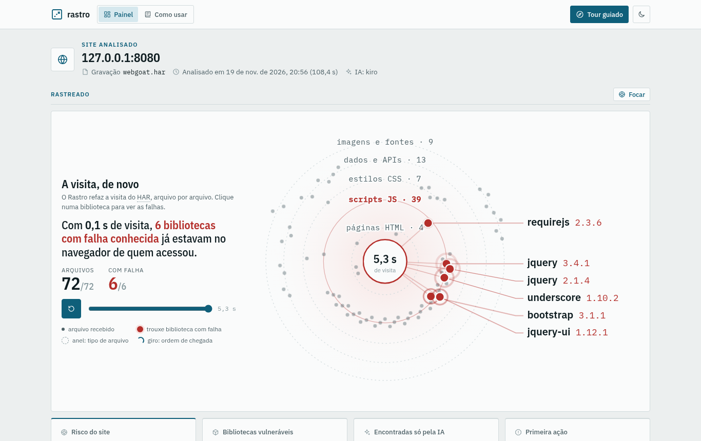

## Mapa da documentação

| Documento | Para quem | O que tem |
|---|---|---|
| [`README.md`](README.md) | Quem vai usar | Instalar, gravar o HAR, analisar, abrir o relatório e problemas comuns. |
| Este documento | Time e banca | Ambiente de desenvolvimento, verificação, frontend, resultados e como a IA foi usada. |
| [`requirements.md`](.kiro/specs/rastro/requirements.md) | Time e agente de IA | Requisitos R01 a R25 em EARS, cada critério com ID. |
| [`design.md`](.kiro/specs/rastro/design.md) | Time e agente de IA | Arquitetura, modelos, fórmulas, travas e provedores de IA. |
| [`tasks.md`](.kiro/specs/rastro/tasks.md) | Time e agente de IA | Tasks T01 a T101, com entrega, aceite, arquivos, teste, requisito e revisor. |
| [`kanban.md`](.kiro/specs/rastro/kanban.md) | Time | Estado de cada task. |
| [`product.md`](.kiro/steering/product.md) | Agente de IA | Para quem é o Rastro e o que ele promete. |
| [`tech.md`](.kiro/steering/tech.md) | Agente de IA | Stack, dependências e regras de Windows e Linux. |
| [`structure.md`](.kiro/steering/structure.md) | Time e agente de IA | Princípios e o que cada pasta e arquivo de `rastro/` faz. |
| [`processo.md`](.kiro/steering/processo.md) | Time e agente de IA | Tasks, commits, revisão e entrega. |
| [`codigo-python.md`](.kiro/steering/codigo-python.md) | Agente de IA | Padrões de código Python. |
| [`frontend-react.md`](.kiro/steering/frontend-react.md) | Agente de IA | Padrões do frontend e o que cada pasta de `frontend/src/` faz. |
| [`SKILL.md`](.kiro/skills/rastro-nova-regra/SKILL.md) | Agente de IA | Passo a passo para acrescentar checagem, assinatura, fonte de dados, provedor de IA ou trava. |
| [`docs/decisoes/`](docs/decisoes/) | Time e banca | Uma decisão por arquivo, com contexto e alternativas. |
| [`arquitetura.html`](docs/arquitetura/arquitetura.html) | Time e banca | Diagrama interativo das camadas, com o fluxo da análise em 9 passos. Abre no navegador. |
| [`docs/verificacao-manual.md`](docs/verificacao-manual.md) | Time | Roteiro do que só se confere na tela e pendências do Windows. |
| [`docs/cobertura/`](docs/cobertura/) | Time e banca | Resultado da verificação em cada sistema e relatório HTML da cobertura. |
| [`docs/prints/`](docs/prints/) | Todos | Telas do relatório. |
| [`docs/historico/`](docs/historico/) | Time | Registros de uma etapa: spikes, análise inicial do pentest, dependências e pitch inicial. |
| [`avaliacao/`](avaliacao/README.md) | Time e banca | HARs de teste, gabarito e [resultados medidos](avaliacao/resultados.md). |

## Preparar o ambiente de desenvolvimento

Precisa de Python 3.10 ou mais novo e Git. Nada é instalado fora da pasta do projeto: as ferramentas, com versão fixa no `requirements-dev.txt`, ficam no `.venv`.

| Passo | Linux | Windows (PowerShell) |
|---|---|---|
| 1. Baixar o projeto | `git clone https://github.com/SENAI-IA/iapd-26t1-e01-rastro.git rastro` | `git clone https://github.com/SENAI-IA/iapd-26t1-e01-rastro.git rastro` |
| 2. Entrar na pasta | `cd rastro` | `cd rastro` |
| 3. Criar o `.venv` (uma vez) | `python3 -m venv .venv` | `py -m venv .venv` |
| 4. Ativar o `.venv` | `source .venv/bin/activate` | `.venv\Scripts\Activate.ps1` |
| 5. Instalar as ferramentas (uma vez) | `pip install -r requirements-dev.txt` | `pip install -r requirements-dev.txt` |

- Os comandos do Windows ainda não foram conferidos do zero (T42); as pendências estão na [verificação manual](docs/verificacao-manual.md#pendências-do-windows-t42).
- Se o PowerShell recusar a ativação, libere só para a janela aberta: `Set-ExecutionPolicy -Scope Process -ExecutionPolicy Bypass`.
- O `requirements-dev.txt` traz o Playwright, que só o `rastro gravar` usa (decisão 12). Os testes usam dublê; para gravar de verdade, basta o Chrome ou o Edge da máquina.
- O `requirements-dev.txt` também fixa o setuptools: o `tests/test_instalacao.py` monta o pacote sem rede, e o setuptools do Ubuntu 22.04 é antigo demais para o `pyproject.toml`.
- Node.js só é preciso para mudar o frontend. O relatório já vem pronto em `rastro/relatorio/modelo.html`.
- O mecanismo do comando `rastro` de qualquer pasta (`instalar` e `desinstalar`) está na [decisão 11](docs/decisoes/11-comando-rastro-de-qualquer-pasta.md). O `install.sh` baixa a `main` para `~/.local/share/rastro`, marca a pasta e roda o `rastro instalar` de dentro dela. O `tests/test_install_sh.py` o roda com um pacote local, sem rede.

## Verificação

Não há CI: a verificação roda na máquina local, no Linux e no Windows, antes de cada entrega. Com o `.venv` ativo, na raiz do projeto:

| O que confere | Comando | Passou quando |
|---|---|---|
| Estilo, erros comuns e complexidade | `ruff check` | `All checks passed!` |
| Tipos | `mypy rastro` | `Success` |
| Testes e cobertura | `pytest --cov=rastro --cov-report=term` | termina sem falhas (1056 testes em 26/11/2026) |

- Os testes não acessam a rede.
- O resultado de cada sistema fica em `docs/cobertura/`, um arquivo por sistema ([`linux.md`](docs/cobertura/linux.md)), com data, commit, versões e a saída dos três comandos.

### Cobertura

O mínimo é 60% nas regras de negócio, com meta de 80% (R19.1). O número medido fica no arquivo de cada sistema em `docs/cobertura/`. Para atualizar também o [relatório HTML](docs/cobertura/html/index.html), arquivo por arquivo e linha por linha:

```
pytest --cov=rastro --cov-report=term --cov-report=html:docs/cobertura/html
coverage report --include="rastro/har/*,rastro/identificacao/*,rastro/travas/*,rastro/fontes/*,rastro/risco/*,rastro/configuracao/*,rastro/acao/*,rastro/pentest/*,rastro/ia/sanitizacao.py"
```

A segunda linha dá o número das regras de negócio. O `.gitignore` versionado em `docs/cobertura/html/` não ignora nada e precisa ficar lá: sem ele, o `pytest-cov` criaria um com `*` e esconderia o relatório do Git.

### Regras automáticas de legibilidade

| Onde | Regra | Quem confere |
|---|---|---|
| `rastro/` | Complexidade de até 5 por função (`C901`, `max-complexity = 5` no `pyproject.toml`) | `ruff check` |
| `rastro/` | No máximo dois níveis de bloco aninhado por função | `tests/test_legibilidade_do_codigo.py`, no `pytest` |
| `frontend/src/` | No máximo dois níveis de bloco aninhado por função | `frontend/conferirAninhamento.mjs`, rodado pelo `npm run build` (ou `npm run conferir`) |

## Frontend (só para quem muda o relatório)

O relatório é React + TypeScript, num único HTML. Mudou algo em `frontend/`, refaça o build e copie o resultado para o pacote Python, no mesmo commit:

| Passo | Linux | Windows (PowerShell) |
|---|---|---|
| 1. Instalar as dependências (uma vez) | `cd frontend` e `npm install` | `cd frontend` e `npm install` |
| 2. Gerar o HTML | `npm run build` | `npm run build` |
| 3. Levar para o pacote | `cp dist/index.html ../rastro/relatorio/modelo.html` | `Copy-Item dist\index.html ..\rastro\relatorio\modelo.html` |

- Antes de renomear classe CSS, leia o tour guiado em [`frontend-react.md`](.kiro/steering/frontend-react.md#organização-da-tela): ele acha cada parte da tela pela classe.
- Arquivo novo que não seja `.py` dentro de `rastro/` precisa entrar em `[tool.setuptools.package-data]` no `pyproject.toml`; o `tests/test_instalacao.py` confere.

## O relatório

O painel tem três zonas, cada uma com "Focar":

- **Rastreado:** o radar com a visita, os indicadores e o painel "Onde a IA entrou".
- **Agir:** o plano de ação, com a task de cada item pronta para o board.
- **Detalhes:** bibliotecas com falhas e a explicação da IA, as "a confirmar" barradas pelas travas e as checagens de cabeçalhos e cookies.

No topo ficam o tema, o tour guiado e as abas "Como usar" e, quando há resultado do pentest, "Segurança ativa". Prints do WebGoat (`avaliacao/webgoat.har`), no Linux, com o Chromium:

| | |
|---|---|
| 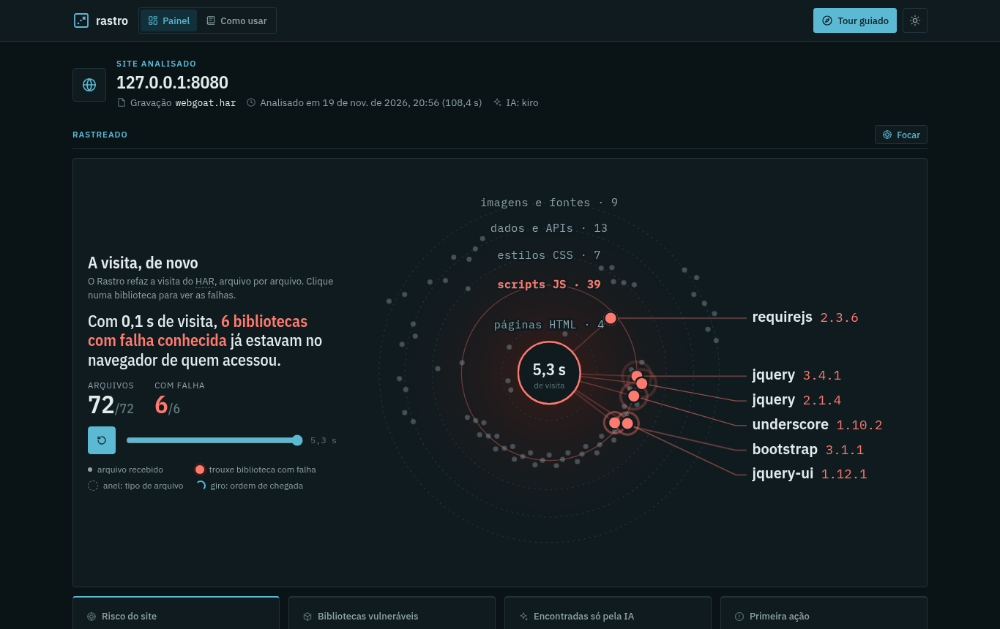 **Tema escuro.** Segue o sistema; o botão no topo troca. | 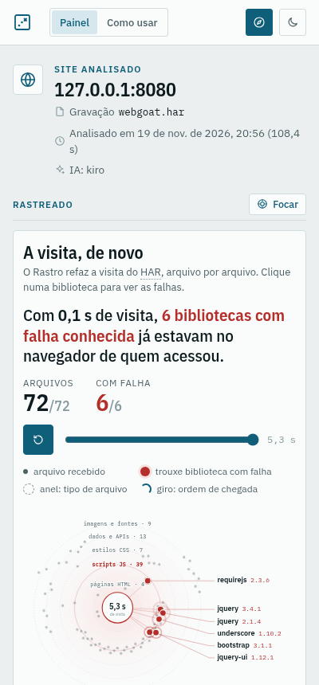 **Tela de 400px.** O radar desce e os indicadores viram uma coluna. |
| 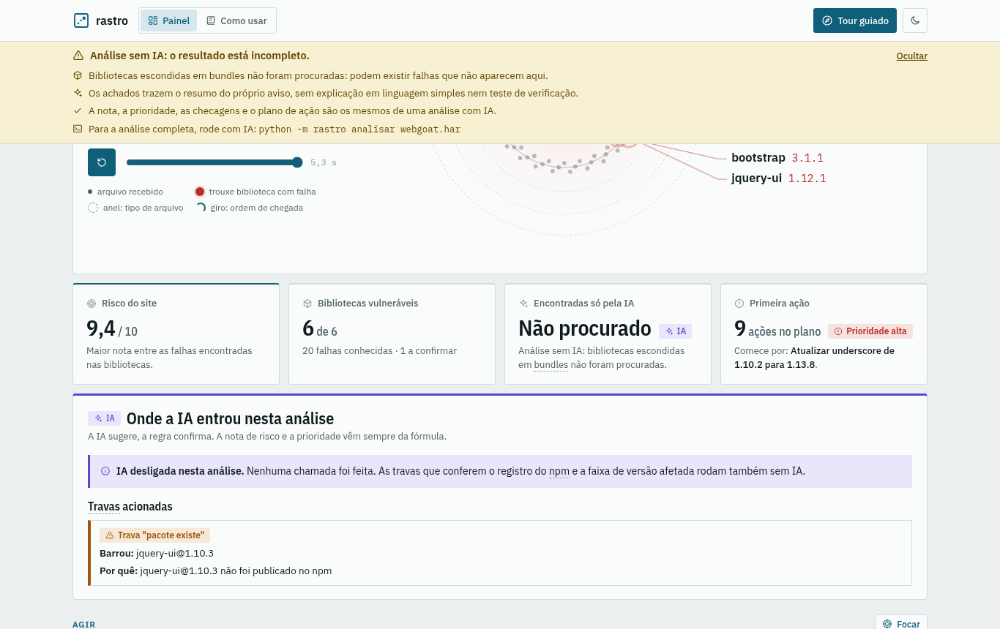 **Sem IA.** O aviso fica no topo e "Encontradas só pela IA" mostra "Não procurado". | 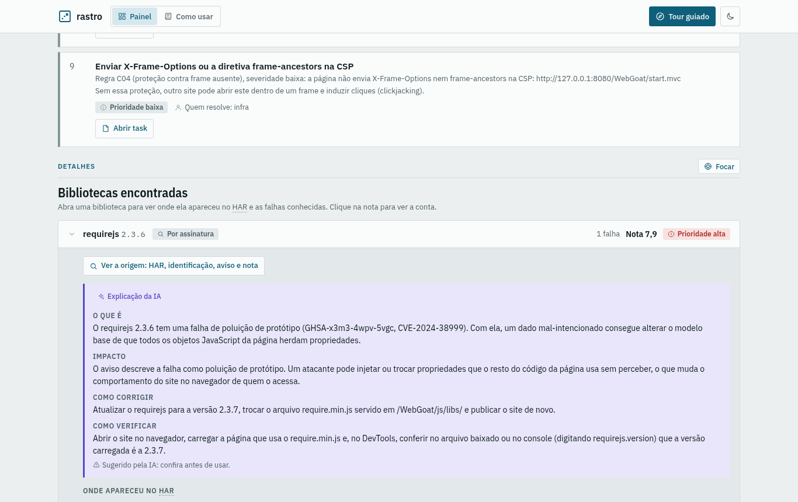 **Explicação da IA**, marcada "Sugerido pela IA: confira antes de usar". |
| 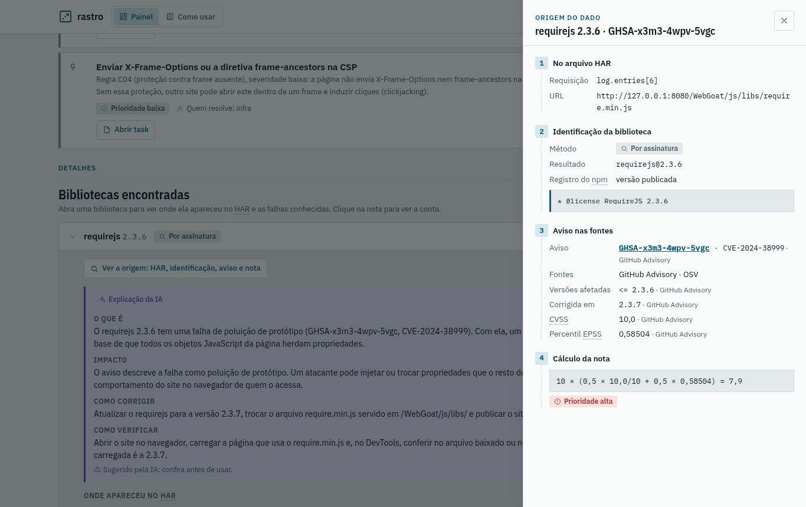 **Origem do dado:** HAR → identificação → aviso → cálculo da nota. | 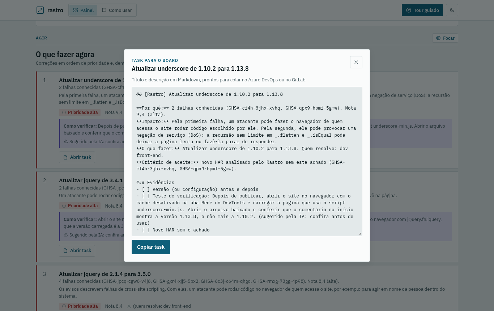 **Task** em Markdown, pronta para colar no board. |
| 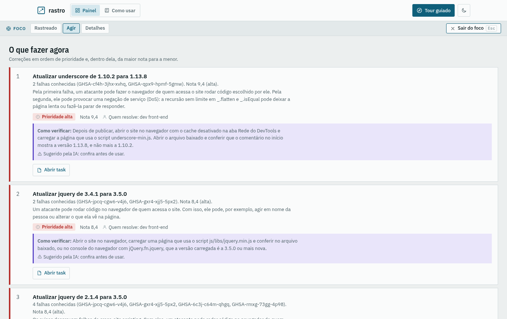 **Modo foco** na zona Agir. | 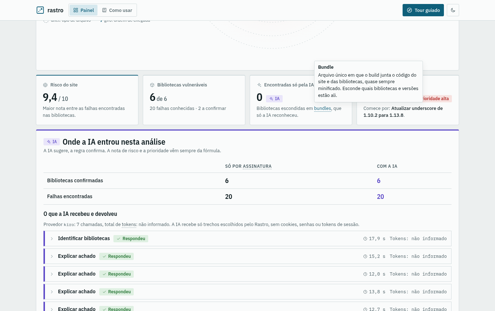 **Glossário** no termo sublinhado. |
| 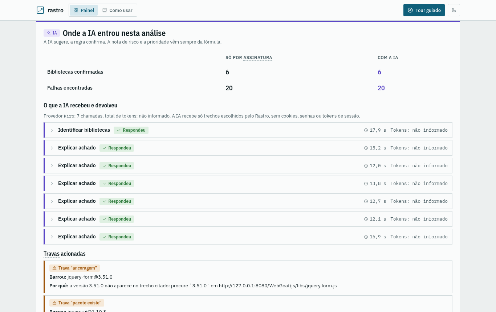 **Onde a IA entrou:** chamadas, tempo, tokens e travas acionadas. | 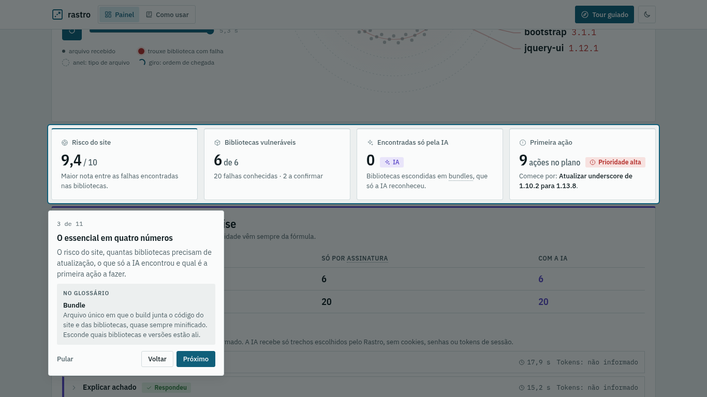 **Tour guiado:** um balão por parte da tela que a análise tem. |
| 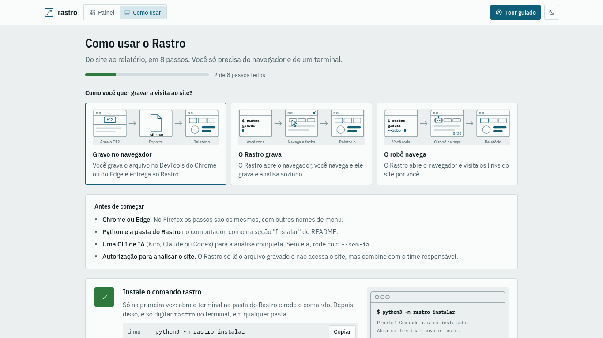 **Como usar:** o jeito de gravar e os passos daquele jeito. | 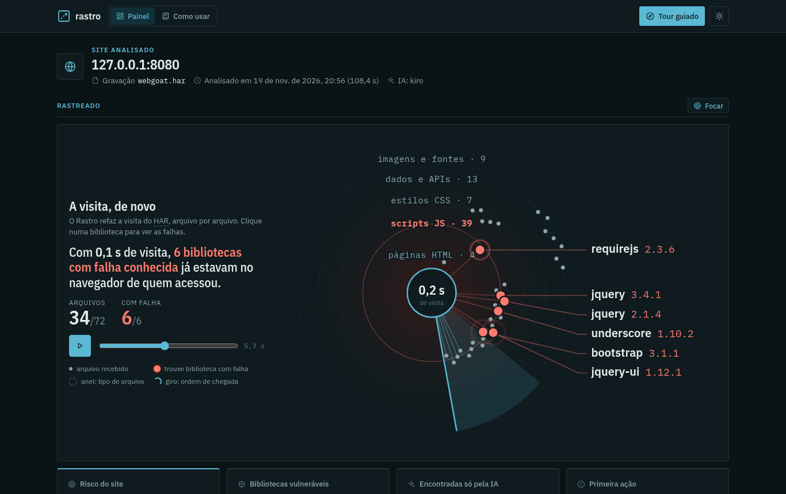 **Radar tocando:** a visita pausada no meio, na ordem de chegada. |
| 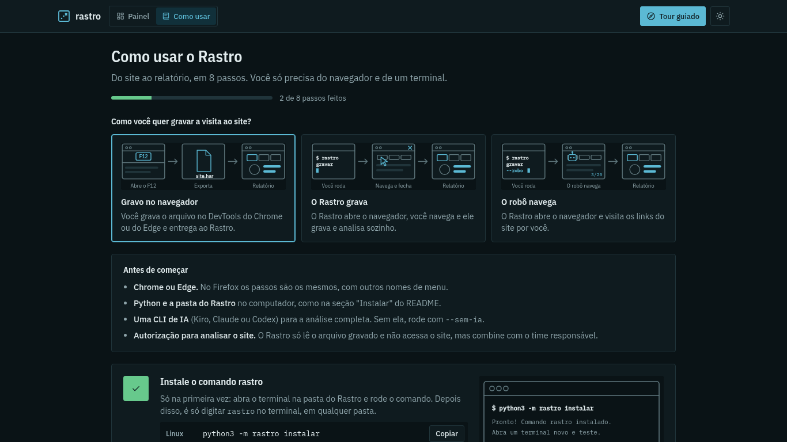 **Como usar no tema escuro.** | |

## Resultados

Medido em 09/11/2026 nos três HARs de `avaliacao/`, contra o gabarito. Os detalhes, as travas acionadas por análise e como medir de novo estão em [`avaliacao/resultados.md`](avaliacao/resultados.md).

| Métrica | Sem IA | Com IA (Kiro) | Com IA (Claude) |
|---|---|---|---|
| Bibliotecas confirmadas, todas do gabarito | 10 | 11 | 11 |
| Falhas encontradas (gabarito: 30) | 30 | 30 | 30 |
| Falso positivo confirmado | **0** | **0** | **0** |
| Tempo das 3 análises | 14 s | 3 min 29 s | 2 min 15 s |

## Desenvolvido com IA

O Rastro foi construído com um agente de IA guiado por arquivos versionados neste repositório. Spec, código e testes foram escritos com o agente, conduzido pelo Paulo task por task; cada commit é revisado por um dos outros cinco membros do grupo, que entra como coautor.

| Arquivo | O que é | Como foi usado |
|---|---|---|
| [`requirements.md`](.kiro/specs/rastro/requirements.md) | Requisitos R01 a R25 em EARS | Cada critério vira pelo menos um teste com o ID no nome (`test_r05_2_...`); os que só se veem na tela estão na [verificação manual](docs/verificacao-manual.md). |
| [`design.md`](.kiro/specs/rastro/design.md) | Arquitetura, modelos, fórmulas, travas e provedores de IA | O agente lê antes de cada task; o que se decide no meio da task volta para o design no mesmo commit. |
| [`tasks.md`](.kiro/specs/rastro/tasks.md) e [`kanban.md`](.kiro/specs/rastro/kanban.md) | Tasks T01 a T101 e o estado de cada uma | Uma task por vez, um commit por task (`feat(risco): ... (T17)`), com o revisor como coautor. O `git log` conta a construção task por task. |
| [`.kiro/steering/`](.kiro/steering/) | Padrões de produto, tecnologia, estrutura, processo, Python e React | Regras que o agente segue em toda task: biblioteca padrão primeiro, núcleo puro, nomes em português, Windows e Linux, nada destrutivo. Mudou um padrão, o steering muda no mesmo commit. |
| [`rastro-nova-regra`](.kiro/skills/rastro-nova-regra/SKILL.md) | Skill para acrescentar checagem, assinatura, fonte, provedor de IA ou trava | Usada nas tasks de regra nova (checagens, assinaturas, OSV, NVD, provedores); o que faltou nela foi corrigido no commit da task. |
| [`docs/decisoes/`](docs/decisoes/) | Uma decisão por arquivo | O porquê das escolhas (fórmula da nota, IA por CLI, travas contra invenção), em vez de comentário no código. |

Da T72 em diante, uma rodada de legibilidade (R19.4) reorganizou o código sem mudar o comportamento: um arquivo por comando, nomes por extenso, funções curtas e sem aninhamento profundo. O agente fez cada passo; as regras automáticas da [verificação](#regras-automáticas-de-legibilidade) impedem a volta atrás.

No próprio produto, a IA sugere bibliotecas em bundles e explica os achados, mas não decide sozinha: travas fixas conferem tudo antes do relatório, e a nota vem de fórmula. Detalhes nas decisões [03](docs/decisoes/03-papel-da-ia.md) e [06](docs/decisoes/06-travas-contra-invencao.md).

## Como trabalhamos

A spec vem antes do código, uma task pequena por vez e um commit por task, com o revisor como coautor. O fluxo completo está em [`processo.md`](.kiro/steering/processo.md).

## Onde está cada coisa

| Na raiz | O que tem |
|---|---|
| `rastro/` | O pacote Python: leitura do HAR, identificação, fontes, travas, risco, IA, relatório, pentest e linha de comando. |
| `tests/` | Os testes, espelhando `rastro/`, e os dados de teste em `tests/dados/`. |
| `frontend/` | A fonte do relatório HTML (React + TypeScript). |
| `docs/` | Decisões, diagrama, verificação manual, cobertura, prints e histórico. |
| `.kiro/` | Spec, steering e skill que guiam o agente de IA. |
| `avaliacao/` | HARs de teste, gabarito e resultados medidos. |
| `install.sh` | Instalador de um comando para o Linux. |

O que cada pasta e arquivo faz por dentro está em [`structure.md`](.kiro/steering/structure.md), para `rastro/`, e em [`frontend-react.md`](.kiro/steering/frontend-react.md), para `frontend/src/`.

## Créditos

Projeto final do curso de IA aplicada (tema Produtividade do SENAI) · grupo E01 IA SEC.
