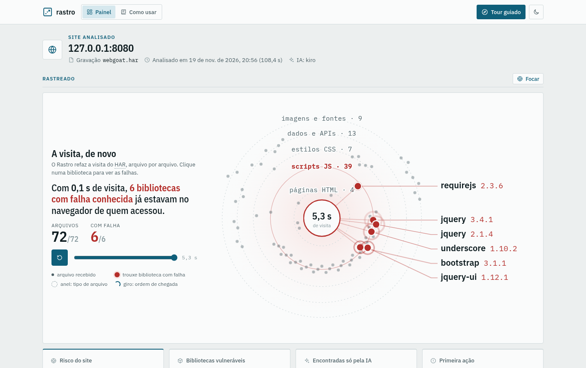

# Rastro

O Rastro descobre as bibliotecas JavaScript que um site usa e as falhas de segurança conhecidas nelas. Ele lê a gravação de uma visita ao site (um arquivo HAR, que o navegador exporta) e gera um relatório com a nota de risco, o que corrigir primeiro e de onde veio cada informação.

A análise não acessa o site: só lê a gravação. Testar as proteções do site é um passo à parte, opcional, que exige autorização.

> **Importante:** use o Rastro só em sites seus ou que você tem autorização para auditar.



O mesmo passo a passo, com figuras, abre no navegador com `rastro como-usar`.

## Antes de começar

- **Python 3.10 ou mais novo** no computador. O Rastro você instala no próximo passo.
- **Chrome ou Edge.** No Firefox, os passos no DevTools são os mesmos, com outros nomes de menu. Para o Rastro gravar por você, precisa ser o Chrome ou o Edge.
- **Uma CLI de IA** (programa de IA de terminal: Kiro `kiro-cli`, Claude `claude` ou Codex `codex`), instalada e com login feito, para a análise completa. Sem ela, rode com `--sem-ia`.
- **Internet durante a análise**, para consultar as bases públicas de falhas (GitHub Advisory, OSV, NVD e npm).
- **Autorização para analisar o site.** Combine com o time responsável e prefira o ambiente de homologação.

O Rastro não instala Python nem a CLI de IA, e não pede `sudo` nem administrador: tudo fica na sua pasta de usuário. Node.js não é necessário.

## Instale o Rastro

Só na primeira vez. Depois disso, é só digitar `rastro` no terminal, em qualquer pasta.

| Sistema | Como instalar |
|---|---|
| Linux | Rode o comando abaixo. Ele baixa o Rastro para `~/.local/share/rastro` e cria o comando `rastro`, sem Git e sem `sudo`. |
| Windows | Baixe o ZIP do repositório (botão **Code** → **Download ZIP**), extraia e rode o comando abaixo dentro da pasta. A instalação do zero no Windows ainda está em conferência. |

Linux:

```bash
curl -fsSL https://raw.githubusercontent.com/SENAI-IA/iapd-26t1-e01-rastro/main/install.sh | bash
```

Windows (PowerShell):

```powershell
py -m rastro instalar
```

Feche o terminal, abra outro e confira:

```bash
rastro --help
```

## Escolha como gravar a visita

| Modo | Como funciona |
|---|---|
| [Gravo no navegador](#gravo-no-navegador) | Você grava o arquivo no DevTools do Chrome ou do Edge e entrega ao Rastro. |
| [O Rastro grava](#o-rastro-grava) | O Rastro abre o navegador, você navega e ele grava e analisa sozinho. |
| [O robô navega](#o-robô-navega) | O Rastro abre o navegador e visita os links do site por você. |

### Gravo no navegador

1. **Abra o site.** No Chrome ou no Edge, abra o site que você quer analisar. Prefira o ambiente de homologação.
2. **Abra a aba Rede.** Pressione `F12` para abrir o DevTools e clique na aba **Rede** (Network).
3. **Desative o cache e recarregue.** Marque **Desativar cache** (Disable cache), deixe o filtro em **Todos** (All) e recarregue com `Ctrl + R`. O HAR só leva o que aparece na lista: com o filtro em Fetch/XHR, ele sai sem nenhum script.
4. **Navegue pelo site.** Passe pelas páginas que importam. Quanto mais páginas, mais bibliotecas o Rastro encontra.
5. **Exporte o HAR.** Clique no ícone de download da aba Rede, escolha **Exportar HAR (sanitized)** e salve como `site.har`. O sanitized sai sem cookies e sem dados de login.
6. **Rode o Rastro.** No terminal, na pasta do `site.har`:

   ```bash
   rastro analisar site.har
   ```

   Com IA, pode levar alguns minutos: o terminal mostra a etapa e o tempo, e enquanto o sinal no fim da linha girar, o Rastro está trabalhando. Para outra IA, acrescente `--ia claude` ou `--ia codex`. Sem CLI de IA, acrescente `--sem-ia`.

Sem site para testar? Use um dos exemplos que vêm com o Rastro (WebGoat, Drupal e Juice Shop, descritos em [`avaliacao/`](avaliacao/README.md)):

```bash
rastro analisar ~/.local/share/rastro/avaliacao/webgoat.har
```

### O Rastro grava

1. **Instale o Playwright.** Só na primeira vez. É o que deixa o Rastro abrir e controlar o Chrome ou o Edge. Deu erro? Siga em frente: se faltar o Playwright, o Rastro mostra o comando certo para o seu computador.

   ```bash
   python3 -m pip install --user playwright==1.65.1
   ```

   No Windows: `py -m pip install --user playwright==1.65.1`.
2. **Comece a gravar.** Troque o endereço pelo do site. O navegador abre sozinho nele.

   ```bash
   rastro gravar https://site.com.br
   ```

3. **Navegue e feche a janela.** Passe pelas páginas que importam. O terminal mostra o tempo e quantas requisições já foram gravadas. Quando terminar, feche a janela (ou aperte `Ctrl + C` no terminal). A análise roda e o relatório abre.

Sem CLI de IA, acrescente `--sem-ia` no fim do comando.

### O robô navega

1. **Instale o Playwright.** Igual ao passo 1 de [O Rastro grava](#o-rastro-grava).
2. **Chame o robô.** Troque o endereço pelo do site. O navegador abre sozinho nele.

   ```bash
   rastro gravar https://site.com.br --robo
   ```

3. **Entre e aperte Enter.** Se o site pede login, entre na janela que abriu. Depois, volte ao terminal e aperte `Enter`.
4. **Espere o robô.** Ele visita os links do site, até 20 páginas ou 3 minutos, sem clicar em botões, sem enviar formulários e sem sair do site. Quando ele parar, feche a janela. A análise roda e o relatório abre.

> **Em produção:** não use o robô com um usuário administrador ou com acesso a dados sensíveis. Um link comum pode aprovar, arquivar ou enviar algo. Nesse caso, use "O Rastro grava" e navegue você mesmo.

## Abra o relatório

O relatório abre sozinho no navegador ao fim da análise e funciona sem internet. Para abrir de novo, dê dois cliques no `relatorio.html`; o terminal mostra onde ele está.

- Comece pela **primeira ação** e por **O que fazer agora**: é o que corrigir antes.
- Na primeira vez, clique em **Tour guiado**, que passa por cada parte da tela.
- **Ver a origem** mostra de onde veio cada informação.

Cada análise fica numa pasta nova, em `~/Rastro/relatorios/<site>/<data e hora>/`, com o `relatorio.html` e o `relatorio.json` (os mesmos dados, para guardar ou comparar). Para não abrir o navegador ao terminar, acrescente `--nao-abrir`.

## Se quiser, confira as proteções do site

Com autorização para testar o site, o Rastro pede de novo algumas páginas da visita (até 20, do mesmo site) e confere se ele devolve as proteções básicas: HTTPS obrigatório, política de conteúdo, cookies protegidos e outras.

```bash
rastro pentest site.har --autorizo
```

Nenhum ataque é feito: só leitura (`GET`, `HEAD` e `OPTIONS`), sem login, sem formulários e sem seguir redirecionamentos. Ficam fora: login e sessão, permissões entre usuários, injeção de código e regras de negócio. Sem `--autorizo`, nada é enviado ao site.

O resultado fica em `~/Rastro/pentest/<site>/<data e hora>/pentest.json`. Para levá-lo ao relatório:

```bash
rastro analisar site.har --pentest <caminho>/pentest.json
```

Ele aparece na aba **Segurança ativa**, separado da nota e do plano de ação. Por que é um comando à parte: [decisão 13](docs/decisoes/13-pentest-por-comando-separado.md).

## Problemas comuns

**A aba Rede está vazia.** O DevTools precisa estar aberto antes de a página carregar. Recarregue com `Ctrl + R`.

**O relatório diz que nenhuma resposta trouxe conteúdo JavaScript.** O HAR foi gravado sem os scripts: quase sempre é o filtro da aba Rede (como Fetch/XHR) ou o cache. Deixe o filtro em **Todos**, marque **Desativar cache**, recarregue e exporte de novo.

**As checagens de cookie estão como não verificadas.** É o esperado com o HAR sanitized, que tira os cookies. As bibliotecas são analisadas do mesmo jeito.

**"o Playwright não está instalado" ao gravar.** Rode o comando que o próprio erro mostra, ou use o modo [Gravo no navegador](#gravo-no-navegador).

**"nem o Google Chrome nem o Microsoft Edge foram encontrados".** Instale um dos dois. O Rastro usa o navegador do computador e não baixa outro.

**"não foi possível abrir o navegador para gravar a visita".** Feche as janelas do Chrome ou do Edge que estiverem travadas e rode de novo. Se continuar, use o modo [Gravo no navegador](#gravo-no-navegador).

**"rastro: comando não encontrado".** Feche o terminal e abra outro. Se continuar, rode de novo o comando de [Instale o Rastro](#instale-o-rastro) e leia o que ele mostra.

**"python3: comando não encontrado".** Instale o Python 3.10 ou mais novo. No Windows, use `py` no lugar de `python3`.

**"já existe um comando rastro" ao instalar.** O comando veio de outra instalação, provavelmente pelo pipx. Remova com `python3 -m pipx uninstall rastro` e instale de novo.

**"a pasta ... já existe e não foi criada por este instalador".** Já há uma pasta `~/.local/share/rastro` que não veio do instalador. Mude-a de lugar ou apague-a e instale de novo.

**"A CLI da IA não foi encontrada".** Instale a CLI, escolha outra IA com `--ia claude` ou rode com `--sem-ia`.

**"A pasta da análise já existe".** O Rastro nunca sobrescreve um relatório. Rode de novo ou escolha outra pasta com `--saida`.

**O navegador não abriu o guia ou o relatório.** Abra à mão o caminho que o terminal mostra.

## Seus dados

- O HAR e o relatório ficam na sua máquina. A análise não acessa o site analisado.
- Quando o Rastro grava, a gravação fica em `~/Rastro/gravacoes/` e **guarda o seu login no site**. Não compartilhe o arquivo e apague quando não precisar mais. O relatório não traz o login.
- A IA recebe só trechos de scripts, o nome e a versão das bibliotecas e os dados das falhas, com tokens, chaves e parâmetros de endereço tirados antes.
- A segurança ativa é opcional: o Rastro só acessa o site quando você roda o `pentest` com `--autorizo`, e o resultado fica separado da nota.

## Atualizar e remover

Para atualizar, rode de novo o comando de [Instale o Rastro](#instale-o-rastro). Suas gravações e relatórios em `~/Rastro` não mudam.

Para remover:

```bash
rastro desinstalar
```

Ele tira o comando `rastro` e mostra os comandos para apagar o resto, se você quiser: os arquivos do Rastro (`~/.local/share/rastro`) e suas gravações e relatórios (`~/Rastro`). O Rastro não apaga essas pastas sozinho. Se instalou o Playwright, remova com `python3 -m pip uninstall playwright`.

## Desenvolvido com IA

O Rastro foi construído com um agente de IA guiado por arquivos versionados no repositório, uma task por vez, cada commit revisado por outro membro do grupo:

- a [spec](.kiro/specs/rastro/) (requisitos, design e tasks) diz o que construir; cada critério dos requisitos vira teste;
- o [steering](.kiro/steering/) traz os padrões que o agente segue em toda task;
- a [skill `rastro-nova-regra`](.kiro/skills/rastro-nova-regra/SKILL.md) é o passo a passo para acrescentar checagem, fonte de dados, provedor de IA ou trava.

Como cada um foi usado: [Desenvolvido com IA, no README técnico](README-TECNICO.md#desenvolvido-com-ia).

## Para quem desenvolve

Instalação com Git, análise sem IA em detalhe, `--saida`, `GITHUB_TOKEN` e `NVD_API_KEY`, verificação, cobertura e arquitetura estão no [README técnico](README-TECNICO.md); as decisões, em [`docs/decisoes/`](docs/decisoes/), e o diagrama, em [`docs/arquitetura/arquitetura.html`](docs/arquitetura/arquitetura.html).

## Créditos

Projeto final do curso de IA aplicada, tema Produtividade do SENAI, grupo E01 IA SEC.
