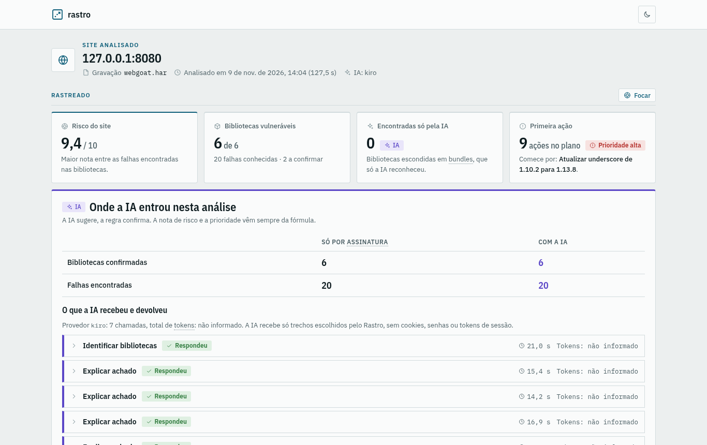
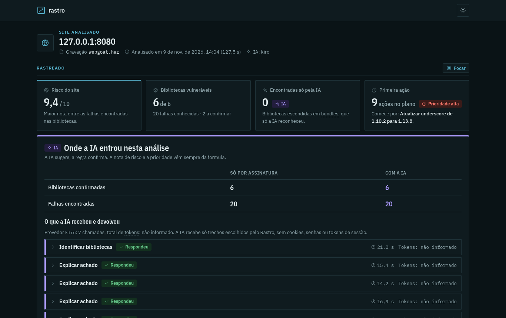
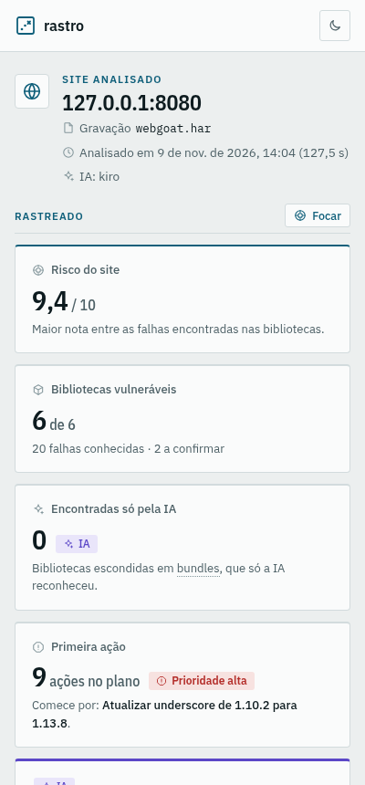
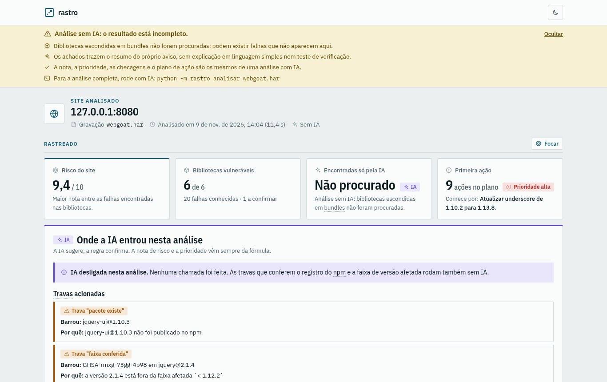
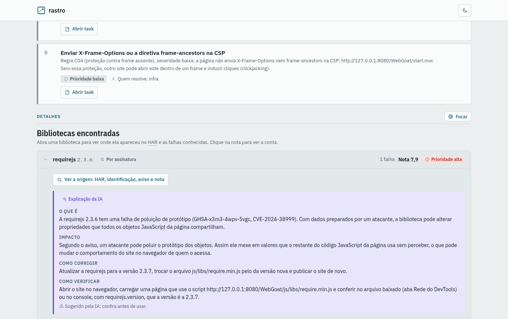
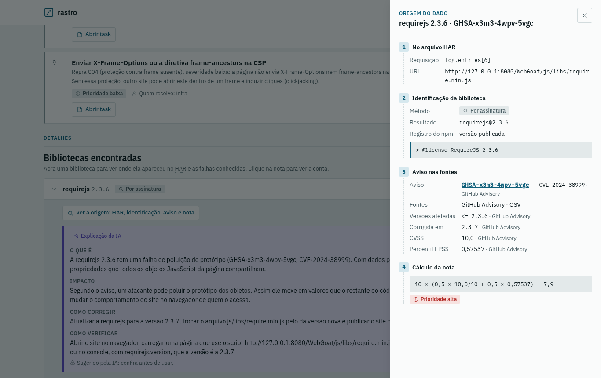
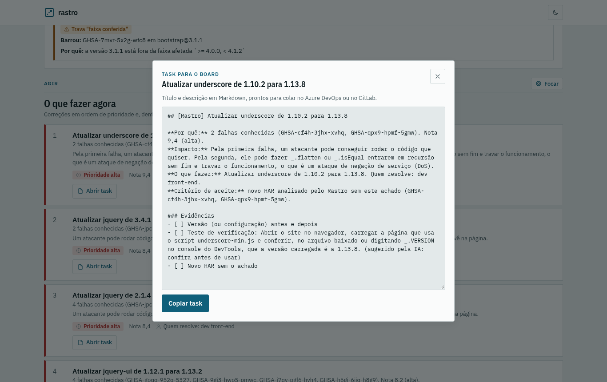
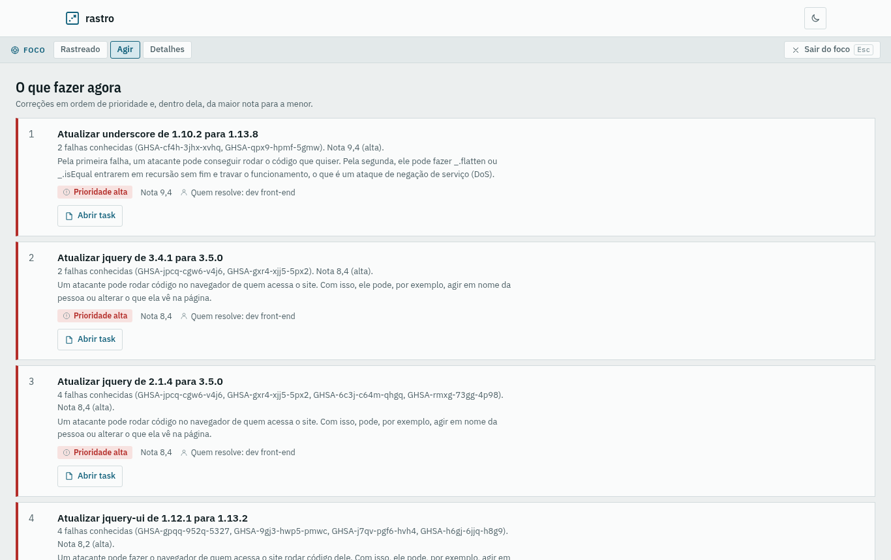
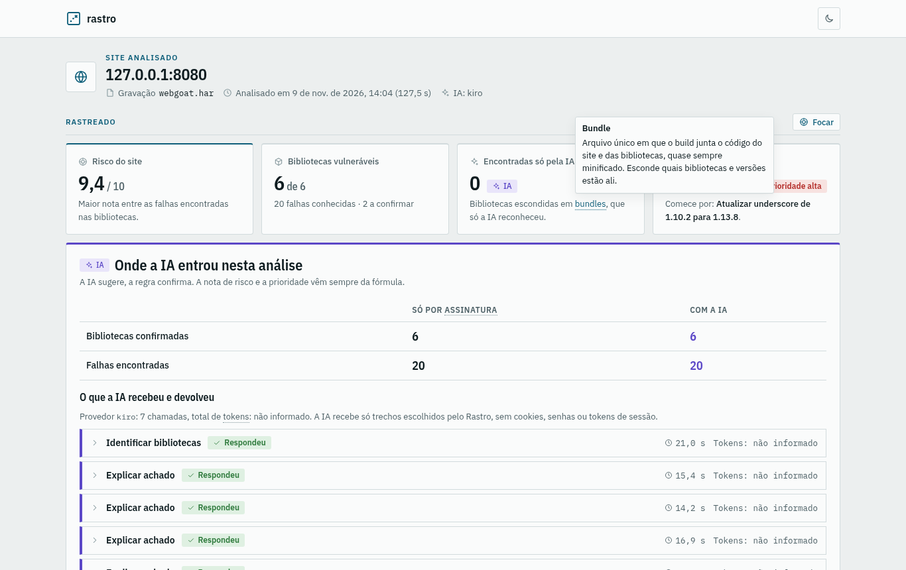
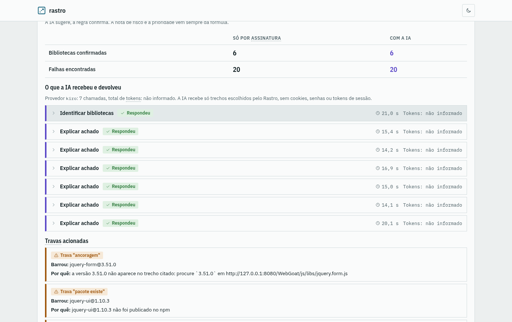

# Rastro

Rastro lê um arquivo HAR, identifica as bibliotecas front-end do site, cruza com o GitHub Advisory (CVE, CVSS, EPSS) e gera um relatório de risco explicado por IA. Só análise passiva: o site analisado nunca é acessado.

Projeto final do curso de IA aplicada (tema Produtividade do SENAI) · grupo E01 IA SEC.

> **Status:** MVP funcionando no Linux (fases 0 a 3 e extensão OSV e NVD). A instalação do zero no Windows ainda não foi conferida (T42): os comandos do Windows abaixo seguem a convenção do projeto e estão marcados como **a conferir**. Andamento no [kanban](.kiro/specs/rastro-mvp/kanban.md).



## O que precisa

| | Para usar | Para desenvolver |
|---|---|---|
| Python 3.10 ou mais novo | sim | sim |
| Internet (GitHub Advisory, OSV, NVD e registro do npm, só leitura) | sim | não (os testes não acessam a rede) |
| CLI de IA instalada e autenticada: Kiro (`kiro-cli`, padrão), Claude (`claude`) ou Codex (`codex`) | só para a análise com IA | não |
| Node.js | não: o HTML do relatório já vem pronto em `rastro/relatorio/modelo.html` | só para mudar o frontend |

- O Rastro não tem dependência Python em produção: não há `pip install` para usar.
- O Rastro não instala nem autentica a CLI de IA. Use a que você já tem; sem nenhuma, rode com `--sem-ia`.
- Nada é instalado globalmente, nada pede administrador ou `sudo`.

## Instalação

Na pasta onde quer o projeto:

| Passo | Linux | Windows (PowerShell) — a conferir (T42) |
|---|---|---|
| 1. Conferir o Python | `python3 --version` | `py --version` |
| 2. Baixar o projeto | `git clone <url-do-repositorio> rastro` | `git clone <url-do-repositorio> rastro` |
| 3. Entrar na pasta | `cd rastro` | `cd rastro` |
| 4. Conferir o Rastro | `python3 -m rastro --help` | `py -m rastro --help` |

- `<url-do-repositorio>` é o endereço do repositório na org SENAI-IA. Sem Git, baixe o ZIP pelo navegador e extraia.
- Passou quando o passo 4 mostra `usage: rastro [-h] comando ...`.
- Os comandos rodam **na raiz do projeto** (a pasta que tem `rastro/` e `README.md`). O HAR pode estar em qualquer lugar.
- Para a IA, confira que a CLI responde no terminal antes: `kiro-cli --version`, `claude --version` ou `codex --version`. No Windows ainda não foi conferido se existe `kiro-cli`; se não houver, use `--ia claude` ou `--ia codex`.

## Uso

### 1. Gravar o HAR

No Chrome ou no Edge, no site que você quer analisar (o seu, ou um que tem autorização para auditar):

1. Abra o DevTools (`F12`) na aba **Rede** (*Network*).
2. Marque **Desativar cache** (*Disable cache*) e recarregue a página, para os scripts virem com o conteúdo.
3. Navegue pelas páginas que importam.
4. Clique no ícone de download da aba Rede e escolha **Exportar HAR (sanitized)**: sai sem cookies e cabeçalhos de autenticação.

Para testar sem gravar nada, use os HARs da pasta [`avaliacao/`](avaliacao/README.md) (WebGoat, Drupal e Juice Shop).

> A exportação manual no Chrome ainda está sendo conferida (T04, `avaliacao/README.md`): os HARs de `avaliacao/` foram gravados pelo Playwright.

### 2. Analisar

| | Linux | Windows (PowerShell) — a conferir (T42) |
|---|---|---|
| Com IA (Kiro, o padrão) | `python3 -m rastro analisar site.har` | `py -m rastro analisar site.har` |
| Com outra IA | `python3 -m rastro analisar site.har --ia claude` | `py -m rastro analisar site.har --ia claude` |
| Sem IA (análise incompleta) | `python3 -m rastro analisar site.har --sem-ia` | `py -m rastro analisar site.har --sem-ia` |
| Em outra pasta de saída | `python3 -m rastro analisar site.har --saida relatorios` | `py -m rastro analisar site.har --saida relatorios` |
| Escolher a IA para a sessão | `export RASTRO_IA=codex` | `$env:RASTRO_IA = "codex"` |

| Opção ou variável | O que faz |
|---|---|
| `--ia NOME` | `kiro`, `claude` ou `codex`. Sem a opção, vale `RASTRO_IA`; sem as duas, `kiro`. |
| `--sem-ia` | Não chama a IA: não procura bibliotecas escondidas em bundles e não explica os achados. Nota, prioridade, checagens e plano de ação são os mesmos. |
| `--saida PASTA` | Troca a pasta dos relatórios. Padrão: `~/Rastro/relatorios` no Linux e `C:\Users\<nome>\Rastro\relatorios` no Windows. |
| `GITHUB_TOKEN` (opcional) | Sem token, o GitHub Advisory aceita 60 consultas por hora (uma por biblioteca); com token, 5.000. |
| `NVD_API_KEY` (opcional) | Chave do NVD, usada só para completar o CVSS que faltar. |

Com IA, cada chamada pode levar até 2 minutos. Exemplo real, no Linux, com o HAR do WebGoat e o Kiro (09/11/2026, 2 min 8 s):

```
$ python3 -m rastro analisar avaliacao/webgoat.har
Análise com a IA kiro. Cada chamada à IA pode levar até 2 minutos; o que ela sugere passa pelas travas antes do relatório.

Relatório gravado em: /home/<nome>/Rastro/relatorios/127.0.0.1_8080/2026-11-09_14-04-47
HTML: /home/<nome>/Rastro/relatorios/127.0.0.1_8080/2026-11-09_14-04-47/relatorio.html
JSON: /home/<nome>/Rastro/relatorios/127.0.0.1_8080/2026-11-09_14-04-47/relatorio.json
Resumo: 127.0.0.1:8080 · bibliotecas: 6 (6 com falhas) · achados: 20 · nota máxima: 9,4 · ações: 9 (6 alta, 1 média, 2 baixa, 0 a avaliar)
```

- Cada análise vai para uma pasta nova, `<site>/<AAAA-MM-DD_HH-MM-SS>/`. O Rastro nunca sobrescreve um relatório e nunca altera o HAR.
- Erro (HAR que não existe ou inválido, IA desconhecida, CLI de IA não encontrada, pasta da análise que já existe) encerra com código 1 e a mensagem começa com `rastro: erro:`. Exemplo: `rastro: erro: a CLI da IA kiro (kiro-cli) não foi encontrada no sistema. Escolha outra IA com --ia. Use --sem-ia (...)`.

### 3. Abrir o relatório

O `relatorio.html` abre com duplo clique, offline, sem nenhuma requisição externa. Pelo terminal:

| Linux | Windows (PowerShell) — a conferir (T42) |
|---|---|
| `xdg-open <caminho do relatorio.html>` | `Invoke-Item <caminho do relatorio.html>` |

O `relatorio.json` tem os mesmos dados, para guardar ou comparar análises.

## O relatório

Prints do relatório do WebGoat (`avaliacao/webgoat.har`), gerados no Linux em 09/11/2026 com o Chromium.

| | |
|---|---|
|  **Tema escuro.** Segue o sistema; o botão no topo troca. |  **Tela de 400px.** Os indicadores viram uma coluna. |
|  **Sem IA.** O aviso fica no topo e "Encontradas só pela IA" mostra "Não procurado". |  **Explicação da IA** em cada biblioteca, marcada "Sugerido pela IA: confira antes de usar". |
|  **Origem do dado:** HAR → identificação → aviso → cálculo da nota. |  **Task** em Markdown, pronta para colar no board. |
|  **Modo foco** na zona Agir. |  **Glossário:** a definição aparece no termo sublinhado. |
|  **Onde a IA entrou:** chamadas, tempo, tokens e travas acionadas. | |

## Roteiro de verificação manual

Os critérios marcados *(verificação manual)* na spec só se conferem olhando a tela; os demais têm teste automático com o ID no nome (`pytest`). Gere um relatório com IA e um com `--sem-ia` do mesmo HAR e siga a tabela:

| # | Passo | O que deve acontecer | Critério | Linux | Windows |
|---|---|---|---|---|---|
| 1 | Rodar `python3 -m rastro --help` (Windows: `py -m rastro --help`) | Mostra o comando `analisar`; no `analisar --help`, `--sem-ia` diz o que se perde na mesma linha | R14.7 | conferido 09/11 | a conferir (T42) |
| 2 | Analisar `avaliacao/webgoat.har` com IA | Terminal mostra a pasta, o `relatorio.html` e o resumo de uma linha | R13.1, R13.8 | conferido 09/11 (Kiro) | a conferir (T42) |
| 3 | Analisar o mesmo HAR com `--sem-ia` | Terminal e topo do relatório avisam que a análise está incompleta; "Encontradas só pela IA" mostra "Não procurado" | R14.5, R14.6 | conferido 09/11 | a conferir (T42) |
| 4 | Rodar com `--ia gpt` | Erro com código 1 listando `kiro, claude, codex` | R14.2 | conferido 09/11 | a conferir (T42) |
| 5 | Abrir o `relatorio.html` com duplo clique, sem internet | Abre completo, sem requisição externa | R13.5 | conferido 09/11 (0 requisições externas no Chromium) | a conferir (T42) |
| 6 | Trocar o tema no botão do topo e estreitar a janela para 400px | Claro e escuro legíveis; em 400px, nada cortado | R13.6 | conferido 09/11 (prints 1 a 3; em 400px, sem rolagem lateral com tudo aberto, nos dois temas) | a conferir (T42) |
| 7 | Abrir uma biblioteca e clicar em "Ver a origem" ou na nota de uma falha | Painel lateral com HAR → identificação → aviso → cálculo | R10.2 | conferido 09/11 (print 6) | a conferir (T42) |
| 8 | Passar o mouse num termo sublinhado; depois chegar nele com `Tab`; depois tocar (celular ou modo de toque do DevTools) | A definição aparece nos três casos | R12.1 | mouse conferido 09/11 (print 9); teclado e toque a conferir | a conferir (T42) |
| 9 | Em "O que fazer agora", clicar em "Abrir task" e em "Copiar task"; colar num editor | Texto com título, contexto, o que fazer, critério de aceite e evidências, igual ao do JSON | R09.2 | abrir conferido 09/11 (print 7); copiar e colar a conferir | a conferir (T42) |
| 10 | Clicar em "Focar" numa zona | A zona ocupa a largura; barra fina no topo com a zona atual, troca de zona e "Sair do foco" | R15.3 | conferido 09/11 (print 8) | a conferir (T42) |
| 11 | Apertar `Esc` ou "Sair do foco" | Volta ao layout completo, na posição da zona | R15.4 | a conferir | a conferir (T42) |
| 12 | Em foco, abrir a origem, um termo do glossário, uma task e, no relatório sem IA, o aviso | Tudo continua funcionando | R15.5 | a conferir | a conferir (T42) |
| 13 | Fazer os passos 10 e 11 só com o teclado e em 400px | Funciona por teclado e em tela estreita | R15.6 | a conferir | a conferir (T42) |

"Conferido 09/11" quer dizer: visto na tela, no Chromium, a partir dos prints de `docs/prints/`. "A conferir" fica para a pessoa do grupo que seguir este README do zero (revisão da T43) e para a T42, no Windows.

## A conferir no Windows (T42)

- Os comandos marcados "a conferir" nas tabelas: `py`, `$env:RASTRO_IA`, `Invoke-Item` e a ativação do `.venv`.
- Se o `kiro-cli` existe para Windows e se `claude` e `codex` são achados (`.exe` ou `.cmd`). A lista completa está em `docs/spike/clis-de-ia.md`, "A conferir no Windows".
- Se os acentos chegam certos no terminal e no relatório.
- A pasta padrão `C:\Users\<nome>\Rastro\relatorios` e o nome da pasta do site com `_` no lugar de `:` (ex.: `127.0.0.1_8080`).

## Verificação

Não há CI: a verificação roda na máquina local, no Linux e no Windows, antes de cada entrega. Precisa só do Python 3.10 ou mais novo. As ferramentas, com versão fixa no `requirements-dev.txt`, ficam no `.venv` do projeto; nada é instalado globalmente.

Na raiz do projeto:

| Passo | Linux | Windows (PowerShell) |
|---|---|---|
| 1. Criar o `.venv` (uma vez) | `python3 -m venv .venv` | `py -m venv .venv` |
| 2. Ativar o `.venv` | `source .venv/bin/activate` | `.venv\Scripts\Activate.ps1` |
| 3. Instalar as ferramentas (uma vez) | `pip install -r requirements-dev.txt` | `pip install -r requirements-dev.txt` |
| 4. Estilo e erros comuns | `ruff check` | `ruff check` |
| 5. Tipos | `mypy rastro` | `mypy rastro` |
| 6. Testes e cobertura | `pytest --cov=rastro --cov-report=term` | `pytest --cov=rastro --cov-report=term` |

- Se o PowerShell recusar a ativação, libere só para a janela aberta: `Set-ExecutionPolicy -Scope Process -ExecutionPolicy Bypass`.
- Passou quando o `ruff` mostra `All checks passed!`, o `mypy` mostra `Success` e o `pytest` termina sem falhas. Os testes não acessam a rede.
- O resultado de cada sistema fica em `docs/cobertura/linux.md` e `docs/cobertura/windows.md`: data, commit, versões e a saída dos três comandos.

### Cobertura

| Medida (Linux, 09/11/2026, commit a61e8f8) | Cobertura |
|---|---|
| Regras de negócio (`har`, `identificacao`, `travas`, `fontes`, `risco`, `configuracao`, `acao`, `ia/sanitizacao`) | **99%** (1582 linhas, 3 sem teste) |
| Total do pacote `rastro` | 99% (2279 linhas, 6 sem teste) |

O mínimo é 60% nas regras de negócio, com meta de 80% (R19.1). O relatório HTML, arquivo por arquivo e linha por linha, fica em [`docs/cobertura/html/index.html`](docs/cobertura/html/index.html). Para atualizá-lo, com o `.venv` ativo:

```
pytest --cov=rastro --cov-report=term --cov-report=html:docs/cobertura/html
```

- O número das regras de negócio sai de `coverage report --include="rastro/har/*,rastro/identificacao/*,rastro/travas/*,rastro/fontes/*,rastro/risco/*,rastro/configuracao/*,rastro/acao/*,rastro/ia/sanitizacao.py"`, logo depois do `pytest`.
- O `.gitignore` versionado em `docs/cobertura/html/` não ignora nada e precisa ficar lá: o `pytest-cov`, ao achar a pasta vazia, criaria um `.gitignore` com `*` que esconderia o relatório do Git.

### Frontend (só para quem muda o relatório)

O relatório é React + TypeScript, num único HTML. Mudou algo em `frontend/`, refaça o build e copie o resultado para o pacote Python, no mesmo commit:

| Passo | Linux | Windows (PowerShell) — a conferir (T42) |
|---|---|---|
| 1. Instalar as dependências (uma vez) | `cd frontend` e `npm install` | `cd frontend` e `npm install` |
| 2. Gerar o HTML | `npm run build` | `npm run build` |
| 3. Levar para o pacote | `cp dist/index.html ../rastro/relatorio/modelo.html` | `Copy-Item dist\index.html ..\rastro\relatorio\modelo.html` |

## Desenvolvido com IA

O Rastro foi construído com um agente de IA guiado por arquivos versionados neste repositório. Spec, código e testes foram escritos com o agente, conduzido pelo Paulo task por task; cada commit é revisado por um dos outros cinco membros do grupo, que entra como coautor.

| Arquivo | O que é | Como foi usado |
|---|---|---|
| [`.kiro/specs/rastro-mvp/requirements.md`](.kiro/specs/rastro-mvp/requirements.md) | Requisitos R01 a R21 em EARS, cada critério com ID | Cada critério vira pelo menos um teste com o ID no nome (`test_r05_2_...`); os que só se veem na tela estão no roteiro acima. |
| [`.kiro/specs/rastro-mvp/design.md`](.kiro/specs/rastro-mvp/design.md) | Arquitetura, modelos, fórmulas, travas, provedores de IA | O agente lê antes de cada task; o que se decide no meio da task volta para o design no mesmo commit. |
| [`.kiro/specs/rastro-mvp/tasks.md`](.kiro/specs/rastro-mvp/tasks.md) e [`kanban.md`](.kiro/specs/rastro-mvp/kanban.md) | Tasks T01 a T52, com entrega, aceite, arquivos, teste, requisito e revisor; estado de cada uma | Uma task por vez, um commit por task (`feat(risco): ... (T17)`), com o revisor como coautor. O `git log` conta a construção task por task. |
| [`.kiro/steering/`](.kiro/steering/) | Padrões de produto, tecnologia, estrutura, processo, Python e React | Regras que o agente segue em toda task: biblioteca padrão primeiro, núcleo puro, nomes em português, Windows e Linux, nada destrutivo. Mudou um padrão, o steering muda no mesmo commit. |
| [`.kiro/skills/rastro-nova-regra/`](.kiro/skills/rastro-nova-regra/SKILL.md) | Passo a passo para acrescentar checagem, assinatura, fonte de dados, provedor de IA ou trava | Usada nas tasks de regra nova (checagens, assinaturas, OSV, NVD, provedores); o que faltou nela foi corrigido no commit da task. |
| [`docs/decisoes/`](docs/decisoes/) | Uma decisão por arquivo, com contexto e alternativas | O porquê das escolhas (fórmula da nota, IA por CLI, travas contra invenção), em vez de comentário no código. |

E no próprio produto a IA tem papel real, mas não decide sozinha: ela sugere bibliotecas em bundles e explica os achados; travas fixas conferem tudo antes de entrar no relatório, e a nota vem de fórmula. Detalhes em [`docs/decisoes/03-papel-da-ia.md`](docs/decisoes/03-papel-da-ia.md) e [`06-travas-contra-invencao.md`](docs/decisoes/06-travas-contra-invencao.md).

## Onde está cada coisa

| Pasta | Conteúdo |
|---|---|
| `rastro/` | O pacote Python: núcleo (`har`, `identificacao`, `travas`, `fontes`, `risco`, `configuracao`, `acao`), IA (`ia`, `explicacao`), relatório e CLI. |
| `frontend/` | Fonte do relatório HTML (React + TypeScript). O build vai pronto em `rastro/relatorio/modelo.html`. |
| `tests/` | Testes, espelhando `rastro/`, e os dados de teste em `tests/dados/`. |
| `avaliacao/` | HARs do WebGoat, do Drupal e do Juice Shop e o gabarito das bibliotecas de cada um. |
| `.kiro/steering/` | Padrões de construção que o agente de IA segue: produto, tecnologia, estrutura, processo, Python e React. |
| `.kiro/specs/rastro-mvp/` | Spec do MVP: requisitos em EARS, design, tasks (com revisor) e kanban. |
| `.kiro/skills/rastro-nova-regra/` | Skill do projeto: passo a passo para acrescentar checagem, assinatura, fonte de dados, provedor de IA ou trava, com teste, cobertura e verificação. |
| `docs/` | Entregáveis: `pitch-inicial.pdf`, `prints/` (telas do relatório), `spike/` (validações da fase 0), `cobertura/` (resultado da verificação em cada sistema e relatório HTML da cobertura) e `decisoes/` (um arquivo por decisão, com contexto, decisão e alternativas). |

## Como trabalhamos

- A spec vem antes do código. Cada task do `tasks.md` é pequena e tem entrega, critério de aceite, arquivos, teste e requisito.
- Um commit por task, direto no `main`, semântico e em pt-BR: `feat(risco): calcular nota de risco pela fórmula fixa (T17)`, com o revisor como coautor. A revisão vem depois do commit; ajuste vira um commit `fix` novo.
- Regras completas em `.kiro/steering/processo.md`.

## Links

- Pitch: [`docs/pitch-inicial.pdf`](docs/pitch-inicial.pdf)
